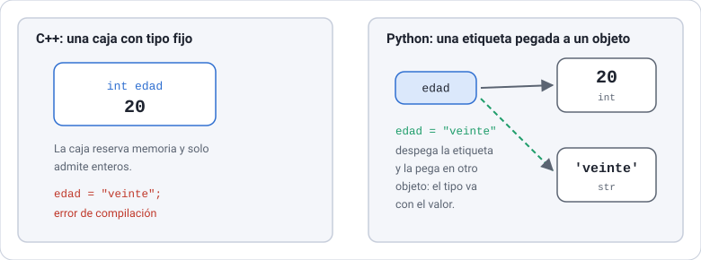
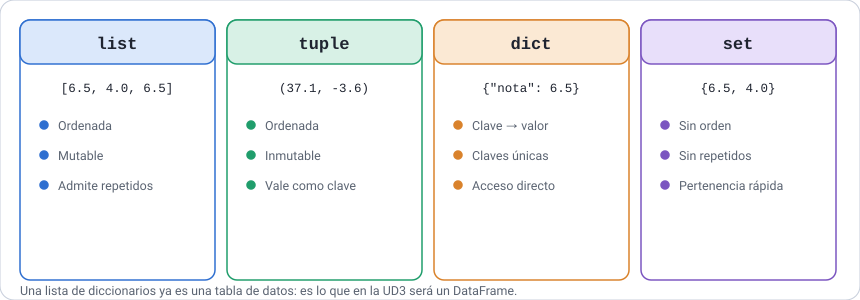
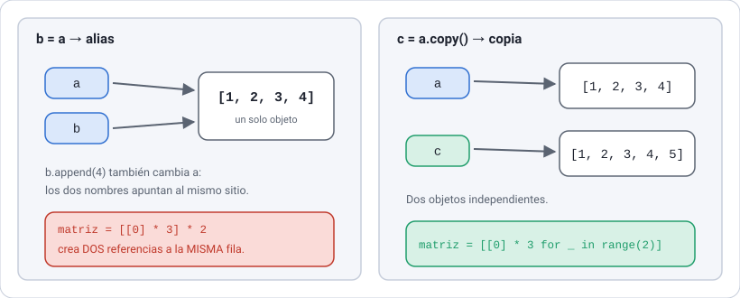
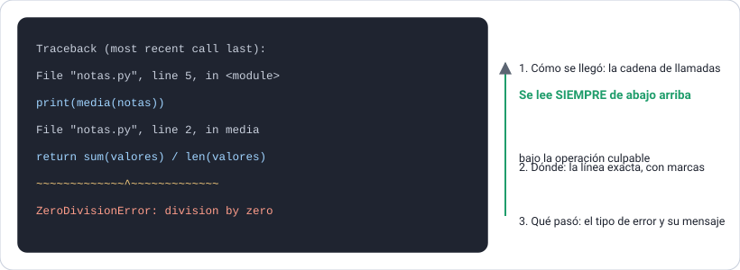

# UD1 · Python para quien ya programa

**Python aplicado a la Inteligencia Artificial** · 2.º DAM · Curso 2026-2027

[← Volver al índice del módulo](../README.md)

## Índice

- [Presentación de la unidad](#presentación-de-la-unidad)
- [1.1 El ecosistema Python](#11-el-ecosistema-python)
- [1.2 Sintaxis y tipos básicos](#12-sintaxis-y-tipos-básicos)
- [1.3 Control de flujo](#13-control-de-flujo)
- [1.4 Funciones](#14-funciones)
- [1.5 Estructuras de datos](#15-estructuras-de-datos)
- [1.6 Ficheros: texto, CSV y JSON](#16-ficheros-texto-csv-y-json)
- [1.7 Errores, excepciones y depuración](#17-errores-excepciones-y-depuración)
- [1.8 Módulos y paquetes](#18-módulos-y-paquetes)
- [Práctica de la unidad · Hito 0 del proyecto integrador](#práctica-de-la-unidad--hito-0-del-proyecto-integrador)
- [Resumen de la unidad](#resumen-de-la-unidad)
- [Bibliografía de la UD1](#bibliografía-de-la-ud1)
- [Continuar](#continuar)

## Presentación de la unidad

En esta unidad, de 7 horas, trasladas a Python lo que ya sabes hacer en C++ y terminas leyendo y procesando un conjunto de datos real con Python puro, sin bibliotecas externas. No empezamos de cero: el objetivo es aprender qué hace distinto Python y escribir código «pythónico», no traducir C++ línea a línea.

### Resultado de aprendizaje y criterios de evaluación

**RA1.** Implementa programas básicos en Python aplicados a la manipulación de datos.

| CE | Criterio de evaluación | Apartados |
| --- | --- | --- |
| 1a | Desarrolla programas en Python con variables, estructuras de control y funciones | 1.2, 1.3, 1.4 |
| 1b | Utiliza estructuras de datos (listas, diccionarios, tuplas) para organizar la información | 1.5 |
| 1c | Procesa archivos de texto con Python aplicando métodos de manipulación de datos | 1.6 |
| 1d | Detecta y gestiona errores en el código con técnicas de depuración y control de flujo | 1.7 |
| 1e | Diseña, estructura y utiliza módulos y paquetes para organizar y reutilizar el código | 1.1, 1.8 |

### Temporalización

| Sesión | Fecha | Horas | Contenidos |
| --- | --- | --- | --- |
| 1 | Lunes 21/09/2026 | 2 | 1.1 Ecosistema e instalación · 1.2 Sintaxis y tipos |
| 2 | Martes 22/09/2026 | 1 | 1.3 Control de flujo |
| 3 | Lunes 28/09/2026 | 2 | 1.4 Funciones · 1.5 Estructuras de datos |
| 4 | Martes 29/09/2026 | 1 | 1.6 Ficheros |
| 5 | Lunes 05/10/2026 (1.ª hora) | 1 | 1.7 Errores y depuración · 1.8 Módulos y paquetes |

El ritmo es alto porque partes de saber programar. Las sesiones se dedican sobre todo a practicar; la lectura completa de cada apartado y los ejercicios marcados como autónomos se hacen fuera del aula.

### Requisitos previos

- Haber superado Programación de 1.º (C++): variables, control de flujo, funciones, vectores y clases.
- Nociones de SQL de Bases de Datos de 1.º (se retoman en la UD4).
- Portátil propio con permisos de administrador para instalar software.

### El conjunto de datos del curso

Desde esta unidad y hasta la última vas a trabajar siempre con el mismo fichero: las **valoraciones de los jugadores de FIFA**, de la edición de 2015 a la de 2020. Son 100.995 filas y 37 columnas, unos 19,5 MB.

Cada fila es un jugador en una edición concreta. El mismo jugador aparece hasta seis veces, una por año, siempre con el mismo `sofifa_id`. Eso permite seguirlo en el tiempo: cómo sube su media, cómo cambia de club, cómo se encarece.

```text
fifa  sofifa_id  short_name   age  club           overall  value_eur
2016  158023     L. Messi     28   FC Barcelona   94       111000000
2017  158023     L. Messi     29   FC Barcelona   93       104500000
```

No es un fichero de juguete. Trae huecos, ceros que en realidad son ausencias y una columna con valores que no deberían estar ahí. Eso es lo normal, y aprender a verlo es la mitad del trabajo.

Tiene una página propia, con el significado de las 37 columnas y los problemas que arrastra: **[El conjunto de datos del curso](../datos-comunes/README.md)**. Léela antes de empezar la práctica de esta unidad.

> [!TIP]
> El fichero ya está en el repositorio, en `datos-comunes/jugadores.csv`, así que puedes empezar sin instalar nada. Aun así, descárgalo tú al menos una vez desde Kaggle siguiendo las instrucciones de esa página: saber moverse por un portal de datos es parte del oficio.

### Cómo usar esta carpeta

| Carpeta | Contenido |
| --- | --- |
| [`listados/`](listados/) | Todos los listados de la unidad como ficheros `.py` listos para ejecutar, más los datos de ejemplo en `listados/datos/` |
| [`proyecto/`](proyecto/) | El proyecto del apartado 1.8: el paquete `ojeador` y su `pyproject.toml` |

Ejecuta los listados **desde la carpeta `listados/`**, con tu entorno virtual activado, para que las rutas relativas a `datos/` funcionen:

```bash
cd ud1-python/listados
python listado_1_33_resumen_jugadores.py
```

Los fragmentos que empiezan por `>>>` son sesiones del intérprete interactivo y no tienen fichero: se escribe lo que sigue a `>>>` y la línea siguiente es la respuesta de Python.

### Convenciones de estos apuntes

- **Listado 1.x**: código completo que puedes copiar y ejecutar. El enlace «ver fichero» abre su versión en `listados/`.
- **Desde C++**: comparación directa con lo que ya conoces, para evitar los errores típicos de quien cambia de lenguaje.
- **Para practicar**: ejercicios cortos al final de cada apartado. Los marcados con (A) son de trabajo autónomo. Cuando el enunciado lo necesita, incluye los **datos de ejemplo** con los que debes probarlo y el **resultado esperado**: tu programa tiene que producir exactamente eso.
- Los nombres de ficheros, órdenes de terminal y fragmentos de código dentro del texto aparecen en `fuente monoespaciada`.

## 1.1 El ecosistema Python

En este módulo trabajaremos con **Python 3.14**, **VS Code** con las extensiones Python y Jupyter, y **un entorno virtual por proyecto**. Este apartado deja tu portátil listo para el resto del curso.

### Python frente a C++

| Aspecto | C++ | Python |
| --- | --- | --- |
| Ejecución | Se compila a código máquina antes de ejecutar | El intérprete (CPython) traduce el código a *bytecode* y lo ejecuta al momento |
| Tipado | Estático: el tipo se declara y se comprueba al compilar | Dinámico pero fuerte: el tipo lo tiene el valor, no la variable, y no hay conversiones implícitas entre tipos incompatibles |
| Bloques | Llaves `{ }` y punto y coma | Sangría obligatoria de 4 espacios y dos puntos `:` |
| Memoria | Manual o RAII (`new`/`delete`, punteros inteligentes) | Automática: el intérprete libera los objetos que ya no se usan |
| Bibliotecas | STL y bibliotecas externas que hay que compilar y enlazar | Biblioteca estándar muy amplia y miles de paquetes instalables con `pip` desde PyPI |

La consecuencia práctica: en Python escribes menos código y pruebas antes, pero muchos errores que C++ detectaba al compilar aparecen solo al ejecutar. Por eso en este módulo insistiremos en probar el código a menudo y en leer bien los mensajes de error (apartado 1.7).

### Qué versión usar

A fecha de hoy, las versiones 3.14 y 3.13 están en fase de mantenimiento activo, y la 3.15 tiene su publicación prevista para el 1 de octubre de 2026 ([Python Developer's Guide](https://devguide.python.org/versions/)). Usaremos **Python 3.14**: es estable y las bibliotecas del curso ya la soportan; por ejemplo, scikit-learn 1.8 funciona con Python 3.11 a 3.14 ([scikit-learn 1.8.0](https://zenodo.org/records/6968622/latest)). Evitaremos la 3.15 durante este curso, porque las bibliotecas científicas tardan unos meses en publicar versiones compatibles.

Python 2 dejó de tener soporte el 1 de enero de 2020 ([Python Developer's Guide](https://devguide.python.org/versions/)). Si consultas material antiguo, como el libro *Python para todos* de la bibliografía, verás `raw_input()` en lugar de `input()` y `print` sin paréntesis: es sintaxis de Python 2 y no funciona en Python 3.

### Instalación en tu portátil

**Windows.** La forma recomendada es el **Python install manager**, que se instala desde la Microsoft Store o con `winget install 9NQ7512CXL7T`. El instalador tradicional dejará de publicarse con Python 3.16 ([python.org](https://www.python.org/downloads/latest/pymanager)). Una vez instalado el gestor, usa la orden `py`:

**Listado 1.1.** Instalación y comprobación de Python en Windows (PowerShell)

```powershell
py install 3.14        # instala Python 3.14
py list                # muestra las versiones instaladas
py -3.14 --version     # comprueba la versión
```

**macOS.** Descarga el instalador oficial desde python.org/downloads. Tras instalarlo, la orden es `python3.14` (o `python3`).

**Linux.** Usa el Python de tu distribución (3.12 o superior sirve para esta unidad) e instala también el paquete de entornos virtuales; en Debian y Ubuntu es `python3-venv`.

### VS Code y las extensiones Python y Jupyter

Instala VS Code y, desde la vista de extensiones (`Ctrl+Mayús+X`), añade **Python** (Microsoft) y **Jupyter** (Microsoft). La extensión Jupyter permite usar cualquier entorno de Python como *kernel* de un notebook, siempre que ese entorno tenga instalado el paquete de Jupyter ([microsoft/vscode-jupyter](https://github.com/microsoft/vscode-jupyter)). Tres órdenes de la paleta (`Ctrl+Mayús+P`) que usarás a diario:

| Orden | Para qué sirve |
| --- | --- |
| `Python: Select Interpreter` | Elegir con qué Python se ejecutan los scripts del proyecto |
| `Jupyter: Create New Jupyter Notebook` | Crear un notebook nuevo |
| `Notebook: Select Notebook Kernel` | Elegir con qué entorno se ejecutan las celdas del notebook |

### Un entorno virtual por proyecto

Un entorno virtual es una carpeta con su propio intérprete y su propio conjunto de paquetes, aislados del resto del sistema. Por convenio se llama `.venv` y vive dentro de la carpeta del proyecto. La documentación oficial insiste en tres ideas: no se sube a Git, no se copia ni se mueve, y debe poder borrarse y recrearse en cualquier momento ([docs.python.org, venv](https://docs.python.org/3/library/venv.html)).

**Listado 1.2.** Crear el proyecto del curso y su entorno virtual en Windows (PowerShell)

```powershell
mkdir python-ia
cd python-ia
py -3.14 -m venv .venv                   # crea el entorno
.venv\Scripts\Activate.ps1               # lo activa
python -m pip install --upgrade pip
python -m pip install ipykernel          # necesario para los notebooks
```

Si PowerShell no deja ejecutar `Activate.ps1`, hay que permitir los scripts locales para tu usuario con la orden siguiente ([docs.python.org, venv](https://docs.python.org/3/library/venv.html)):

```powershell
Set-ExecutionPolicy -ExecutionPolicy RemoteSigned -Scope CurrentUser
```

**Listado 1.3.** Lo mismo en macOS y Linux (bash/zsh)

```bash
mkdir python-ia && cd python-ia
python3.14 -m venv .venv
source .venv/bin/activate
python -m pip install --upgrade pip
python -m pip install ipykernel
```

Con el entorno activado, el indicador de la terminal muestra `(.venv)`. Para salir, escribe `deactivate`. Desde Python 3.13, `venv` crea automáticamente un `.gitignore` dentro del entorno para que Git lo ignore ([docs.python.org, venv](https://docs.python.org/3/library/venv.html)).

> [!TIP]
> **Buena práctica.** Escribe siempre `python -m pip` en lugar de `pip` a secas. Así tienes la garantía de que el paquete se instala en el intérprete que estás usando y no en otro Python del sistema.

### Tres formas de ejecutar Python

**1. El intérprete interactivo.** Escribe `python` en la terminal y prueba expresiones sueltas. Es la calculadora del programador.

```python
>>> 2 ** 100
1267650600228229401496703205376
>>> "dam".upper()
'DAM'
```

**2. Un script.** Un fichero `.py` que se ejecuta de principio a fin con `python nombre.py`.

**Listado 1.4.** `hola.py`: primer script · [ver fichero](listados/listado_1_04_hola.py)

```python
import sys

nombre = input("¿Cómo te llamas? ")
version = f"{sys.version_info.major}.{sys.version_info.minor}"
print(f"Hola, {nombre}. Estás usando Python {version}.")

# True si se está ejecutando dentro de un entorno virtual
print("¿Entorno virtual?", sys.prefix != sys.base_prefix)
```

La última línea usa la comprobación que recomienda la propia documentación: dentro de un entorno virtual, `sys.prefix` y `sys.base_prefix` son distintos ([docs.python.org, venv](https://docs.python.org/3/library/venv.html)).

**3. Un notebook.** Un fichero `.ipynb` con celdas de código y de texto que se ejecutan una a una y guardan sus resultados. Crea `exploracion.ipynb`, pulsa *Select Kernel* arriba a la derecha y elige el entorno `.venv` del proyecto.

| Usa… | Cuando… |
| --- | --- |
| Script o módulo `.py` | El código se va a reutilizar, probar o desplegar |
| Notebook `.ipynb` | Estás explorando datos o presentando un análisis con texto y gráficos |

### Estilo: PEP 8

PEP 8 es la guía de estilo oficial de Python; parte de la idea de que el código se lee muchas más veces de las que se escribe ([PEP 8](https://www.python.org/dev/peps/pep-0008/)). Las reglas que aplicaremos desde el primer día:

- Sangría de 4 espacios, nunca tabuladores.
- Líneas de 79 caracteres como máximo.
- `snake_case` para variables y funciones, `CamelCase` para clases y `MAYUSCULAS` para constantes.
- Los `import` van al principio del fichero, uno por línea.

Configura VS Code para formatear al guardar con un formateador automático, por ejemplo Ruff o Black. Así el estilo deja de ser una preocupación.

### Estructura del proyecto del curso

```text
python-ia/
├── .venv/              entorno virtual (no se sube a Git)
├── datos/              ficheros de datos originales
├── notebooks/          exploración y análisis
├── src/                código reutilizable (módulos y paquetes)
└── requirements.txt    dependencias del proyecto (apartado 1.8)
```

### Para practicar

1. Instala Python 3.14, VS Code y las extensiones Python y Jupyter. Crea el proyecto `python-ia` con su entorno virtual.
2. Ejecuta `hola.py` desde la terminal con el entorno activado y comprueba que la última línea muestra `True`. Desactiva el entorno y vuelve a ejecutarlo: ¿qué cambia?
3. Crea `notebooks/exploracion.ipynb`, selecciona el kernel `.venv` y ejecuta `import sys; sys.executable`. La ruta debe apuntar dentro de `.venv`.
4. (A) Ejecuta `import this` en el intérprete. Elige dos aforismos y explica cada uno con un ejemplo de código C++ que lo incumpla.

## 1.2 Sintaxis y tipos básicos

En Python no se declaran tipos: una variable es un **nombre que apunta a un objeto**, y es el objeto el que tiene tipo. Todo lo demás de este apartado se deriva de esa idea. El tutorial oficial, pensado precisamente para programadores que llegan desde otro lenguaje, cubre estos contenidos en su capítulo 3 ([The Python Tutorial](https://docs.python.org/3/tutorial/introduction.html)).

### Variables: etiquetas, no cajas

**Listado 1.5.** El tipo va con el valor, no con el nombre

```python
>>> edad = 20
>>> type(edad)
<class 'int'>
>>> edad = "veinte"        # el mismo nombre apunta ahora a un str
>>> type(edad)
<class 'str'>
```

> [!NOTE]
> **Desde C++.** En C++, `int edad;` reserva una caja de memoria que solo admite enteros. En Python, `edad` es una etiqueta que puedes despegar y pegar en cualquier objeto. Eso no significa que Python sea «débil» con los tipos: no mezcla tipos incompatibles por su cuenta.



*Figura 1.1. Las variables de Python son etiquetas que se pegan a objetos, no cajas con un tipo fijo.*

**Listado 1.6.** Tipado dinámico pero fuerte

```python
>>> "20" + 1
TypeError: can only concatenate str (not "int") to str
>>> int("20") + 1          # la conversión siempre es explícita
21
```

Dos detalles de sintaxis que usarás constantemente:

- **Asignación múltiple.** `a, b = 1, 2` asigna a la vez, y `a, b = b, a` intercambia dos valores sin variable auxiliar.
- **Constantes por convenio.** No existe `const`. Un nombre en mayúsculas, como `MEDIA_MAXIMA = 99`, indica a quien lee que no debe modificarse.

### Números

| Tipo | Ejemplo | Observaciones |
| --- | --- | --- |
| `int` | `42`, `1_000_000` | Precisión ilimitada: no hay desbordamiento. El guion bajo solo mejora la lectura |
| `float` | `3.14`, `2.5e-3` | Coma flotante de doble precisión, como `double` en C++ |
| `complex` | `3 + 4j` | Números complejos nativos |

**Listado 1.7.** Operadores aritméticos: las diferencias con C++ están en la división

```python
>>> 7 / 2          # división real, SIEMPRE devuelve float
3.5
>>> 7 // 2         # división entera (redondea hacia abajo)
3
>>> -7 // 2        # hacia abajo, no hacia cero: en C++ -7/2 da -3
-4
>>> 7 % 3          # resto
1
>>> 2 ** 0.5       # potencia
1.4142135623730951
```

**Listado 1.8.** La coma flotante no es exacta

```python
>>> 0.1 + 0.2
0.30000000000000004
>>> 0.1 + 0.2 == 0.3
False
>>> import math
>>> math.isclose(0.1 + 0.2, 0.3)     # así se comparan floats
True
>>> round(2.5), round(3.5)           # redondeo al par más cercano
(2, 4)
```

El problema de `0.1 + 0.2` no es de Python, sino de la representación binaria de los decimales; ocurre igual en C++. El tutorial le dedica el capítulo 15 ([The Python Tutorial](https://docs.python.org/3/tutorial/floatingpoint.html)).

### Booleanos y `None`

- Los valores son `True` y `False`, con mayúscula inicial. Los operadores lógicos son palabras: `and`, `or`, `not`, en lugar de `&&`, `||`, `!`.
- Las comparaciones se pueden encadenar como en matemáticas: `0 <= media <= 99`.
- `None` representa la ausencia de valor, parecido a `nullptr`. Se compara con `is`: `if resultado is None:`.
- Cualquier objeto tiene un valor de verdad. Son **falsos** `0`, `0.0`, `""`, `[]`, `{}` y `None`; casi todo lo demás es verdadero. Por eso es idiomático escribir `if lista:` en lugar de `if len(lista) > 0:`.

### Cadenas de texto (`str`)

Las cadenas son secuencias **inmutables** de caracteres Unicode. Se escriben con comillas simples o dobles, y con comillas triples si ocupan varias líneas.

**Listado 1.9.** Índices y rebanadas (*slicing*)

```python
>>> s = "Python"
>>> s[0], s[-1]            # primer y último carácter
('P', 'n')
>>> s[1:4]                 # desde el índice 1 hasta el 4 (sin incluirlo)
'yth'
>>> s[:3], s[3:]
('Pyt', 'hon')
>>> s[::-1]                # paso -1: la cadena al revés
'nohtyP'
>>> s[0] = "J"
TypeError: 'str' object does not support item assignment
```

Los métodos de `str` que más usarás al procesar datos:

| Método | Ejemplo | Resultado |
| --- | --- | --- |
| `strip()` | `"  hola \n".strip()` | `'hola'` |
| `split(sep)` | `"a,b,,c".split(",")` | `['a', 'b', '', 'c']` |
| `join(iterable)` | `" ".join(["a", "b"])` | `'a b'` |
| `replace(a, b)` | `"Hola".replace("o", "0")` | `'H0la'` |
| `upper()`, `lower()`, `title()` | `"hola mundo".title()` | `'Hola Mundo'` |
| `startswith()`, `endswith()` | `"datos.csv".endswith(".csv")` | `True` |
| `find(sub)`, `count(sub)` | `"banana".count("a")` | `3` |

### f-strings: formatear la salida

Una f-string es una cadena precedida de `f` en la que las expresiones entre llaves se evalúan. Tras los dos puntos se indica el formato ([The Python Tutorial](https://docs.python.org/3/tutorial/inputoutput.html)).

**Listado 1.10.** Procesar y formatear una línea de datos · [ver fichero](listados/listado_1_10_linea_datos.py)

```python
linea = "  L. Messi;FC Barcelona;94;95500000 \n"

nombre, club, media, valor = linea.strip().split(";")
media = int(media)                     # todo lo que llega como texto hay que convertirlo
valor = int(valor)

print(f"{nombre:<12} {club:<16} media {media:>3}  {valor / 1_000_000:>6.1f} M€")
# L. Messi     FC Barcelona     media  94    95.5 M€
```

| Especificador | Significado | Ejemplo |
| --- | --- | --- |
| `:.2f` | 2 decimales | `f"{899.9:.2f}"` → `899.90` |
| `:>8` / `:<10` | Alinear a la derecha / izquierda en ese ancho | `f"{'DAM':>6}"` → `'   DAM'` |
| `:,` | Separador de miles | `f"{1234567:,}"` → `1,234,567` |
| `:.1%` | Porcentaje | `f"{0.2345:.1%}"` → `23.4%` |
| `=` | Muestra la expresión y su valor (depuración) | `f"{x=}"` → `x=42` |

### Entrada por teclado y conversiones

`input()` **siempre devuelve un `str`**, aunque el usuario escriba un número. Hay que convertirlo con `int()` o `float()`. Si el texto no es convertible, Python lanza un `ValueError`: por ejemplo, `int("3.5")` falla. Veremos cómo capturar ese error en el apartado 1.7.

> [!WARNING]
> Cuidado con `bool()`: `bool("False")` devuelve `True`, porque cualquier cadena no vacía es verdadera.

### Para practicar

1. Predice el resultado y compruébalo en el intérprete: `7 / 2`, `7 // 2`, `-7 // 2`, `-7 % 3`, `2 ** 0.5`, `round(2.5)`, `round(3.5)`.
2. Escribe `conversor.py`, que pida la altura de un jugador en centímetros y muestre su equivalente en pies y pulgadas con un decimal. Una pulgada son 2,54 cm y un pie, 12 pulgadas.

   ```text
   Temperatura en °C: 25
   25.0 °C son 77.0 °F
   ```
3. A partir de `"  garcía lópez, ana  "`, obtén y muestra `"Ana García López"` usando solo métodos de `str`.
4. (A) Lee el capítulo 15 del tutorial y explica con tus palabras por qué `0.1 + 0.2 != 0.3`. ¿Qué consecuencias tiene al comparar importes en euros?

## 1.3 Control de flujo

Las estructuras son las que ya conoces, con dos cambios de mentalidad: `for` recorre **elementos**, no índices, y `match` sustituye a `switch` con mucha más potencia. Los bloques se delimitan con dos puntos y sangría; no hay llaves.

### Condicionales: `if`, `elif`, `else`

**Listado 1.11.** Clasificar a un jugador por su media · [ver fichero](listados/listado_1_11_calificacion.py)

```python
media = 87

if media < 0 or media > 99:
    nivel = "Valoración no válida"
elif media < 60:
    nivel = "Reserva"
elif media < 70:
    nivel = "Suplente"
elif media < 80:
    nivel = "Titular"
elif media < 90:
    nivel = "Estrella"
else:
    nivel = "Clase mundial"

print(f"Media {media}: {nivel}")       # Media 87: Estrella

# La misma idea en una línea, cuando solo hay dos casos.
titular = "sí" if media >= 70 else "no"
print("¿Es titular?", titular)         # ¿Es titular? sí
```

Para asignaciones sencillas existe la **expresión condicional**, equivalente al operador ternario de C++:

```python
titular = "sí" if media >= 70 else "no"
```

### `match`: coincidencia de patrones

`match`, disponible desde Python 3.10, compara un valor con una serie de **patrones**. Además de valores literales, puede reconocer estructuras, capturar partes en variables y combinar alternativas con `|` ([The Python Tutorial](https://docs.python.org/3/tutorial/controlflow.html#match-statements)).

**Listado 1.12.** Intérprete de órdenes con `match` · [ver fichero](listados/listado_1_12_ordenes_match.py)

```python
comando = input("Orden: ").strip().lower()

match comando.split():
    case ["salir"]:
        print("Hasta luego")
    case ["cargar", fichero]:                  # captura el 2.º elemento
        print(f"Cargando {fichero}...")
    case ["filtrar", columna, valor]:
        print(f"Filtrando {columna} = {valor}")
    case ["ayuda" | "?"]:                      # alternativas
        print("Órdenes: cargar, filtrar, salir")
    case _:                                    # comodín: cualquier otro caso
        print(f"Orden desconocida: {comando}")
```

Con la entrada `cargar jugadores.csv`, el programa muestra `Cargando jugadores.csv...`; con `borrar todo`, llega al comodín.

> [!NOTE]
> **Desde C++.** `match` no tiene *fallthrough*: se ejecuta solo el primer `case` que encaja y no hace falta `break`. Tampoco se limita a enteros o enumerados: compara listas, tuplas, diccionarios y objetos.

### Bucle `for`: recorrer elementos

El `for` de Python equivale al *range-based for* de C++ (`for (auto x : v)`). Nunca necesitas gestionar un índice a mano; si lo necesitas, `enumerate` te lo da.

**Listado 1.13.** Las cuatro formas habituales de `for` · [ver fichero](listados/listado_1_13_bucles_for.py)

```python
jugadores = ["L. Messi", "J. Oblak", "K. De Bruyne"]
medias = [94, 91, 91]

for jugador in jugadores:                          # 1. elemento a elemento
    print(jugador)

print()
for i, jugador in enumerate(jugadores, start=1):   # 2. con su posición
    print(f"{i}. {jugador}")

print()
for jugador, media in zip(jugadores, medias):      # 3. dos secuencias en paralelo
    print(f"{jugador:<14} {media}")

print()
for numero in range(3):                            # 4. un número de veces
    print("Vuelta", numero)
```

`range(inicio, fin, paso)` genera enteros desde `inicio` hasta `fin` **sin incluirlo**. Con un solo argumento empieza en 0: `range(5)` produce 0, 1, 2, 3 y 4.

### Bucle `while`, `break` y `continue`

Python no tiene `do … while`. El idioma equivalente es un `while True` que se rompe con `break` cuando se cumple la condición de salida.

**Listado 1.14.** Validar una entrada hasta que sea correcta · [ver fichero](listados/listado_1_14_validar_edad.py)

```python
while True:
    texto = input("Edad (0-120): ")
    if texto.isdigit() and 0 <= int(texto) <= 120:
        break
    print("Valor no válido, inténtalo de nuevo.")

edad = int(texto)
print(f"Edad registrada: {edad}")
```

`continue` salta a la siguiente iteración y `pass` es una instrucción vacía, útil cuando la sintaxis exige un bloque que aún no has escrito.

### La cláusula `else` de los bucles

Un bucle puede llevar `else`: ese bloque se ejecuta si el bucle termina **sin** pasar por `break`. Es la forma idiomática de expresar «busqué y no lo encontré».

**Listado 1.15.** Buscar con `for … else` (adaptado del tutorial oficial) · [ver fichero](listados/listado_1_15_busqueda_for_else.py)

```python
PLANTILLA = [
    ("L. Messi", "RW, CF, ST"),
    ("Sergio Ramos", "CB"),
    ("J. Oblak", "GK"),
    ("K. De Bruyne", "CAM, CM"),
]

for nombre, posiciones in PLANTILLA:
    for posicion in posiciones.split(","):
        if posicion.strip() == "GK":
            print(f"{nombre:<14} es portero")
            break                    # encontrado: salimos del bucle interno
    else:
        print(f"{nombre:<14} juega de campo")   # el for terminó sin break
```

### Tabla de equivalencias C++ → Python

| C++ | Python |
| --- | --- |
| `for (int i = 0; i < n; i++)` | `for i in range(n):` |
| `for (auto x : v)` | `for x in v:` |
| `switch (x) { case 1: …; break; }` | `match x:` / `case 1:` (sin `break`) |
| `do { … } while (c);` | `while True:` … `if not c: break` |
| `i++` | `i += 1` |
| `c ? a : b` | `a if c else b` |
| `&&`, `\|\|`, `!` | `and`, `or`, `not` |

### Para practicar

1. Escribe FizzBuzz del 1 al 30: múltiplos de 3 → `Fizz`, de 5 → `Buzz`, de ambos → `FizzBuzz`.
2. Crea una calculadora con un menú que se repita hasta que el usuario escriba `salir`. Usa `while True` y `match` para las órdenes `suma a b`, `resta a b` y `salir`. Recuerda que `input()` devuelve texto: hay que convertir los dos números.

   ```text
   Orden: suma 3 4
   7.0
   Orden: resta 10 2.5
   7.5
   Orden: multiplica 2 3
   Orden desconocida: multiplica 2 3
   Orden: salir
   Hasta luego
   ```
3. Dadas `nombres = ["L. Messi", "Sergio Ramos", "J. Oblak"]` y `medias = [94, 89, 91]`, muestra cada jugador con su posición en la lista y su media, y cuenta cuántos llegan a 90. Pista: `enumerate` y `zip` a la vez.

   ```text
   1. Ana   6.5
   2. Luis  4.0
   3. Eva   9.1
   Aprobados: 2 de 3
   ```
4. (A) Reescribe este bucle de C++ de forma pythónica, sin manejar el índice a mano:

```cpp
for (int i = 0; i < v.size(); i++) {
    cout << i << ": " << v[i] << endl;
}
```

## 1.4 Funciones

Una función se define con `def`, puede devolver varios valores a la vez y admite parámetros por nombre y con valor por defecto. Las funciones son objetos: se pueden guardar en variables y pasar a otras funciones. El tutorial oficial trata todo esto en sus apartados 4.8 y 4.9 ([The Python Tutorial](https://docs.python.org/3/tutorial/controlflow.html#defining-functions)).

### Definición, documentación y anotaciones de tipo

**Listado 1.16.** Una función bien escrita · [ver fichero](listados/listado_1_16_media.py)

```python
def media(valores: list[float]) -> float:
    """Devuelve la media aritmética de una lista no vacía de números."""
    return sum(valores) / len(valores)


print(media([94, 93, 91, 91]))     # 92.25
help(media)                        # muestra el docstring
```

- La cadena entre comillas triples tras la cabecera es el **docstring**: documenta la función y aparece al escribir `help(media)` o al pasar el ratón por encima en VS Code.
- `valores: list[float]` y `-> float` son **anotaciones de tipo**. Python **no las comprueba** al ejecutar: `media("hola")` falla dentro de `sum`, no al llamarla. Sirven para documentar y para que el editor detecte errores antes de ejecutar.
- Una función sin `return` devuelve `None`.

### Devolver varios valores

**Listado 1.17.** Retorno múltiple y desempaquetado · [ver fichero](listados/listado_1_17_estadisticas.py)

```python
def estadisticas(valores: list[float]) -> tuple[float, float, float]:
    """Devuelve el mínimo, el máximo y la media."""
    return min(valores), max(valores), sum(valores) / len(valores)


peor, mejor, promedio = estadisticas([94, 93, 91, 91, 89])
print(peor, mejor, promedio)       # 89 94 91.6

# Lo que devuelve es una tupla; desempaquetarla es opcional.
resultado = estadisticas([94, 93, 91])
print(resultado)                   # (91, 94, 92.66666666666667)
print(f"Media: {resultado[2]:.2f}")
```

En realidad la función devuelve **una tupla** de tres elementos, que se desempaqueta en tres variables. En C++ necesitarías un `struct`, un `std::tuple` o parámetros por referencia.

### Tipos de parámetros

**Listado 1.18.** Coste de un traspaso: valores por defecto y parámetros solo por nombre · [ver fichero](listados/listado_1_18_precio_final.py)

```python
def coste_traspaso(valor: float, comision: float = 0.10, *,
                   descuento: float = 0.0) -> float:
    """Calcula lo que cuesta fichar a un jugador.

    Primero se aplica el descuento sobre el valor de mercado y después la
    comisión del agente. Los parámetros que siguen a `*` solo se pueden pasar
    por nombre, para que nadie escriba un 0.2 suelto sin decir qué significa.
    """
    return round(valor * (1 - descuento) * (1 + comision), 2)


print(coste_traspaso(95_500_000))                      # 105050000.0
print(coste_traspaso(95_500_000, 0.05))                # 100275000.0
print(coste_traspaso(95_500_000, descuento=0.2))       # 84040000.0

# Esto falla a propósito: descuento no se puede pasar por posición.
try:
    coste_traspaso(95_500_000, 0.10, 0.2)
except TypeError as error:
    print("\nPor posición ->", error)
```

Obligar a pasar un parámetro por nombre evita errores de orden y hace legibles las llamadas. Es un patrón que verás constantemente en pandas y scikit-learn.

**Listado 1.19.** Número variable de argumentos: `*args` y `**kwargs` · [ver fichero](listados/listado_1_19_args_kwargs.py)

```python
def resumen(*valores, **opciones):
    """valores llega como tupla; opciones, como diccionario."""
    decimales = opciones.get("decimales", 2)
    total = sum(valores)
    return f"{len(valores)} valores, total {total:.{decimales}f}"


resumen(1.5, 2.25, 3)                # '3 valores, total 6.75'
resumen(1.5, 2.25, 3, decimales=0)   # '3 valores, total 7'
```

### Una trampa clásica: valores por defecto mutables

El valor por defecto se crea **una sola vez**, al definir la función, no en cada llamada. Si es una lista o un diccionario, todas las llamadas comparten el mismo objeto. El tutorial lo destaca como advertencia importante ([The Python Tutorial](https://docs.python.org/3/tutorial/controlflow.html#default-argument-values)).

**Listado 1.20.** El error y su corrección · [ver fichero](listados/listado_1_20_defecto_mutable.py)

```python
def anadir_mal(elemento, lista=[]):        # MAL
    lista.append(elemento)
    return lista

anadir_mal(1)    # [1]
anadir_mal(2)    # [1, 2]   ← la lista «por defecto» sobrevive entre llamadas


def anadir(elemento, lista=None):          # BIEN
    if lista is None:
        lista = []
    lista.append(elemento)
    return lista
```

### Cómo se pasan los argumentos

Python no pasa «por valor» ni «por referencia» en el sentido de C++: la función recibe **una referencia al mismo objeto** que tiene quien la llama.

**Listado 1.21.** Modificar frente a reasignar · [ver fichero](listados/listado_1_21_paso_argumentos.py)

```python
def modificar(lista):
    lista.append(99)      # cambia el objeto recibido: quien llama lo ve

def reasignar(lista):
    lista = [0]           # solo mueve la etiqueta local: quien llama no lo ve

datos = [1, 2]
modificar(datos)
print(datos)              # [1, 2, 99]
reasignar(datos)
print(datos)              # [1, 2, 99]
```

> [!NOTE]
> **Desde C++.** Con objetos inmutables (`int`, `float`, `str`, `tuple`) el efecto es como el paso por valor, porque la función no puede modificarlos. Con objetos mutables (`list`, `dict`, `set`) es como pasar un puntero: cuidado con modificar datos que no son tuyos.

### Ámbito de las variables

Python busca un nombre en este orden: local, funciones que la contienen, global del módulo y predefinidos (regla **LEGB**). Una función puede **leer** variables globales, pero si les asigna un valor crea una variable local nueva. Existe la palabra `global` para evitarlo, pero en este módulo no la usaremos: una función debe recibir lo que necesita por parámetro y devolver su resultado.

### Funciones como valores y funciones lambda

Como las funciones son objetos, se pueden pasar como argumento. El caso más habitual es el parámetro `key` de `sorted`, `min` y `max`, que indica **por qué** ordenar o comparar. Para funciones de una sola expresión se usa `lambda`.

**Listado 1.22.** Ordenar con una función clave · [ver fichero](listados/listado_1_22_ordenar_lambda.py)

```python
jugadores = [("L. Messi", 94), ("Sergio Ramos", 89), ("J. Oblak", 91)]

# key recibe cada elemento y devuelve el valor por el que se ordena.
ranking = sorted(jugadores, key=lambda j: j[1], reverse=True)
print(ranking)           # [('L. Messi', 94), ('J. Oblak', 91), ('Sergio Ramos', 89)]

mejor = max(jugadores, key=lambda j: j[1])
print(mejor)             # ('L. Messi', 94)

# Ordenar por dos criterios: primero por media (de mayor a menor) y, a igualdad,
# por nombre alfabético. El menos solo vale para números.
plantilla = [("Hazard", 91), ("De Bruyne", 91), ("Oblak", 91), ("Messi", 94)]
print(sorted(plantilla, key=lambda j: (-j[1], j[0])))
```

Las funciones que reciben o devuelven otras funciones son la base de los decoradores, que verás aplicados en la UD2 (`@property`, `@dataclass`) y usarás en la UD3 con Streamlit.

### Para practicar

1. Escribe `es_primo(n: int) -> bool` con su docstring y úsala para listar los primos menores que 50.
2. Escribe `normalizar(texto: str, *, mayusculas: bool = False) -> str`, que quite espacios al principio y al final, reduzca los espacios repetidos a uno y, si se pide, pase a mayúsculas. Pista: `split()` sin argumentos y `join`.

   ```python
   normalizar("  hola    mundo  ")                    # 'hola mundo'
   normalizar("  hola    mundo  ", mayusculas=True)   # 'HOLA MUNDO'
   normalizar("DAM")                                  # 'DAM'
   ```
3. Amplía `estadisticas` para que devuelva también la mediana: el valor central de los datos ordenados, o la media de los dos centrales si hay un número par de valores. Pista: `sorted(valores)` y `len(valores) % 2`.

   ```python
   estadisticas([4.5, 7.0, 9.25, 6.0])    # (4.5, 9.25, 6.6875, 6.5)
   estadisticas([4.0, 8.0, 6.0])          # (4.0, 8.0, 6.0, 6.0)
   ```

   El cuarto valor es la mediana: en la primera lista, la media de 6.0 y 7.0.
4. (A) Sin ejecutarlo, explica qué imprime la versión incorrecta del listado 1.20 si llamamos `anadir_mal(3, [])` y después `anadir_mal(4)`. Compruébalo después.

## 1.5 Estructuras de datos

Python trae cuatro colecciones integradas que cubren casi todas las necesidades: **listas**, **tuplas**, **diccionarios** y **conjuntos**. Una lista de diccionarios ya es, en la práctica, una tabla de datos; en la UD3 pandas hará lo mismo a gran escala. Referencia: capítulo 5 del tutorial ([The Python Tutorial](https://docs.python.org/3/tutorial/datastructures.html)).

| Estructura | Sintaxis | Ordenada | Mutable | Duplicados | Equivalente en C++ |
| --- | --- | --- | --- | --- | --- |
| Lista `list` | `[1, 2, 2]` | Sí | Sí | Sí | `std::vector` |
| Tupla `tuple` | `(1, 2, 2)` | Sí | No | Sí | `std::tuple`, `std::pair`, un `struct` |
| Diccionario `dict` | `{"a": 1}` | Orden de inserción | Sí | Claves únicas | `std::unordered_map` |
| Conjunto `set` | `{1, 2}` | No | Sí | No | `std::unordered_set` |

A diferencia de C++, una misma colección puede contener objetos de tipos distintos, aunque en la práctica conviene que sean homogéneos.



*Figura 1.2. Las cuatro colecciones integradas y los rasgos que deciden cuál usar en cada caso.*

### Listas

**Listado 1.23.** Operaciones habituales con listas · [ver fichero](listados/listado_1_23_listas.py)

```python
notas = [6.5, 4.0, 9.1]

notas.append(7.25)        # añade al final
notas.insert(0, 5.0)      # inserta en una posición
# [5.0, 6.5, 4.0, 9.1, 7.25]

ultima = notas.pop()      # extrae y devuelve el último: 7.25
notas.remove(4.0)         # elimina la primera aparición de un valor
# [5.0, 6.5, 9.1]

sorted(notas, reverse=True)   # devuelve una lista NUEVA ordenada
notas.sort(reverse=True)      # ordena la lista ORIGINAL y devuelve None

9.1 in notas              # True: pertenencia
len(notas)                # 3
```

Las rebanadas del apartado 1.2 funcionan igual con listas: `notas[:2]`, `notas[-1]`, `notas[::-1]`.

### Asignar no es copiar

Como las variables son etiquetas (apartado 1.2), `b = a` no copia la lista: crea un segundo nombre para el **mismo** objeto.

**Listado 1.24.** Alias, copia y el error de la matriz · [ver fichero](listados/listado_1_24_copias.py)

```python
a = [1, 2, 3]
b = a              # alias: a y b son la misma lista
b.append(4)
print(a)           # [1, 2, 3, 4]

c = a.copy()       # copia independiente (también vale a[:] o list(a))
c.append(5)
print(a)           # [1, 2, 3, 4]

matriz = [[0] * 3] * 2              # MAL: dos referencias a la misma fila
matriz[0][0] = 9                    # [[9, 0, 0], [9, 0, 0]]

matriz = [[0] * 3 for _ in range(2)]    # BIEN: dos filas distintas
matriz[0][0] = 9                        # [[9, 0, 0], [0, 0, 0]]
```

`copy()` hace una copia **superficial**: si la lista contiene otras listas, estas se siguen compartiendo. Para copiar estructuras anidadas completas está `copy.deepcopy()`.



*Figura 1.3. Asignar crea un segundo nombre para el mismo objeto; copiar crea un objeto nuevo.*

### Tuplas

Una tupla es una secuencia **inmutable**. Se usa para agrupar datos heterogéneos que van juntos, como las coordenadas de un punto o una fila de datos, y como clave de un diccionario, cosa que una lista no puede ser.

**Listado 1.25.** Empaquetado y desempaquetado · [ver fichero](listados/listado_1_25_tuplas.py)

```python
punto = (37.18, -3.60)          # latitud y longitud
lat, lon = punto                # desempaquetado

primero, *resto = [10, 20, 30, 40]
# primero = 10, resto = [20, 30, 40]
```

### Diccionarios

Un diccionario asocia **claves** únicas con **valores**. El acceso por clave es muy rápido, y desde Python 3.7 se garantiza que se conserva el orden de inserción.

**Listado 1.26.** Crear, consultar, modificar y recorrer un diccionario · [ver fichero](listados/listado_1_26_diccionarios.py)

```python
jugador = {"nombre": "L. Messi", "media": 94, "club": "FC Barcelona"}

jugador["nombre"]                  # 'L. Messi'
jugador["telefono"]                # KeyError: 'telefono'
jugador.get("pais")                # None: no lanza error
jugador.get("pais", "desconocido") # valor alternativo

jugador["media"] = 93              # modificar
jugador["pais"] = "Argentina"      # añadir
del jugador["pais"]                # eliminar

"media" in jugador                 # True: busca entre las CLAVES

for clave, valor in jugador.items():
    print(f"{clave}: {valor}")
```

Un patrón que usarás a menudo es **contar o acumular por clave**:

**Listado 1.27.** Frecuencia de palabras con `dict` y con `Counter` · [ver fichero](listados/listado_1_27_frecuencias.py)

```python
texto = "el perro y el gato y el raton"

frecuencias = {}
for palabra in texto.split():
    frecuencias[palabra] = frecuencias.get(palabra, 0) + 1
# {'el': 3, 'perro': 1, 'y': 2, 'gato': 1, 'raton': 1}

from collections import Counter             # la versión de la biblioteca estándar
Counter(texto.split()).most_common(2)       # [('el', 3), ('y', 2)]
```

### Conjuntos

Un conjunto guarda elementos **sin repetir y sin orden**. Comprobar si un elemento pertenece a él es muy rápido, y admite las operaciones de la teoría de conjuntos.

**Listado 1.28.** Operaciones con conjuntos · [ver fichero](listados/listado_1_28_conjuntos.py)

```python
matriculados = {"Ana", "Luis", "Eva", "Juan"}
aprobados = {"Ana", "Eva", "Marta"}

matriculados & aprobados     # intersección: {'Ana', 'Eva'}
matriculados - aprobados     # diferencia: {'Luis', 'Juan'}
matriculados | aprobados     # unión
matriculados ^ aprobados     # diferencia simétrica: {'Luis', 'Juan', 'Marta'}

sorted(set([3, 1, 3, 2, 1]))   # quitar duplicados: [1, 2, 3]
```

Al imprimir un conjunto, el orden de los elementos puede variar entre ejecuciones.

### Comprensiones

Una **comprensión** construye una colección a partir de otra en una sola expresión: `[expresión for elemento in iterable if condición]`. Es más legible y, normalmente, más rápida que el bucle equivalente con `append`.

**Listado 1.29.** Comprensiones de lista, diccionario y conjunto · [ver fichero](listados/listado_1_29_comprensiones.py)

```python
cuadrados = [n ** 2 for n in range(1, 6)]            # [1, 4, 9, 16, 25]
pares = [n for n in range(20) if n % 2 == 0]         # con filtro

precios = {"teclado": 25.0, "ratón": 12.5, "monitor": 180.0}
con_iva = {p: round(v * 1.21, 2) for p, v in precios.items()}
caros = [p for p, v in precios.items() if v > 20]    # ['teclado', 'monitor']

iniciales = {nombre[0] for nombre in ["Ana", "Alberto", "Eva"]}   # {'A', 'E'}
```

Si una comprensión no cabe en una línea o necesita varias condiciones anidadas, vuelve al bucle `for`: la legibilidad manda.

### Todo junto: agrupar, agregar, ordenar y buscar

Las cuatro operaciones de este apartado son las que forman cualquier análisis de datos. Conviene hacerlas una vez a mano, con diccionarios y bucles, porque en la UD3 cada una pasará a ser una línea de pandas y es mucho más fácil confiar en una herramienta cuando sabes qué hace por dentro.

**Listado 1.30.** Las cuatro operaciones, con Python puro · [ver fichero](listados/listado_1_30_jugadores_por_pais.py)

```python
JUGADORES = [
    {"nombre": "L. Messi", "pais": "Argentina", "media": 94, "valor": 95_500_000},
    {"nombre": "K. De Bruyne", "pais": "Belgium", "media": 91, "valor": 90_000_000},
    {"nombre": "E. Hazard", "pais": "Belgium", "media": 91, "valor": 90_000_000},
    {"nombre": "Sergio Ramos", "pais": "Spain", "media": 89, "valor": 34_500_000},
    # ...
]

# 1. AGRUPAR Y AGREGAR: el diccionario hace de «cajón» por país.
valor_por_pais = {}
for jugador in JUGADORES:
    pais = jugador["pais"]
    valor_por_pais[pais] = valor_por_pais.get(pais, 0) + jugador["valor"]

# 2. ORDENAR: sorted con key, de mayor a menor.
for pais, total in sorted(valor_por_pais.items(), key=lambda par: par[1], reverse=True):
    print(f"  {pais:<10} {total / 1_000_000:>6.1f} M€")

# 3. BUSCAR EL MÁXIMO: max con key evita escribir el bucle.
mas_caro = max(JUGADORES, key=lambda j: j["valor"])
```

```text
Valor total de la selección, por país:
  Belgium     180.0 M€
  Spain       109.0 M€
  Argentina    95.5 M€

Media de valoración por país:
  Argentina  94.0  (1 jugador)
  Belgium    91.0  (2 jugadores)
  Spain      88.3  (3 jugadores)

El más caro: L. Messi (95.5 M€)
```

Fíjate en el patrón de la agrupación, porque se repite siempre: un diccionario vacío, un recorrido, y `get(clave, 0)` para que la primera vez empiece en cero en lugar de fallar. Calcular una **media** por grupo necesita dos diccionarios, uno que suma y otro que cuenta, porque hay que dividir al final. Esa incomodidad es la razón de que exista `groupby` en pandas.

### Para practicar

1. A partir de `JUGADORES` (listado 1.30), calcula cuántos jugadores hay por país y el valor medio de los de cada país.

   ```text
   {'Argentina': 1, 'Portugal': 1, 'Slovenia': 1, 'Belgium': 2, 'Spain': 3}
   Valor medio de los españoles: 36.3 M€
   ```
2. Con una comprensión, obtén la lista de países distintos ordenada alfabéticamente. Hazlo después con un conjunto. ¿Qué diferencia hay?
3. **Medias por jugador.** Partiendo de esta lista de tuplas, en la que cada tupla es `(jugador, edición, media)`:

   ```python
   datos = [
       ("L. Messi", 2018, 94),
       ("Sergio Ramos", 2018, 91),
       ("L. Messi", 2019, 94),
       ("Sergio Ramos", 2019, 91),
       ("J. Oblak", 2019, 90),
       ("L. Messi", 2020, 94),
       ("J. Oblak", 2020, 91),
   ]
   ```

   Construye **dos** diccionarios, uno a partir del otro:

   a) Uno que agrupe todas las medias de cada jugador, en el orden en que aparecen:

   ```python
   {'L. Messi': [94, 94, 94], 'Sergio Ramos': [91, 91], 'J. Oblak': [90, 91]}
   ```

   b) Y otro, construido a partir del anterior, con la media de cada jugador a lo largo de las ediciones:

   ```python
   {'L. Messi': 94.0, 'Sergio Ramos': 91.0, 'J. Oblak': 90.5}
   ```

   Puedes resolverlo con un bucle y un condicional, o con `dict.get` y `setdefault` (listado 1.27). La edición no interviene en el resultado: está en los datos para que practiques a quedarte solo con lo que necesitas.
4. (A) Explica por qué `[[0] * 3] * 2` crea filas compartidas. Dibuja las etiquetas y los objetos.

## 1.6 Ficheros: texto, CSV y JSON

Hasta aquí los datos estaban escritos dentro del programa. A partir de ahora vienen de fuera, que es como funciona todo en la vida real: un fichero, una base de datos o una llamada a un servidor. Este apartado va del caso más común, un fichero en tu disco.

Hay tres ideas que conviene tener claras antes de escribir una línea, porque son el origen de casi todos los errores que vas a cometer:

1. **Una ruta no es una cadena de texto.** Escribir `"datos/jugadores.csv"` funciona hasta que ejecutas el programa desde otra carpeta, o desde otro sistema operativo. Para eso está `pathlib`.
2. **Todo lo que sale de un fichero de texto es texto.** El `94` de un CSV no es el número noventa y cuatro: es la cadena `"94"`. Si no lo conviertes, `"94" + 1` falla y `"94" > "100"` da `True`, porque compara letra a letra.
3. **Lo que se abre hay que cerrarlo.** Y la forma de no olvidarse nunca es `with`.

### Rutas con `pathlib`

`pathlib` representa una ruta como un objeto con métodos, no como una cadena. Eso evita los dos problemas de las cadenas: las barras (`/` en macOS y Linux, `\` en Windows) y el punto de partida.

El punto de partida es el que más confunde. Cuando escribes `Path("datos/jugadores.csv")`, Python busca esa carpeta **a partir de donde se ejecuta el programa**, que no tiene por qué ser donde está el fichero `.py`. Si ejecutas desde VS Code, desde la terminal o con doble clic, el punto de partida puede ser distinto cada vez.

La solución es anclarse a algo que no cambia: `__file__`, que es la ruta del propio fichero de código.

**Listado 1.31.** Localizar el fichero de datos desde cualquier sitio · [ver fichero](listados/listado_1_31_pathlib.py)

```python
from pathlib import Path

AQUI = Path(__file__).resolve()       # ruta absoluta de este .py
RAIZ = AQUI.parents[2]                # dos carpetas más arriba: la raíz del repositorio
DATOS = RAIZ / "datos-comunes" / "jugadores.csv"

print("¿Existe?", DATOS.exists())
print("Tamaño: ", f"{DATOS.stat().st_size / 1024 / 1024:.1f} MB")
print("Nombre: ", DATOS.name, "· sin extensión:", DATOS.stem, "· extensión:", DATOS.suffix)
```

```text
¿Existe? True
Tamaño:  19.5 MB
Nombre:  jugadores.csv · sin extensión: jugadores · extensión: .csv
```

`resolve()` convierte la ruta en absoluta y resuelve los `..`. `parents` son las carpetas que contienen al fichero, de dentro hacia fuera: `parents[0]` es `listados/`, `parents[1]` es `ud1-python/` y `parents[2]` es la raíz. El operador `/` une rutas y pone el separador que toque en cada sistema.

> [!TIP]
> Escribe siempre las rutas a partir de `Path(__file__)`. Es dos líneas más y te ahorra el `FileNotFoundError` más tonto y más repetido del curso.

> [!NOTE]
> **Desde C++.** No hay nada parecido en la biblioteca estándar que usaste en 1.º; lo más cercano es `std::filesystem::path`, de C++17. La diferencia práctica es que en Python `pathlib` es lo normal y manipular rutas como cadenas se considera un error.

### Ficheros de texto

`open()` devuelve un objeto fichero. Usado dentro de un `with`, se cierra solo al salir del bloque, también si salta una excepción por el camino.

**Listado 1.32.** Escribir y leer un fichero de texto · [ver fichero](listados/listado_1_32_fichero_texto.py)

```python
ruta = Path("datos/registro.txt")

with ruta.open("w", encoding="utf-8") as fichero:      # "w" crea o vacía
    fichero.write("inicio del repaso de fichas\n")     # el salto de línea es tuyo
    fichero.writelines(["ERROR: edición 2021 no encontrada\n", "fin del repaso\n"])

with ruta.open(encoding="utf-8") as fichero:           # por defecto, "r" de lectura
    for numero, linea in enumerate(fichero, start=1):
        if linea.startswith("ERROR"):
            print(f"Línea {numero}: {linea.rstrip()}")  # rstrip quita el \n final
```

```text
Línea 2: ERROR: edición 2021 no encontrada
```

Tres cosas que hay que fijar de aquí:

**El modo.** `"r"` lee, `"w"` **vacía el fichero** y escribe desde cero, `"a"` añade al final y `"x"` falla si ya existe. Confundir `"w"` con `"a"` borra trabajo.

**La codificación.** `encoding="utf-8"` no es opcional. Sin ella, Python usa la codificación por defecto del sistema, que en Windows no es UTF-8, y tus ficheros con tildes se leerán bien en tu portátil y mal en el del compañero. Ponlo siempre, en lectura y en escritura.

**El salto de línea.** `write()` escribe exactamente lo que le das: si quieres una línea, el `\n` lo pones tú. Y al leer, cada línea llega **con** su `\n`, por eso aparece `rstrip()`.

> [!WARNING]
> Si al leer un CSV ves un carácter raro antes del primer nombre de columna, como `short_name`, es la marca BOM que mete Excel al guardar. Se quita leyendo con `encoding="utf-8-sig"`.

### Ficheros CSV

Un CSV es texto con un valor por columna y comas (o puntos y comas) en medio. Parece que se puede partir con `linea.split(",")`, y es justo lo que no hay que hacer: en nuestro fichero, la columna de posiciones vale `"RW, CF, ST"`, con comas dentro y entrecomillada, y `split` la rompería en tres.

El módulo `csv` de la biblioteca estándar entiende las comillas, los saltos de línea dentro de un campo y los separadores raros. Es una línea más y nunca falla.

```python
import csv

with ruta.open(encoding="utf-8", newline="") as fichero:
    for fila in csv.DictReader(fichero):
        print(fila["short_name"], fila["overall"])
```

`DictReader` usa la primera línea como nombres de columna y devuelve cada fila como un diccionario. El `newline=""` es un requisito del módulo `csv`: sin él, los campos con saltos de línea se parten mal en Windows.

Vamos a aplicarlo al fichero de verdad, las 100.995 filas.

**Listado 1.33.** Resumir el fichero completo con la biblioteca estándar · [ver fichero](listados/listado_1_33_resumen_jugadores.py)

```python
import csv
from collections import Counter
from pathlib import Path

DATOS = Path(__file__).resolve().parents[2] / "datos-comunes" / "jugadores.csv"
EDICION = 2020

filas, medias, valores, sin_valor = 0, [], [], 0
por_pais = Counter()

with DATOS.open(encoding="utf-8", newline="") as fichero:
    for fila in csv.DictReader(fichero):
        if int(fila["fifa"]) != EDICION:      # todo llega como texto: hay que convertir
            continue
        filas += 1
        medias.append(int(fila["overall"]))
        por_pais[fila["nationality"]] += 1

        valor = int(fila["value_eur"])
        if valor == 0:                        # agentes libres: el cero es «no hay dato»
            sin_valor += 1
        else:
            valores.append(valor)

print(f"FIFA {EDICION}: {filas:,} jugadores")
print(f"Media de 'overall': {sum(medias) / len(medias):.1f}")
print(f"Valor medio: {sum(valores) / len(valores):,.0f} €")
for pais, total in por_pais.most_common(3):
    print(f"  {pais:<16} {total:>5}")
```

```text
FIFA 2020: 18,278 jugadores leídos en 0.5 s
Sin valor de mercado: 250 (1.4 %)

Media de la columna 'overall': 66.2
Mejor: 94 · Peor: 48

Valor medio (sin contar los ceros): 2,518,485 €
Valor mediano:                      725,000 €

Cinco países con más jugadores:
  England           1667   9.1 %
  Germany           1216   6.7 %
  Spain             1035   5.7 %
```

Medio segundo para recorrer cien mil filas con Python puro. Guárdate el dato: en la UD3 harás lo mismo con pandas y podrás comparar.

Dos decisiones que ya has tomado sin darte cuenta, y que son las que de verdad importan en el análisis de datos:

**Filtrar una edición.** Si sumas las seis, estás mezclando al mismo jugador seis veces y la media no significa nada.

**Separar los ceros.** Hay 250 jugadores con `value_eur` a cero. No valen cero euros: son agentes libres y el dato no está. Si los metes en la media, te sale un valor medio más bajo que el real. La diferencia entre un analista y alguien que calcula medias es exactamente esta: preguntarse qué significa cada número antes de sumarlo.

> [!WARNING]
> Y hay una trampa mayor esperándote: en **FIFA 15 las 15.465 filas tienen el valor y el salario a cero**. Si calculas el valor medio por edición sin filtrar, te saldrá que en 2015 los futbolistas del mundo no valían nada. Está explicado en [la página del conjunto de datos](../datos-comunes/README.md).

### Ficheros JSON

JSON guarda estructuras completas —diccionarios y listas anidados—, no una tabla plana. Es el formato en el que viajan los datos por internet y el que usaremos para el informe del hito 0.

**Listado 1.34.** Guardar un informe y volver a leerlo · [ver fichero](listados/listado_1_34_informe_json.py)

```python
import json

informe = {
    "fichero": "jugadores.csv",
    "edicion": 2020,
    "filas": 18278,
    "columnas": {
        "overall": {"tipo": "entero", "minimo": 48, "maximo": 94, "media": 66.2},
        "nationality": {"tipo": "texto", "distintos": 162},
    },
}

RUTA.write_text(json.dumps(informe, indent=2, ensure_ascii=False), encoding="utf-8")

recuperado = json.loads(RUTA.read_text(encoding="utf-8"))
print(recuperado["columnas"]["overall"]["media"])
```

`dumps` convierte a texto y `loads` vuelve a objetos de Python. El `indent=2` lo deja legible para una persona, y `ensure_ascii=False` escribe las tildes tal cual en vez de como `é`.

> [!IMPORTANT]
> JSON solo sabe de diccionarios, listas, cadenas, números, booleanos y nulos. Un `set`, una fecha o un objeto propio no se pueden guardar directamente: hay que convertirlos antes a algo que JSON entienda. Si intentas guardar un conjunto, el error que verás es `TypeError: Object of type set is not JSON serializable`.

### Para practicar

1. Modifica el listado 1.33 para que calcule, además, cuántos jugadores hay por pie bueno. Comprueba que te salen estos números:

   ```text
   Right    13960  76.4 %
   Left      4318  23.6 %
   ```

2. Calcula la media de `overall` de **cada edición** y escríbela ordenada por año. ¿Sube o baja con los años?

   ```text
   2015  65.7
   2016  65.8
   ...
   ```

3. Escribe un programa que recorra el fichero y guarde en `datos/caros.json` los diez jugadores más caros de FIFA 20, con su nombre, club y valor. Comprueba que el primero es L. Messi con 95.500.000 €.

4. (A) Abre `jugadores.csv` con Excel o LibreOffice y guárdalo como «CSV UTF-8». Léelo después con `encoding="utf-8"` y con `encoding="utf-8-sig"`, e imprime las claves de la primera fila. Explica qué diferencia ves y por qué.

## 1.7 Errores, excepciones y depuración

Como Python no compila de antemano, la mayoría de los errores aparecen al ejecutar, en forma de **excepciones**. Saber leer un *traceback*, capturar solo las excepciones que puedes tratar y usar el depurador de VS Code es lo que separa perder diez minutos de perder una tarde. Referencia: capítulo 8 del tutorial ([The Python Tutorial](https://docs.python.org/3/tutorial/errors.html)).

### Tres tipos de error

| Tipo | Cuándo aparece | Ejemplo |
| --- | --- | --- |
| Error de sintaxis | Antes de ejecutar nada: Python no entiende el código | Un paréntesis sin cerrar, una sangría incorrecta |
| Excepción | Durante la ejecución, en la línea problemática | Dividir entre cero, una clave que no existe |
| Error lógico | Nunca: el programa termina, pero el resultado es incorrecto | Usar `<` donde iba `<=` |

Los errores lógicos son los más peligrosos, porque no avisan. Se combaten probando con datos cuyo resultado conoces y con el depurador.

### Leer un *traceback*

**Listado 1.35.** Un programa que falla… · [ver fichero](listados/listado_1_35_traceback.py)

```python
def media(valores):
    return sum(valores) / len(valores)

notas = []
print(media(notas))
```

…y el informe de error que produce:

```text
Traceback (most recent call last):
  File "notas.py", line 5, in <module>
    print(media(notas))
          ^^^^^^^^^^^^
  File "notas.py", line 2, in media
    return sum(valores) / len(valores)
           ~~~~~~~~~~~~~^~~~~~~~~~~~~~
ZeroDivisionError: division by zero
```

Se lee **de abajo arriba**. La última línea dice qué pasó (`ZeroDivisionError`) y por qué. Justo encima está la línea exacta, con marcas que señalan la operación culpable. Más arriba aparece la cadena de llamadas que llevó hasta allí.



*Figura 1.4. Las tres preguntas que responde un traceback, en el orden en que conviene leerlas.*

### Las excepciones más frecuentes

| Excepción | Causa típica | Ejemplo |
| --- | --- | --- |
| `SyntaxError` | Código mal escrito | `print("hola"` → paréntesis sin cerrar |
| `IndentationError` | Sangría incorrecta | Un `if` sin bloque sangrado debajo |
| `NameError` | Nombre no definido o mal escrito | `print(nombre)` antes de asignarlo |
| `TypeError` | Operación con un tipo incompatible | `"20" + 1` |
| `ValueError` | Tipo correcto, valor inválido | `int("3.5")`, `int("")` |
| `KeyError` | Clave inexistente en un diccionario | `d["telefono"]` |
| `IndexError` | Índice fuera de rango | `lista[5]` en una lista de 2 elementos |
| `AttributeError` | El objeto no tiene ese método o atributo | `"abc".push(1)` |
| `ZeroDivisionError` | División entre cero | `media([])` |
| `FileNotFoundError` | El fichero no existe | `open("no_existe.txt")` |

### Capturar excepciones: `try`, `except`, `else`, `finally`

**Listado 1.36.** Cuando falla el 100 % de las filas, el fallo es tuyo · [ver fichero](listados/listado_1_36_lectura_robusta.py)

La estrategia correcta al leer un fichero real no es confiar en que todo vendrá bien, ni abandonar al primer fallo. Es esta: intentar procesar cada fila, apartar las que no se puedan, seguir adelante, y **contar al final cuántas se quedaron fuera y por qué**.

Ese recuento no es burocracia. Es el que te avisa cuando el problema no está en los datos, sino en tu código.

```python
def anio_ingenuo(texto: str) -> int:
    """Primer intento: convertir el año de contrato a entero."""
    if texto == "":
        raise ValueError("viene vacío")
    return int(texto)


def anio_correcto(texto: str) -> int:
    """Segundo intento, sabiendo que el CSV escribe los años como '2021.0'."""
    if texto == "":
        raise ValueError("viene vacío")
    return int(float(texto))        # primero a decimal, luego se trunca


def recorrer(convertir):
    procesadas, descartadas, anios = 0, Counter(), []
    with DATOS.open(encoding="utf-8", newline="") as fichero:
        for fila in csv.DictReader(fichero):
            try:
                anios.append(convertir(fila["contract_valid_until"]))
                procesadas += 1
            except ValueError as error:
                descartadas[str(error)[:34]] += 1
    return procesadas, descartadas, anios
```

```text
--- Intento ingenuo ---
  Procesadas:       0 de 100,995 (0.0 %)
  Descartadas: 99,662  invalid literal for int() with bas
  Descartadas:  1,333  viene vacío
  No ha sobrevivido ninguna fila: el fallo es del código, no de los datos.

--- Intento correcto ---
  Procesadas:  99,662 de 100,995 (98.7 %)
  Descartadas:  1,333  viene vacío
  Contratos entre 2014 y 2026
```

Esto es lo que pasa de verdad al leer un fichero que no has escrito tú. `contract_valid_until` guarda los años como `2021.0`, porque la columna tiene huecos y el formato decimal es el único que admite el vacío. `int("2021.0")` falla, y falla en todas las filas.

Un programa que se cayera en la primera fila te habría dado un `ValueError` y poco más. Este te dice que han fallado las 100.995, y esa cifra redonda es la pista: cuando falla todo, no son los datos, eres tú. `int(float(texto))` lo arregla, y entonces aparece el problema de verdad: 1.333 jugadores **sí** tienen el campo vacío, porque no tienen contrato. Ese sí es un dato que falta, y hay que decidir qué hacer con él.

### Lanzar tus propias excepciones

No todos los errores los detecta Python. Si tu función recibe una media de 120, el lenguaje no se queja —es un entero perfectamente válido—, pero tú sabes que ese dato es imposible. Para eso está `raise`: avisar de que algo va mal en cuanto lo detectas, en lugar de dejar que el valor erróneo contamine los cálculos de más adelante.

**Listado 1.37.** Validar una media con `raise` · [ver fichero](listados/listado_1_37_validar_media.py)

```python
def validar_media(media: int) -> int:
    """Devuelve la media si está entre 1 y 99; si no, lanza ValueError."""
    if not 1 <= media <= 99:
        raise ValueError(f"Media fuera de rango: {media}")
    return media


print(validar_media(94))
try:
    validar_media(120)
except ValueError as e:
    print("Error:", e)      # Error: Media fuera de rango: 120
```

Elige el tipo de excepción que corresponda: `ValueError` si el valor no sirve, `TypeError` si el tipo no es el esperado, `FileNotFoundError` si falta un fichero. Y escribe en el mensaje **el valor concreto que ha fallado**: `"Media fuera de rango: 120"` sirve para depurar; `"Error de validación"` no sirve para nada.

> [!IMPORTANT]
> Fíjate en el orden del aprendizaje: primero el código te mintió (cero filas procesadas), después te dijo la verdad (1.333 sin contrato). Si hubieras escrito `except: pass`, habrías tenido una lista vacía y ningún aviso. Capturar la excepción **y contarla** es lo que marca la diferencia.

### Para practicar

1. Provoca a propósito cada excepción de la tabla en el intérprete. Anota la última línea del *traceback* de cada una.
2. Reescribe el listado 1.14 con `try`/`except ValueError` en lugar de `isdigit()`. Comprueba que, además de rechazar `"abc"` y `"150"`, ahora detecta correctamente que `"-5"` es un número y lo rechaza por estar fuera de rango, cosa que la versión con `isdigit()` no distinguía.

   ```text
   Edad (0-120): abc
   Eso no es un número, inténtalo de nuevo.
   Edad (0-120): -5
   La edad debe estar entre 0 y 120.
   Edad (0-120): 20
   Edad registrada: 20
   ```
3. Pon un punto de interrupción condicional dentro del bucle del listado 1.36 que se detenga solo cuando `fila["short_name"]` empiece por `"L. Messi"`. Inspecciona `fila` en el panel de variables.
4. (A) Amplía el listado 1.36 para que descarte también las filas con `value_eur` igual a cero, contándolas aparte de las que fallan al convertir. Usa `raise ValueError` dentro del `try` y registra el motivo.

## 1.8 Módulos y paquetes

Un **módulo** es un fichero `.py`; un **paquete** es una carpeta de módulos. Organizar el código así permite reutilizarlo desde scripts, notebooks y, al final del curso, desde la aplicación Streamlit. Referencia: capítulo 6 del tutorial ([The Python Tutorial](https://docs.python.org/3/tutorial/modules.html)).

### Importar

**Listado 1.38.** Las tres formas de `import` · [ver fichero](listados/listado_1_38_imports.py)

```python
import statistics                      # 1. el módulo completo
statistics.mean([4.5, 7.0, 9.25])

from pathlib import Path               # 2. un nombre concreto
ruta = Path("datos")

import datetime as dt                  # 3. con un alias
hoy = dt.date.today()
```

Evita `from modulo import *`: llena tu espacio de nombres de nombres desconocidos y hace imposible saber de dónde viene cada función.

> [!NOTE]
> **Desde C++.** `import` se parece a `#include`, pero no copia texto: carga el módulo **una sola vez**, lo ejecuta y te da acceso a sus nombres a través de un espacio de nombres propio, como un `namespace`. No hay ficheros de cabecera ni enlazado.

### Tu primer módulo y `__name__`

Al importar un módulo, Python ejecuta todo su código. Para que un fichero funcione a la vez como módulo importable y como script, se usa la comprobación `if __name__ == "__main__":`. Ese bloque solo se ejecuta cuando el fichero se lanza directamente ([The Python Tutorial](https://docs.python.org/3/tutorial/modules.html#executing-modules-as-scripts)).

**Listado 1.39.** `utilidades.py`: módulo con autoprueba · [ver fichero](listados/utilidades.py)

```python
"""Funciones de texto reutilizables."""


def normalizar(texto: str) -> str:
    """Quita espacios sobrantes y pasa a minúsculas."""
    return " ".join(texto.split()).lower()


if __name__ == "__main__":
    # Solo se ejecuta con: python utilidades.py
    assert normalizar("  Hola   MUNDO ") == "hola mundo"
    print("Pruebas superadas")
```

Desde otro fichero de la misma carpeta basta con `import utilidades` y `utilidades.normalizar("...")`; las pruebas no se ejecutan.

### Paquetes: el código del proyecto en `src/`

Un **módulo** es un fichero `.py`. Un **paquete** es una carpeta de módulos que se importa como una unidad. En cuanto un programa pasa de un par de cientos de líneas, se organiza en paquete: cada módulo con una responsabilidad, y un sitio claro donde buscar cada cosa.

Vamos a construir uno pequeño, `ojeador`, que hace dos consultas sobre el fichero de jugadores. Pequeño a propósito: lo que importa aquí es **el mecanismo**, no el contenido. El paquete grande lo construyes tú en el hito 0. Tienes el proyecto completo en [`proyecto/`](proyecto/).

```text
proyecto/
├── pyproject.toml          cómo se instala el paquete
└── src/
    └── ojeador/
        ├── __init__.py     qué ofrece el paquete al exterior
        ├── __main__.py     se ejecuta con: python -m ojeador
        ├── lectura.py      leer el CSV y convertir los tipos
        └── consultas.py    las preguntas que se le hacen a los datos
```

La división no es decorativa. `lectura.py` sabe de ficheros y de conversiones, y no sabe nada de qué preguntas se van a hacer. `consultas.py` recibe una lista de diccionarios y no sabe de dónde ha salido: podría venir de un CSV, de una base de datos o de un servidor. Esa independencia es la que permite cambiar una pieza sin tocar la otra, y es lo que evalúa el criterio 1e.

**Listado 1.40.** `src/ojeador/lectura.py` · [ver fichero](proyecto/src/ojeador/lectura.py)

```python
RAIZ = Path(__file__).resolve().parents[4]
POR_DEFECTO = RAIZ / "datos-comunes" / "jugadores.csv"

NUMERICAS = ("fifa", "age", "overall", "potential", "value_eur", "wage_eur")


def leer_edicion(edicion: int, ruta: Path = POR_DEFECTO) -> list[dict]:
    """Devuelve los jugadores de una edición, con los números ya convertidos."""
    jugadores = []
    with ruta.open(encoding="utf-8", newline="") as fichero:
        for fila in csv.DictReader(fichero):
            try:
                convertida = {c: int(fila[c]) for c in NUMERICAS}
            except ValueError:
                continue
            if convertida["fifa"] != edicion:
                continue
            convertida.update({c: fila[c] for c in ("short_name", "nationality", "club")})
            jugadores.append(convertida)
    return jugadores
```

La ruta por defecto es un **parámetro**, no una constante escondida dentro de la función. Así el paquete funciona sin configurar nada, y a la vez se le puede pasar otro fichero cuando haga falta, por ejemplo para probarlo con un CSV pequeño.

**Listado 1.41.** `src/ojeador/consultas.py` · [ver fichero](proyecto/src/ojeador/consultas.py)

```python
def mas_caros(jugadores: list[dict], cuantos: int = 5) -> list[dict]:
    """Los jugadores con mayor valor de mercado, de mayor a menor.

    Los de valor cero (agentes libres) quedan fuera: ahí el cero significa
    «no hay dato», no «no vale nada».
    """
    con_valor = [j for j in jugadores if j["value_eur"] > 0]
    return sorted(con_valor, key=lambda j: j["value_eur"], reverse=True)[:cuantos]
```

Fíjate en que la decisión sobre los ceros está **escrita en el docstring**. Dentro de seis meses, ni tú ni nadie recordará por qué se filtran; ahí queda explicado.

**Listado 1.42.** `src/ojeador/__init__.py`: la interfaz pública · [ver fichero](proyecto/src/ojeador/__init__.py)

```python
from .lectura import leer_edicion
from .consultas import mas_caros, media_por_pais

__all__ = ["leer_edicion", "mas_caros", "media_por_pais"]
```

El punto de `.lectura` indica una **importación relativa**: el módulo `lectura` de este mismo paquete, no uno que se llame igual en otro sitio. Gracias a este fichero, quien use el paquete escribe `from ojeador import mas_caros` sin tener que saber en qué módulo está cada función. Si mañana mueves `mas_caros` a otro fichero, cambias esta línea y nadie más se entera.

`__all__` declara qué nombres se consideran públicos. Es documentación para quien lea el código y, además, lo que exporta `from ojeador import *`.

**Listado 1.43.** `src/ojeador/__main__.py`: el programa principal · [ver fichero](proyecto/src/ojeador/__main__.py)

```python
from . import leer_edicion, mas_caros, media_por_pais

EDICION = 2020


def main() -> None:
    jugadores = leer_edicion(EDICION)
    print(f"FIFA {EDICION}: {len(jugadores):,} jugadores\n")
    for jugador in mas_caros(jugadores):
        print(f"  {jugador['short_name']:<20} {jugador['club']:<22} "
              f"{jugador['value_eur'] / 1_000_000:>6.1f} M€")


if __name__ == "__main__":
    main()
```

```text
FIFA 2020: 18,278 jugadores

Los cinco más caros:
  Neymar Jr            Paris Saint-Germain     105.5 M€
  L. Messi             FC Barcelona             95.5 M€
  K. Mbappé            Paris Saint-Germain      93.5 M€
  E. Hazard            Real Madrid              90.0 M€
  K. De Bruyne         Manchester City          90.0 M€

Media más alta, entre los 38 países con 100 jugadores o más:
  Uruguay          71.6
  Brazil           71.2
  Portugal         70.5
```

`__main__.py` es lo que se ejecuta al escribir `python -m ojeador`. Es el único módulo que decide **qué** se hace; los demás solo ofrecen piezas. Esa separación es la que permite que el mismo paquete sirva para un programa de consola hoy y para una aplicación web en la UD7.

> [!NOTE]
> **Desde C++.** No hay cabeceras ni enlazado. `__init__.py` cumple el papel que allí hacía el `.h` que incluías: decir qué se ofrece hacia fuera. Y `__main__.py` es el equivalente del `main()`, con la diferencia de que un paquete puede tener varios puntos de entrada o ninguno.

**Listado 1.44.** `pyproject.toml` · [ver fichero](proyecto/pyproject.toml)

```toml
[project]
name = "python-ia"
version = "0.1.0"
requires-python = ">=3.12"

[build-system]
requires = ["setuptools>=64"]
build-backend = "setuptools.build_meta"
```

**Listado 1.45.** Instalar y ejecutar (con el entorno activado, desde la carpeta del proyecto)

```bash
python -m pip install -e .      # -e: editable; los cambios en src/ se ven al instante
python -m ojeador               # ejecuta src/ojeador/__main__.py
```

Salida:

```text
FIFA 2020: 18,278 jugadores

Los cinco más caros:
  Neymar Jr            Paris Saint-Germain     105.5 M€
  L. Messi             FC Barcelona             95.5 M€
  K. Mbappé            Paris Saint-Germain      93.5 M€
  E. Hazard            Real Madrid              90.0 M€
  K. De Bruyne         Manchester City          90.0 M€

Media más alta, entre los 38 países con 100 jugadores o más:
  Uruguay          71.6
  Brazil           71.2
  Portugal         70.5
  Czech Republic   70.3
  Spain            70.0
```

Y en cualquier notebook del proyecto:

```python
from pathlib import Path
from ojeador import leer_edicion, mas_caros

jugadores = leer_edicion(2020)
mas_caros(jugadores, cuantos=3)
```

La instalación genera una carpeta `src/python_ia.egg-info`: añádela al `.gitignore` del proyecto.

### La biblioteca estándar: pilas incluidas

Antes de instalar nada, comprueba si la biblioteca estándar ya lo resuelve.

| Módulo | Para qué | Ejemplo |
| --- | --- | --- |
| `pathlib` | Rutas y ficheros | `Path("datos").glob("*.csv")` |
| `csv`, `json` | Formatos de datos | Apartado 1.6 |
| `datetime` | Fechas y horas | `dt.date.fromisoformat("2026-09-21")` |
| `math`, `statistics` | Cálculo y estadística básica | `statistics.median(notas)` |
| `random` | Números aleatorios | `random.choice(ciudades)` |
| `collections` | Colecciones especializadas | `Counter`, `defaultdict` |
| `logging` | Registro de mensajes | Apartado 1.7 |
| `re` | Expresiones regulares | Validar códigos postales |

### Paquetes externos y `requirements.txt`

Lo que no está en la biblioteca estándar se instala desde PyPI con `pip`. Para que otra persona, o tú mismo en otro ordenador, pueda reproducir el entorno, se guarda la lista de paquetes en `requirements.txt`. La documentación de `venv` recomienda precisamente esto: un entorno no se copia, se recrea a partir de ese fichero ([docs.python.org, venv](https://docs.python.org/3/library/venv.html)).

**Listado 1.46.** Guardar y restaurar las dependencias

```bash
# Guardar (excluyendo el propio proyecto, instalado en modo editable)
python -m pip freeze --exclude-editable > requirements.txt

# Recrear el entorno en otro equipo
python -m venv .venv
# (activar el entorno)
python -m pip install -r requirements.txt
python -m pip install -e .
```

`requirements.txt` sí se sube a Git; `.venv` no.

### Para practicar

1. Crea `utilidades.py` (listado 1.39), ejecútalo directamente y después impórtalo desde otro script. Comprueba que las pruebas solo se ejecutan en el primer caso.
2. Monta el paquete `ojeador` en tu proyecto, instálalo en modo editable y ejecuta `python -m ojeador`.
3. Añade al paquete un módulo `validacion.py` con `validar_media` (listado 1.37) y exporta la función en `__init__.py`. Úsala desde un notebook.
4. (A) Genera tu `requirements.txt`, borra la carpeta `.venv` y reconstruye el entorno desde cero siguiendo el listado 1.46.

## Práctica de la unidad · Hito 0 del proyecto integrador

Vas a construir un **explorador**: un programa que lee el fichero de jugadores y escribe un informe describiéndolo. Cuántas filas tiene, qué hay en cada columna, cuántos huecos, qué valores se repiten.

Y lo vas a hacer **sin pandas**, solo con la biblioteca estándar. No es por hacerlo difícil: en la UD3 esto mismo serán cuatro líneas, y la única forma de confiar en esas cuatro líneas es haber escrito antes las cien que hay detrás.

Este explorador no se tira al terminar. En la UD2 lo convertirás en un paquete instalable y en la UD3 le añadirás la limpieza. Es la base de todo el curso.

![Ruta del hito 0. Se parte de: El fichero de jugadores del curso: 100.995 filas y 37 columnas. Paso 1: Leer la página del conjunto de datos y describirlo, produce docs/ficha_dataset.md. Paso 2: Abrir el CSV con pathlib y csv, produce lectura.py. Paso 3: Inferir el tipo de cada columna, produce tipos.py. Paso 4: Contar vacíos, mínimos, máximos y frecuencias, produce estadisticas.py. Paso 5: Escribir el informe y registrar los fallos, produce datos/informe_inicial.json. Paso 6: Organizarlo como paquete ejecutable, produce src/explorador/. Se entrega: Paquete instalable, informe generado, ficha del conjunto de datos y defensa.](figuras/hito-0.svg)

*Figura 1.5. La ruta del hito 0: conocer el conjunto de datos y construir el explorador.*

### 1. Conocer los datos

Antes de escribir código, lee [la página del conjunto de datos](../datos-comunes/README.md) y escribe `docs/ficha_dataset.md` con:

- Qué son estos datos, de dónde salen y con qué licencia, en un párrafo tuyo.
- Las columnas que te parecen más interesantes y por qué.
- **Los tres problemas** que trae el fichero, explicados con tus palabras.
- Una pregunta que te gustaría responder con estos datos al terminar el curso.

### 2. Leer el fichero

Un módulo que abra `datos-comunes/jugadores.csv` con `pathlib` y `csv`, y entregue las filas. Nada de `split(",")`: la columna `player_positions` tiene comas dentro.

### 3. Inferir el tipo de cada columna

Para cada una de las 37 columnas, decidir si es **entero**, **decimal** o **texto**, mirando sus valores. Ojo: todo llega como texto, y una columna con huecos no puede ser entera si usas `int()` directamente.

### 4. Calcular las estadísticas

| Para todas las columnas | Para las numéricas | Para las de texto |
| --- | --- | --- |
| Valores vacíos y su porcentaje | Mínimo, máximo y media | Número de valores distintos |
| Tipo inferido | | Los 5 más frecuentes |

### 5. Escribir el informe y registrar los fallos

Un `datos/informe_inicial.json` con todo lo anterior, y un recuento de las filas que no se han podido procesar y por qué, registrado con `logging`.

### 6. Organizarlo como paquete

```text
src/explorador/
├── __init__.py
├── __main__.py       se ejecuta con: python -m explorador
├── lectura.py        abrir el CSV y entregar las filas
├── tipos.py          inferir el tipo de una columna
├── estadisticas.py   vacíos, mínimos, máximos, medias y frecuencias
└── informe.py        juntarlo todo y guardarlo
```

### Cómo saber que vas bien

Compara tu informe con estas cifras. Las hemos sacado del mismo fichero, así que **te tienen que salir exactamente iguales**. Si una no cuadra, ahí tienes un fallo que encontrar.

| Comprobación | Valor correcto |
| --- | --- |
| Filas leídas | 100.995 |
| Columnas detectadas | 37 |
| `overall`: mínimo, máximo y media | 40 · 94 · 65,81 |
| `age`: mínimo, máximo y media | 16 · 47 · 25,07 |
| Nacionalidades distintas | 179 |
| Clubes distintos | 918 |
| Nacionalidad más frecuente | England, con 9.555 jugadores |
| Vacíos en `gk_diving` | 89.748 (88,9 %) |
| Vacíos en `pace` | 11.247 (11,1 %) |
| Vacíos en `release_clause_eur` | 51.644 (51,1 %) |
| Vacíos en `joined` | 8.038 (8,0 %) |
| Columnas con algún hueco | 16 de 37 |

Y dos preguntas para comprobar que has entendido lo que has hecho, no solo que te salen los números:

1. Los vacíos de `pace` (11,1 %) y los de `gk_diving` (88,9 %) suman 100 %. ¿Por qué?
2. ¿Qué tipo ha deducido tu programa para `value_eur`? ¿Y qué pasaría si calcularas su media sin mirar antes la columna `fifa`?

### Entregables

- Repositorio con `pyproject.toml`, `docs/ficha_dataset.md`, el paquete `src/explorador/` y un `README.md` que explique cómo se instala y se ejecuta.
- El fichero `datos/informe_inicial.json` generado.
- Defensa oral breve (5 minutos): explicar una función del código elegida por el profesor.

Fecha de entrega: a fijar. Se propone antes del inicio de la UD3 (20/10/2026).

### Qué se evalúa

| CE | Evidencias en la práctica |
| --- | --- |
| 1a | Funciones con docstring y anotaciones de tipo; control de flujo claro, sin código repetido |
| 1b | Estructura de datos adecuada a cada tarea: diccionarios para contar, conjuntos para valores distintos |
| 1c | Lectura con `csv` y `pathlib`, codificación explícita, escritura correcta del informe JSON |
| 1d | Tratamiento de fichero inexistente y de valores no convertibles con excepciones concretas; uso de `logging` |
| 1e | Paquete organizado en módulos, ejecutable con `python -m` e instalable en modo editable |

## Resumen de la unidad

| Apartado | Idea clave |
| --- | --- |
| 1.1 Ecosistema | Python 3.14, VS Code con Python y Jupyter, y un entorno virtual `.venv` por proyecto. Instala siempre con `python -m pip` |
| 1.2 Tipos | Las variables son etiquetas; el tipo lo tiene el objeto. `/` siempre da `float`, los `float` no son exactos y las cadenas son inmutables |
| 1.3 Control de flujo | `for` recorre elementos; usa `enumerate` y `zip` en lugar de índices. `match` reconoce estructuras, no solo valores |
| 1.4 Funciones | Docstring y anotaciones siempre. Parámetros por nombre para las opciones. Nunca un valor por defecto mutable |
| 1.5 Estructuras de datos | Lista, tupla, diccionario y conjunto, cada uno para lo suyo. Asignar no copia. Las comprensiones sustituyen a los bucles sencillos |
| 1.6 Ficheros | `with`, `encoding="utf-8"` y `pathlib` siempre. CSV con el módulo `csv`, JSON con `json` |
| 1.7 Errores | El *traceback* se lee de abajo arriba. Captura solo lo que sabes tratar, lanza excepciones con mensajes claros y depura con puntos de interrupción |
| 1.8 Módulos y paquetes | Código reutilizable en `src/`, instalado en modo editable. `if __name__ == "__main__":` separa el módulo del programa. El entorno se recrea con `requirements.txt` |

## Bibliografía de la UD1

Todas las fuentes web se consultaron el 21 de septiembre de 2026.

### Documentación oficial de Python

- Python Software Foundation. (2026). *The Python Tutorial* (versión 3.14). <https://docs.python.org/3/tutorial/index.html>. Capítulos citados: [3. Introducción informal](https://docs.python.org/3/tutorial/introduction.html), [4. Control de flujo y funciones](https://docs.python.org/3/tutorial/controlflow.html), [5. Estructuras de datos](https://docs.python.org/3/tutorial/datastructures.html), [6. Módulos](https://docs.python.org/3/tutorial/modules.html), [7. Entrada y salida](https://docs.python.org/3/tutorial/inputoutput.html), [8. Errores y excepciones](https://docs.python.org/3/tutorial/errors.html), [11. Biblioteca estándar II (logging)](https://docs.python.org/3/tutorial/stdlib2.html#logging) y [15. Aritmética de coma flotante](https://docs.python.org/3/tutorial/floatingpoint.html).
- Python Software Foundation. (2026). *venv — Creation of virtual environments*. <https://docs.python.org/3/library/venv.html>
- Python Software Foundation. (2026). *csv — CSV File Reading and Writing*. <https://docs.python.org/3/library/csv.html>
- Python Software Foundation. (2026). *Status of Python versions*. Python Developer's Guide. <https://devguide.python.org/versions/>
- Python Software Foundation. (2026). *Python install manager 26.3*. <https://www.python.org/downloads/latest/pymanager>
- van Rossum, G., Warsaw, B. y Coghlan, A. (2001, revisada). *PEP 8 – Style Guide for Python Code*. <https://www.python.org/dev/peps/pep-0008/>

### Herramientas

- Microsoft. (2026). *Jupyter Extension for Visual Studio Code*. <https://github.com/microsoft/vscode-jupyter>
- scikit-learn developers. (2025). *scikit-learn 1.8.0* [software]. Zenodo. <https://zenodo.org/records/6968622/latest>

### Lectura complementaria

- Vadillo, J. *Aprende Python desde cero a experto*. Libro gratuito, licencia CC BY-NC-SA 4.0. Descarga: <https://leanpub.com/aprende-python/> · Repositorio: <https://github.com/jvadillo/aprende-python-desde-cero-a-experto>. En español y con Python 3; algunas instrucciones de instalación se refieren a versiones antiguas, así que para instalar sigue el apartado 1.1. Correspondencia con esta unidad:

| Capítulo del libro | Apartado de la UD1 |
| --- | --- |
| 1. Introducción | 1.1 |
| 2. Variables y tipos de datos · 3. Operadores y expresiones | 1.2 |
| 4. Estructuras de control | 1.3 |
| 7. Funciones | 1.4 |
| 5. Listas y tuplas · 6. Diccionarios | 1.5 |
| 8. Excepciones | 1.7 |
| 11. Módulos y paquetes | 1.8 |

- González Duque, R. *Python para todos*. Licencia CC BY 2.5 España. <http://mundogeek.net/tutorial-python/>. Útil para repasar conceptos, pero escrito para Python 2: sustituye `raw_input()` por `input()` y usa `print()` con paréntesis.

### Fuentes de datos para el proyecto

- Gobierno de España. *datos.gob.es*, catálogo nacional de datos abiertos. <https://datos.gob.es>
- University of California, Irvine. *UCI Machine Learning Repository*. <https://archive.ics.uci.edu>
- Kaggle. *Datasets*. <https://www.kaggle.com/datasets>

---

## Continuar

| ← Unidad anterior | Índice | Unidad siguiente → |
| :--- | :---: | ---: |
| *Primera unidad del módulo* | [Índice del módulo](../README.md) | [UD2 · Programación orientada a objetos](../ud2-poo/UD2-programacion-orientada-a-objetos.md) |
