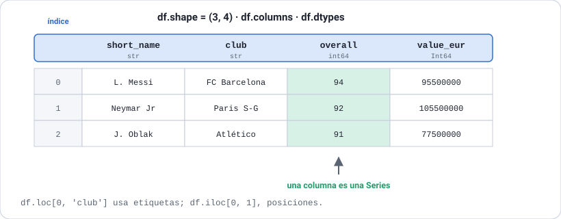
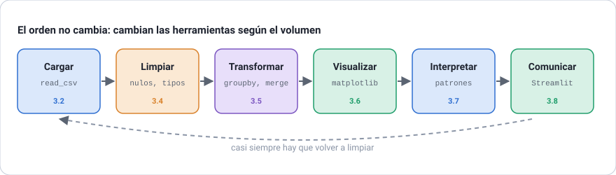
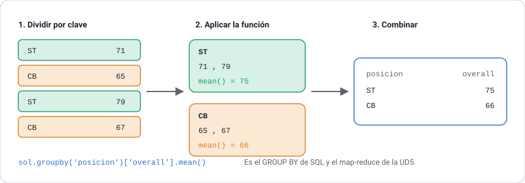
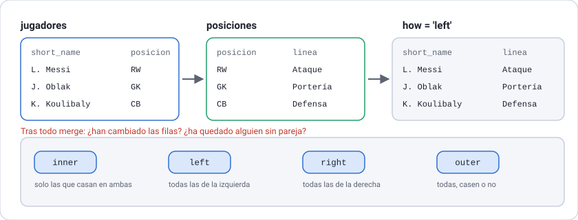
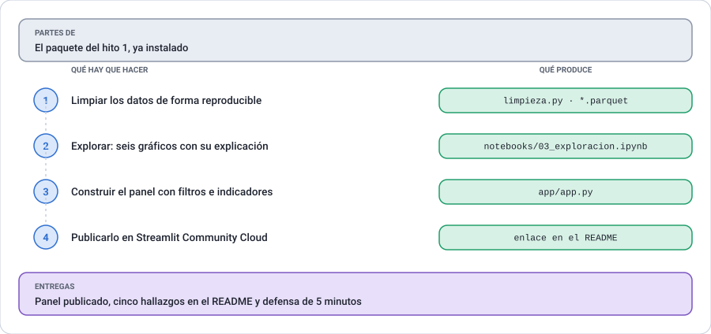

# UD3 · Análisis de datos con Python

**Python aplicado a la Inteligencia Artificial** · 2.º DAM · Curso 2026-2027

[← Volver al índice del módulo](../README.md)

## Índice

- [Presentación de la unidad](#presentación-de-la-unidad)
- [3.1 NumPy: el motor que hay debajo](#31-numpy-el-motor-que-hay-debajo)
- [3.2 pandas: cargar e inspeccionar](#32-pandas-cargar-e-inspeccionar)
- [3.3 Seleccionar y filtrar](#33-seleccionar-y-filtrar)
- [3.4 Limpiar los datos](#34-limpiar-los-datos)
- [3.5 Transformar: columnas, grupos y uniones](#35-transformar-columnas-grupos-y-uniones)
- [3.6 Visualizar: matplotlib y seaborn](#36-visualizar-matplotlib-y-seaborn)
- [3.7 Análisis exploratorio](#37-análisis-exploratorio)
- [3.8 De los datos a la decisión: Streamlit](#38-de-los-datos-a-la-decisión-streamlit)
- [Práctica de la unidad · Hito 2 del proyecto integrador](#práctica-de-la-unidad--hito-2-del-proyecto-integrador)
- [Resumen de la unidad](#resumen-de-la-unidad)
- [Bibliografía de la UD3](#bibliografía-de-la-ud3)
- [Continuar](#continuar)

## Presentación de la unidad

Es la unidad más larga del módulo: 10 horas. En la UD1 recorriste las 100.995 filas del fichero de jugadores con el módulo `csv` y un puñado de diccionarios, y tardaste medio segundo. Funcionaba. El problema no era la velocidad: era que contar jugadores por país te costó quince líneas, y calcular la media por país, dos diccionarios.

Aquí eso pasa a ser una línea. Pero el cambio importante no es escribir menos código, sino poder hacerte preguntas que antes no compensaba responder. Cuando agrupar cuesta una línea, agrupas por todo; y de ahí salen los hallazgos.

La unidad va en ese orden: cargar, mirar, limpiar, transformar, dibujar, interpretar y publicar. Termina con una aplicación web funcionando en internet, que es donde acaba de verdad un análisis: no en un cuaderno que solo abres tú.

### Resultado de aprendizaje y criterios de evaluación

**RA2.** Utiliza herramientas de análisis y procesamiento de datos con Python.

| CE | Criterio de evaluación | Apartados |
| --- | --- | --- |
| 2a | Gestiona conjuntos de datos para su carga, limpieza y estructuración | 3.2, 3.3, 3.4, 3.5 |
| 2b | Genera representaciones visuales aplicando principios de análisis gráfico | 3.6 |
| 2c | Realiza análisis exploratorio identificando patrones y tendencias | 3.7 |
| 2e | Interpreta los resultados para la toma de decisiones | 3.7, 3.8 |

El criterio 2d, sobre consultas en bases de datos, se trabaja en la UD4.

### Temporalización

| Sesión | Fecha | Horas | Contenidos |
| --- | --- | --- | --- |
| 1 | Martes 20/10/2026 | 1 | 3.1 NumPy |
| 2 | Lunes 26/10/2026 | 2 | 3.2 Cargar e inspeccionar · 3.3 Seleccionar y filtrar |
| 3 | Martes 27/10/2026 | 1 | 3.4 Nulos, duplicados y texto |
| 4 | Martes 03/11/2026 | 1 | 3.4 Atípicos · 3.5 Columnas derivadas |
| 5 | Lunes 09/11/2026 | 2 | 3.5 Agrupaciones, tablas dinámicas, uniones y series temporales |
| 6 | Martes 10/11/2026 | 1 | 3.6 Visualización |
| 7 | Lunes 16/11/2026 | 2 | 3.7 Análisis exploratorio · 3.8 Streamlit y despliegue |

El lunes 02/11 es festivo.

### Antes de empezar: instalar las dependencias

Con el entorno virtual del módulo activado:

```bash
pip install pandas numpy matplotlib seaborn streamlit pyarrow
```

`pyarrow` no se usa directamente: es lo que permite a pandas leer y escribir ficheros Parquet, que aparecen en el apartado 3.5.

### Qué datos vamos a usar

El mismo fichero de siempre, `datos-comunes/jugadores.csv`, con las valoraciones de FIFA 15 a FIFA 20. Si no lo has mirado todavía, su página de referencia está aquí: **[El conjunto de datos del curso](../datos-comunes/README.md)**.

Hay un segundo fichero, pequeño, que aparece en el apartado de uniones: `datos-comunes/posiciones.csv`, con las 15 posiciones, su nombre en español y la línea del campo a la que pertenecen.

### Cómo usar esta carpeta

| Carpeta | Contenido |
| --- | --- |
| [`listados/`](listados/) | Los listados de la unidad. `comun.py` concentra la carga y la limpieza |
| [`app/`](app/) | La aplicación de Streamlit lista para desplegar |
| [`figuras/`](figuras/) | Las figuras de los apuntes |

Los listados se ejecutan desde `ud3-datos/listados/`:

```bash
cd ud3-datos/listados
python listado_3_09_groupby.py
streamlit run listado_3_20_panel_streamlit.py
```

Los gráficos se guardan en `listados/graficos/`, que no se sube al repositorio: se regenera ejecutando los listados.

## 3.1 NumPy: el motor que hay debajo

pandas está construido sobre NumPy, así que conviene entender qué aporta NumPy antes de usar pandas. Y lo que aporta se resume en una idea: **operar sobre muchos números a la vez en lugar de uno a uno**.

Una lista de Python guarda referencias a objetos, cada uno en un sitio distinto de la memoria, y cada uno con su tipo. Sumar dos listas elemento a elemento obliga a recorrerlas, mirar el tipo de cada par y llamar a la suma correspondiente. Un `array` de NumPy guarda los números **del mismo tipo, uno detrás de otro**, y la suma se hace en código compilado sin volver a Python en cada vuelta. A eso se le llama **vectorización**.

**Listado 3.1.** El array y la vectorización · [ver fichero](listados/listado_3_01_numpy.py)

```python
import numpy as np

medias = np.array([94, 93, 91, 91, 89])
print("array:", medias, "· tipo de los datos:", medias.dtype)

# Las operaciones se aplican a todos los elementos a la vez.
print("medias + 1:   ", medias + 1)
print("medias > 90:  ", medias > 90)
print("solo los > 90:", medias[medias > 90])     # máscara booleana

print(f"media {medias.mean():.1f} · máximo {medias.max()} · desviación {medias.std():.2f}")
```

```text
array: [94 93 91 91 89] · tipo de los datos: int64

medias + 1:    [95 94 92 92 90]
medias > 90:   [ True  True  True  True False]
solo los > 90: [94 93 91 91]

media 91.6 · máximo 94 · desviación 1.74
```

Fíjate en `medias > 90`. No devuelve `True` o `False`: devuelve **un array de booleanos, uno por elemento**. Y ese array se puede usar entre corchetes para quedarse solo con los elementos donde vale `True`. A eso se le llama **máscara booleana**, y es exactamente la forma en que filtrarás filas en pandas durante el resto del curso. Si entiendes esto, el apartado 3.3 no te costará nada.

¿Y cuánto más rápido es? Depende de la operación, y conviene medirlo en lugar de repetir que «NumPy es rapidísimo».

```text
Dos millones de valoraciones:
  media                lista   14.7 ms · NumPy   1.6 ms ·    9 veces más rápido
  cuántas pasan de 85  lista   59.2 ms · NumPy   4.5 ms ·   13 veces más rápido
```

Entre nueve y trece veces, en este caso. Hay operaciones donde la diferencia es mucho mayor y otras donde apenas se nota, porque el cuello de botella pasa a ser la memoria. Pero hay una segunda ventaja que no se mide en milisegundos: escribir `array.mean()` en lugar de un bucle con un acumulador. Es esa legibilidad la que hace posible el código de pandas que viene a continuación.

> [!NOTE]
> **Desde C++.** Un `array` de NumPy es lo más parecido a un `std::vector<double>` que hay en Python: memoria contigua, un solo tipo, tamaño fijo. La diferencia es que en NumPy las operaciones aritméticas están sobrecargadas para trabajar sobre el vector entero, algo que en C++ tendrías que escribir tú o buscar en una biblioteca como Eigen.

### Para practicar

1. Crea un array con las valoraciones `[94, 66, 48, 72, 88]` y obtén, sin bucles: cuántas superan 70, la media de las que superan 70 y la diferencia de cada una respecto a la media general.

   ```text
   Superan 70: 3
   Media de esas: 84.67
   Diferencias: [ 20.4  -7.6 -25.6  -1.6  14.4]
   ```

2. Comprueba qué pasa al crear `np.array([94, 66, "alto"])`. Mira el `dtype` resultante y explica en una línea por qué un array no puede mezclar tipos como sí hace una lista.

3. (A) Mide con el método del listado 3.1 cuánto tarda en ordenar un millón de números una lista (`sorted`) y un array (`np.sort`). Anota el resultado y explica si la diferencia es la que esperabas.

## 3.2 pandas: cargar e inspeccionar

Un **DataFrame** es una tabla: filas, columnas con nombre y un tipo por columna. Una **Series** es una sola columna. Casi todo lo que hagas a partir de ahora consiste en transformar un DataFrame en otro.



*Figura 3.1. Las partes de un DataFrame. El índice es lo que más confunde al principio: no es un número de fila, es una etiqueta.*

### Cargar con los parámetros adecuados

`read_csv` tiene más de cincuenta parámetros. En la práctica se usan cuatro o cinco, pero elegirlos bien ahorra mucha limpieza después.

**Listado 3.2.** Cargar el fichero de tres maneras · [ver fichero](listados/listado_3_02_leer_csv.py)

```python
import pandas as pd

RUTA = Path(__file__).resolve().parents[2] / "datos-comunes" / "jugadores.csv"

# La lectura mínima: pandas deduce separador, tipos y cabecera.
jugadores = pd.read_csv(RUTA)
print("Filas y columnas:", jugadores.shape)
print("Memoria:", f"{jugadores.memory_usage(deep=True).sum() / 1024**2:.1f} MB")

# Leer solo lo que hace falta: menos memoria y menos ruido.
columnas = ["fifa", "short_name", "age", "nationality", "club",
            "player_positions", "overall", "potential", "value_eur"]
ligero = pd.read_csv(RUTA, usecols=columnas)

# Las fechas no se convierten solas: hay que pedirlo.
con_fechas = pd.read_csv(RUTA, usecols=["short_name", "dob", "joined"],
                         parse_dates=["dob", "joined"])
```

```text
Filas y columnas: (100995, 37)
Memoria: 82.2 MB

Con usecols: (100995, 9) · 26.7 MB

Tipos de las fechas:
short_name               str
dob           datetime64[us]
joined        datetime64[us]
```

Tres cosas que conviene retener:

**`usecols` no es una optimización prematura.** Pasar de 82 a 27 MB en una línea importa cuando el fichero crece, y además evita arrastrar treinta columnas que no vas a mirar. En la UD5 esto será la diferencia entre poder trabajar y no poder.

**Las fechas llegan como texto.** `dob` sin `parse_dates` es una cadena `"1987-06-24"`, con la que no puedes restar ni extraer el mes. Pedirlo al cargar es más cómodo que convertir después.

**`memory_usage(deep=True)`.** Sin `deep=True`, pandas no cuenta lo que ocupan las cadenas de verdad y te da una cifra mucho menor que la real.

### Las seis órdenes con las que se empieza siempre

Antes de calcular nada hay que saber qué hay dentro. Casi todos los errores de análisis vienen de haber supuesto algo sobre los datos que no era cierto, y estas seis respuestas evitan la mayoría.

**Listado 3.3.** Lo primero que se hace con un conjunto de datos nuevo · [ver fichero](listados/listado_3_03_inspeccion.py)

```python
sol = jugadores[jugadores["fifa"] == 2020]

print("1. shape:", sol.shape)                 # ¿cuánto hay?
sol.info()                                    # 2. tipos y huecos
print(sol.describe())                         # 3. cómo se reparten los números
print(sol[["nationality", "club"]].describe())  # 4. y los textos
print(sol["preferred_foot"].value_counts())   # 5. qué valores distintos hay
print(sol.sample(3, random_state=7))          # 6. una muestra al azar
```

```text
1. shape: (18278, 37)

3. describe() de las numéricas:
           age  overall  potential    value_eur
count  18278.0  18278.0    18278.0      18278.0
mean      25.3     66.2       71.5    2484037.6
std        4.7      6.9        6.1    5585481.1
min       16.0     48.0       49.0          0.0
25%       22.0     62.0       67.0     325000.0
50%       25.0     66.0       71.0     700000.0
75%       29.0     71.0       75.0     2100000.0
max       42.0     94.0       95.0  105500000.0

4. describe() de las categóricas:
       nationality          club preferred_foot
count        18278         18278          18278
unique         162           698              2
top        England  FC Barcelona          Right
freq          1667            33          13960
```

Ese `describe()` ya tiene dos avisos dentro, si se sabe mirar.

El primero: **`min` de `value_eur` es 0**. Un jugador de FIFA 20 no vale cero euros. Ahí hay algo que explicar, y lo veremos en el apartado 3.4.

El segundo: **la media de `value_eur` es 2,48 millones y la mediana 700.000**. Cuando la media casi cuadruplica a la mediana, la distribución tiene una cola larga hacia arriba y la media deja de describir a nadie. Es un dato sobre la **forma** de los datos, no sobre su centro.

> [!TIP]
> Usa `sample()` en vez de `head()` para echar un primer vistazo. Los ficheros suelen venir ordenados por algo —aquí, por valoración—, así que `head()` te enseña siempre lo mismo: los diez mejores del mundo, que no se parecen al resto.

### Para practicar

1. Carga solo las columnas `short_name`, `age`, `overall` y `club` de FIFA 20 y comprueba cuánta memoria ocupa frente al fichero completo.

2. Aplica `describe()` a la columna `age` de cada edición por separado. ¿Está envejeciendo el conjunto de jugadores?

3. (A) Busca en la documentación de pandas qué hacen los parámetros `dtype`, `nrows` y `skiprows` de `read_csv`, y explica en una línea en qué situación usarías cada uno.

## 3.3 Seleccionar y filtrar

La confusión más habitual de quien empieza con pandas es mezclar las tres formas de seleccionar. La regla es corta:

| Para… | Se usa | Ejemplo |
| --- | --- | --- |
| Elegir columnas | `[]` | `sol["overall"]`, `sol[["short_name", "club"]]` |
| Filtrar filas por una condición | `[]` con una máscara | `sol[sol["overall"] >= 90]` |
| Filas y columnas por **nombre** | `.loc` | `sol.loc[sol["age"] < 20, ["short_name", "potential"]]` |
| Filas y columnas por **posición** | `.iloc` | `sol.iloc[0, :3]` |

**Listado 3.4.** Las tres formas de seleccionar · [ver fichero](listados/listado_3_04_seleccion.py)

```python
# Una columna es una Series; dos o más, un DataFrame.
print("Una columna ->", type(sol["overall"]).__name__)      # Series
print("Varias      ->", type(sol[["short_name", "overall"]]).__name__)  # DataFrame

# Varias condiciones: paréntesis obligatorios, y & | en lugar de and / or.
jovenes_promesa = sol[(sol["age"] <= 21) & (sol["potential"] >= 85)]

# .loc: filas por condición, columnas por nombre, en una sola orden.
sol.loc[sol["nationality"] == "Spain", ["short_name", "club", "overall"]]

# isin evita escribir una cadena de condiciones con |.
sol[sol["club"].isin(["FC Barcelona", "Real Madrid", "Atlético Madrid"])]

# between, para rangos.
sol[sol["age"].between(34, 40)]
```

```text
Jugadores con media 90 o más: 10
Menores de 22 con potencial 85+: 170
   short_name  age                club  overall  potential
    K. Mbappé   20 Paris Saint-Germain       89         95
   M. de Ligt   19            Juventus       85         93
   João Félix   19     Atlético Madrid       80         93
G. Donnarumma   20               Milan       85         92
    J. Sancho   19   Borussia Dortmund       84         92

Jugadores de los tres grandes: 99
Entre 34 y 40 años: 898
```

> [!WARNING]
> Dos errores que vas a cometer, porque los cometemos todos. El primero: `sol[sol["age"] > 30 & sol["overall"] > 80]` falla, porque `&` tiene más prioridad que `>`. Hay que poner paréntesis a cada condición. El segundo: usar `and` en lugar de `&` da `ValueError: The truth value of a Series is ambiguous`, porque `and` espera un único booleano y aquí hay dieciocho mil.

> [!NOTE]
> **Desde C++.** No hay bucle. `sol[sol["overall"] >= 90]` construye un array de booleanos del tamaño de la tabla y se queda con las filas marcadas, todo en código compilado. Escribir un `for` sobre las filas de un DataFrame funciona, pero es entre diez y cien veces más lento y se considera un error de estilo.

### Para practicar

1. Obtén los jugadores españoles de FIFA 20 con valoración 85 o más, ordenados de mayor a menor.

   ```text
   De Gea, Sergio Ramos, Sergio Busquets, Piqué, David Silva
   ```

2. Cuenta cuántos jugadores tienen `potential` al menos 10 puntos por encima de `overall`. ¿Qué edad media tienen?

3. (A) Escribe la misma selección del ejercicio 1 con `[]` y con `.loc`, y explica en qué caso es obligatorio `.loc`. Pista: prueba a asignar un valor nuevo con las dos formas.

## 3.4 Limpiar los datos

Limpiar no es «dejarlo bonito». Es **tomar decisiones sobre los datos y dejarlas escritas**, porque cada una cambia los resultados y alguien tendrá que poder revisarlas. Este apartado recorre las cuatro decisiones que hay que tomar con este fichero.



*Figura 3.2. La limpieza no es un paso previo que se hace una vez: se vuelve a ella cada vez que el análisis descubre algo.*

### Valores ausentes: antes de rellenar, preguntar por qué faltan

Rellenar los huecos con la media es la respuesta automática, y casi siempre la equivocada. Un hueco puede significar tres cosas muy distintas: que el dato se perdió, que no se midió, o que **no se aplica**. Solo en el primer caso tiene sentido estimarlo.

**Listado 3.5.** Contar los huecos y, sobre todo, entenderlos · [ver fichero](listados/listado_3_05_nulos.py)

```python
nulos = sol.isna().sum()
print((nulos[nulos > 0] / len(sol) * 100).round(1).sort_values(ascending=False))
```

```text
gk_kicking              88.9
gk_reflexes             88.9
gk_positioning          88.9
gk_speed                88.9
gk_diving               88.9
gk_handling             88.9
dribbling               11.1
passing                 11.1
pace                    11.1
shooting                11.1
defending               11.1
physic                  11.1
release_clause_eur       7.1
joined                   7.0
team_position            1.3
contract_valid_until     1.3
```

Dos bloques, uno al 88,9 % y otro al 11,1 %. Las cifras suman 100, lo cual no es casualidad. La forma de averiguar qué pasa es mirar **quién** tiene esos huecos:

```python
sin_pace = sol[sol["pace"].isna()]
print("Sus posiciones:", sin_pace["player_positions"].value_counts().head(3).to_dict())
```

```text
Jugadores sin 'pace': 2036
Sus posiciones: {'GK': 2036}

Jugadores sin 'gk_diving': 16242
¿Alguno es portero? False

2036 + 16242 = 18278 = 18278 jugadores
```

Ahí está la explicación completa. Los 2.036 jugadores sin velocidad son **exactamente** los 2.036 porteros, ni uno más ni uno menos. Y los 16.242 sin valoración de portero son exactamente los jugadores de campo. Los dos grupos no se solapan y suman el total.

No son datos perdidos: son columnas **que no se aplican** a ese jugador. Un portero no tiene un valor de regate porque la pregunta no tiene sentido para él.

> [!IMPORTANT]
> Si rellenaras `pace` con la media de la columna (67,7), estarías afirmando que los porteros corren como un extremo. Y lo peor es que el programa no se quejaría: te daría un número, y ese número aparecería en tus gráficos y en tu modelo sin que nadie notara nada. Los errores que no dan error son los caros.

Las tres respuestas posibles ante un hueco, y cuándo vale cada una:

| Respuesta | Cuándo | En este fichero |
| --- | --- | --- |
| `dropna()` | El dato falta de verdad y la fila no sirve sin él | Al analizar solo jugadores de campo |
| `fillna(valor)` | El hueco tiene un valor equivalente y conocido | Casi nunca aquí |
| Dejarlo | El hueco es legítimo y pandas ya lo ignora | **La respuesta correcta en este caso** |

```text
media de 'pace' ignorando los nulos: 67.7
media tratando los nulos como cero: 60.2  <- falsa
```

Esa es la razón de dejarlos: `mean()`, `sum()`, `median()` y `groupby()` **ya ignoran los nulos**. No hay que hacer nada; hay que no hacer nada.

### El agujero de FIFA 15

Hay un segundo problema, y este sí obliga a decidir.

**Listado 3.6.** Las cuatro decisiones de limpieza de este fichero · [ver fichero](listados/listado_3_06_limpieza.py)

```python
print(jugadores.groupby("fifa")["value_eur"].median().astype(int))
```

```text
fifa
2015         0
2016    575000
2017    650000
2018    700000
2019    675000
2020    700000
```

El valor mediano de 2015 es cero euros. No es que aquel año los futbolistas no valieran nada: **esa edición del dataset no recoge el dato**, en ninguna de sus 15.465 filas, y tampoco trae la cláusula de rescisión.

Esto no se arregla: se decide. Y la decisión de este curso es **quitar FIFA 15 entera** en cuanto se carga el fichero, porque cualquier análisis de dinero que la incluya saldrá mal, y mantener la excepción en la cabeza durante diez horas es pedir un error. Se pierden 15.465 filas y 3.136 jugadores que solo aparecen ahí; a cambio, el resto de la unidad trabaja sobre datos homogéneos.

> [!TIP]
> Fíjate en el orden: primero se **mide** el problema (una tabla de cinco líneas), después se **decide**, y la decisión se escribe en el código con su porqué. Un `df = df[df.fifa >= 2016]` suelto, sin comentario, es una bomba de relojería para quien lea el código dentro de seis meses, aunque seas tú.

### Duplicados, ceros que son ausencias y texto sucio

```text
Filas duplicadas enteras: 0
Duplicados de (edición, jugador): 0
  Ninguno. Que el mismo jugador salga seis veces es correcto:
  son seis ediciones, no seis copias.
```

Comprobar duplicados es obligatorio, pero hay que comprobar los que importan. Aquí, `duplicated()` a secas no encuentra nada, y `duplicated(subset=["fifa", "sofifa_id"])` tampoco: la tabla está bien formada. Que Messi aparezca cinco veces no es un duplicado, es la estructura del fichero.

```text
Jugadores con value_eur = 0: 250
  Valor medio contándolos:       2,484,038 €
  Valor medio sin contarlos:     2,518,485 €
```

Esos 250 son agentes libres: sin contrato, sin valor asignado. El cero no es un importe, es una ausencia disfrazada de número, y es el peor tipo de dato sucio porque pasa todos los controles. Se convierten en nulos para que pandas los ignore:

```python
for columna in ("value_eur", "wage_eur"):
    jugadores[columna] = jugadores[columna].replace(0, pd.NA).astype("Int64")
```

> [!WARNING]
> El `.astype("Int64")`, con mayúscula, no es un capricho. El `int64` normal de NumPy **no admite nulos**, así que al meter un `pd.NA` pandas convertiría la columna entera en texto y a partir de ahí `nlargest`, `mean` y las comparaciones fallarían. El `Int64` de pandas es el entero que sí admite ausencias.

Y por último, el texto:

```text
body_type
Normal                 10750
Lean                    6505
Stocky                  1016
Messi                      1
C. Ronaldo                 1
Neymar                     1
PLAYER_BODY_TYPE_25        1
Courtois                   1
Shaqiri                    1
Akinfenwa                  1
```

Siete filas de dieciocho mil con algo que no es una complexión: seis nombres propios y un código interno del juego que se escapó sin traducir. Es lo que pasa cuando alguien pone un campo libre donde tenía que haber una lista cerrada. Se corrigen al valor más común y se sigue.

La última decisión es `work_rate`, que guarda **dos datos en una columna**: `"Medium/Low"` es esfuerzo en ataque y esfuerzo en defensa. Una columna con dos cosas dentro no se puede agrupar ni comparar, así que se parte en dos.

```python
sol[["esfuerzo_ataque", "esfuerzo_defensa"]] = sol["work_rate"].str.split("/", expand=True)
```

### Valores atípicos: encontrarlos es fácil, decidir no

Un atípico es un valor que se aleja mucho del resto. El criterio más usado es el del **rango intercuartílico**: se considera atípico lo que queda por encima de `Q3 + 1,5 × (Q3 − Q1)`.

**Listado 3.7.** Atípicos: el criterio dice cuáles, los datos dicen qué hacer · [ver fichero](listados/listado_3_07_atipicos.py)

```text
Q1      325,000 €
Q3    2,100,000 €
Límite superior    4,762,500 €

Atípicos: 2,511 de 18,028 (13.9 %)

Los cinco más altos:
  short_name                club  overall  value_eur
   Neymar Jr Paris Saint-Germain       92  105500000
    L. Messi        FC Barcelona       94   95500000
   K. Mbappé Paris Saint-Germain       89   93500000
   E. Hazard         Real Madrid       91   90000000
K. De Bruyne     Manchester City       91   90000000
```

Un 13,9 % de atípicos. Y en cuanto se mira quiénes son, la respuesta es evidente: Neymar, Messi, Mbappé. **No son errores.** Es una distribución con cola larga, donde unos pocos valen cien veces más que la mediana. Eso es el mercado del fútbol, no un fallo de captura.

```text
Asimetría del valor:              6.39  (0 sería simétrica)
Asimetría del logaritmo:          0.40

Media:      2,518,485 €
Mediana:      725,000 €
```

La asimetría de 6,39 es la medida de esa cola. Y al tomar logaritmos baja a 0,40, casi simétrica: por eso **los gráficos de dinero se dibujan en escala logarítmica** y por eso en la UD6 el modelo predecirá el logaritmo del salario y no el salario.

> [!IMPORTANT]
> La regla no es «elimina los atípicos». Es: encuéntralos, **mira quiénes son** y decide. Si son errores de captura (una edad de 300 años), fuera. Si son la cola natural del fenómeno, se quedan, porque muchas veces son lo más interesante del conjunto. Quitar a Messi del análisis del mercado del fútbol sería absurdo.

### Para practicar

1. Comprueba cuántos jugadores de FIFA 20 tienen `contract_valid_until` vacío y mira sus clubes. ¿Encuentras una explicación?

2. Aplica el criterio del rango intercuartílico a la columna `age` en vez de a `value_eur`. ¿Cuántos atípicos salen? ¿Son errores?

   ```text
   Límite superior: 39.5 años · atípicos: 19
   ```

3. Escribe una función `limpiar(df)` que haga las cuatro decisiones del listado 3.6 y devuelva el DataFrame limpio. Compárala con la que hay en `comun.py`.

4. (A) Ejecuta `sol["value_eur"].replace(0, pd.NA)` **sin** el `.astype("Int64")` y después `sol.nlargest(3, "value_eur")`. Copia el error y explica con tus palabras qué ha pasado con el tipo de la columna.

## 3.5 Transformar: columnas, grupos y uniones

Con los datos limpios empieza el análisis de verdad. Este apartado tiene cinco herramientas, y las vas a usar todas en cada proyecto de datos que hagas en tu vida.

### Columnas derivadas: el dato que no viene, pero se calcula

Casi ningún análisis interesante sale de las columnas tal como vienen. Lo normal es construir las que responden a tu pregunta.

**Listado 3.8.** Cinco formas de crear una columna · [ver fichero](listados/listado_3_08_columnas.py)

```python
# 1. Aritmética entre columnas: se aplica fila a fila, sin bucle.
sol["margen"] = sol["potential"] - sol["overall"]

# 2. Clasificar por tramos: pd.cut reparte en intervalos.
sol["tramo_edad"] = pd.cut(sol["age"], bins=[15, 21, 25, 30, 50],
                           labels=["Promesa", "Joven", "Madurez", "Veterano"])

# 3. Una condición: np.where es el "si... entonces... si no".
sol["titular"] = np.where(sol["overall"] >= 70, "sí", "no")

# 4. Varias condiciones: np.select, en orden, con un valor por defecto.
sol["nivel"] = np.select(
    [sol["overall"] >= 85, sol["overall"] >= 75, sol["overall"] >= 65],
    ["Estrella", "Titular", "Rotación"],
    default="Reserva")

# 5. Texto: extraer una parte de una columna.
sol["inicial"] = sol["short_name"].str[0]
```

```text
       short_name  age tramo_edad  overall    nivel  margen
         L. Messi   32   Veterano       94 Estrella       0
Cristiano Ronaldo   34   Veterano       93 Estrella       0
        Neymar Jr   27    Madurez       92 Estrella       0
         J. Oblak   26    Madurez       91 Estrella       2

Margen de mejora medio por tramo de edad:
tramo_edad
Promesa     13.0
Joven        6.1
Madurez      0.9
Veterano     0.0
```

Esa última tabla es una **comprobación de cordura**, y merece la pena cogerle el hábito. Si acabas de construir una columna que mide «lo que le queda por crecer a un jugador», lo mínimo que tiene que pasar es que los jóvenes tengan mucho y los veteranos nada. Sale 13,0 contra 0,0. La columna está bien construida.

Cuando una columna nueva da un resultado que no se parece a lo que sabes del mundo, casi siempre está mal la columna, no el mundo.

> [!TIP]
> `np.select` evalúa las condiciones **en orden** y se queda con la primera que se cumple. Por eso van de mayor a menor: si pusieras `>= 65` la primera, todos los jugadores de 90 serían «Rotación».

### Agrupar: la operación más importante de pandas

`groupby` hace en una línea lo que en la UD1 te costó dos diccionarios y un bucle: parte los datos en grupos, calcula algo en cada uno y junta los resultados.



*Figura 3.3. Partir, calcular y juntar. Son siempre los mismos tres pasos.*

**Listado 3.9.** `groupby` de lo simple a lo útil · [ver fichero](listados/listado_3_09_groupby.py)

```python
# Lo mínimo: columna para agrupar, columna para calcular, operación.
sol.groupby("posicion")["overall"].mean()

# Varias operaciones a la vez, con nombres propios para las columnas.
resumen = sol.groupby("posicion").agg(
    jugadores=("sofifa_id", "size"),
    media=("overall", "mean"),
    edad=("age", "mean"),
    valor_mediano=("value_eur", "median"),
)
```

```text
          jugadores  media  edad  valor_mediano
posicion
LW              378   66.9  23.5      1000000.0
RW              369   67.1  23.8      1000000.0
CF              113   69.1  25.4       975000.0
CAM            1146   66.9  24.6       925000.0
LM             1049   66.5  24.7       875000.0
CDM            1424   67.4  25.9       875000.0
ST             2582   66.4  25.3       825000.0
RM             1050   66.1  24.7       775000.0
```

La forma `agg(nombre=("columna", "operación"))` es la que debes memorizar: da columnas con nombres legibles en lugar de un índice de dos niveles ilegible.

Y hay una trampa que aparece en cuanto agrupas por algo con muchas categorías:

```text
Países con mejor media (mínimo 100 jugadores):
                jugadores  media
nationality
Uruguay               164   71.6
Brazil                824   71.2
Portugal              344   70.5
Czech Republic        102   70.3
Spain                1035   70.0

  Sin ese filtro, el primero sería un país con 4 jugador(es):
   Mozambique           4   73.2
   Chad                 1   73.0
   Bahrain              1   72.0
```

Chad es el segundo mejor país del mundo con una media de 73,0… basada en un jugador. **Una media sobre un grupo diminuto no es una media, es un dato suelto.** Filtrar los grupos pequeños antes de ordenar no es opcional: es la diferencia entre un ranking y un disparate.

### Tablas dinámicas: el mismo groupby, en rejilla

`pivot_table` coloca un grupo en las filas y otro en las columnas. No calcula nada nuevo; lo coloca de forma que se pueda leer de un vistazo.

**Listado 3.10.** Rejillas y totales · [ver fichero](listados/listado_3_10_pivot.py)

```python
tabla = sol.pivot_table(values="overall", index="posicion", columns="tramo",
                        aggfunc="mean", observed=True)
```

```text
tramo     Promesa  Joven  Madurez  Veterano
posicion
CAM          61.4   67.8     70.5      71.2
CB           60.6   66.4     69.1      69.6
CDM          61.3   67.4     69.6      70.0
CF           61.4   70.1     72.5      73.6
CM           60.1   66.9     69.1      69.4
GK           58.0   63.5     67.9      68.9
```

Para contar con totales, `crosstab` es más directo:

```text
tramo       Promesa  Joven  Madurez  Veterano  Total
es_portero
False          4070   4872     5004      2296  16242
True            444    547      558       487   2036
Total          4514   5419     5562      2783  18278
```

Y una rejilla puede tener casillas vacías, que es un resultado en sí mismo:

```text
esfuerzo_defensa     High     Low  Medium
posicion
CAM                3350.0  1100.0   825.0
CB                  900.0   550.0   675.0
CDM                1100.0   315.0   700.0
CF                10250.0   575.0   875.0
CM                 1200.0   575.0   650.0
GK                   <NA>    <NA>   400.0
```

Los dos huecos de la fila `GK` no son un fallo: **no hay ni un solo portero con esfuerzo defensivo alto o bajo**, todos están en medio. Si rellenaras esos huecos con ceros, estarías inventando porteros que no existen y además diciendo que valen cero euros.

### Unir tablas: traer datos de otro sitio

Dos situaciones muy distintas con la misma orden.



*Figura 3.4. El `merge` de búsqueda (arriba) y los cuatro tipos de unión (abajo).*

**Listado 3.11.** Los dos tipos de unión que vas a necesitar · [ver fichero](listados/listado_3_11_merge.py)

**La primera es una búsqueda**: una tabla pequeña añade información a cada fila de la grande. Aquí, los 15 códigos de posición traen su nombre en español y su línea del campo.

```python
posiciones = cargar_posiciones()                 # 15 filas
con_linea = sol.merge(posiciones, on="posicion", how="left")
```

```text
Antes del merge: (18278, 29) · después: (18278, 32)
  Mismas filas, tres columnas más. Eso es lo que debe pasar.

Jugadores y valor mediano por línea:
                  jugadores  media  valor_mediano
linea
Ataque                 3442   66.7       875000.0
Centro del campo       6862   66.4       800000.0
Defensa                5938   66.3       675000.0
Portería               2036   64.8       400000.0

Sin línea asignada: 0
```

> [!IMPORTANT]
> Después de todo `merge`, dos comprobaciones obligatorias. **¿Han cambiado las filas?** En una búsqueda no deben cambiar: si aumentan, la tabla pequeña tiene claves repetidas y estás duplicando jugadores. **¿Ha quedado alguien sin pareja?** Un `isna().sum()` sobre una columna traída te lo dice. Aquí son 18.278 antes y después, y cero sin asignar: correcto.

**La segunda es un cruce entre dos tablas grandes**, y ahí sí hay que elegir qué pasa con las filas que no casan.

```python
cruce = anterior.merge(actual, on="sofifa_id", how="inner", suffixes=("_19", "_20"))
izquierda = anterior.merge(actual, on="sofifa_id", how="left", suffixes=("_19", "_20"))
```

```text
FIFA 19: 17,770 jugadores · FIFA 20: 18,278
inner -> 13,144 jugadores están en las dos ediciones
left  -> 17,770 filas, de las que 4,626 no aparecen en FIFA 20
```

| Tipo | Se queda con | Cuándo usarlo |
| --- | --- | --- |
| `inner` | Solo lo que está en las dos | Comparar, calcular diferencias |
| `left` | Todo lo de la izquierda | Enriquecer sin perder filas |
| `right` | Todo lo de la derecha | Casi nunca: se da la vuelta y se usa `left` |
| `outer` | Todo de las dos, con huecos | Auditar qué falta en cada lado |

Esos 4.626 jugadores que están en FIFA 19 y no en FIFA 20 son un dato, no un problema: se retiraron, bajaron de categoría o el juego dejó de incluirlos. Elegir `inner` los descarta en silencio; elegir `left` te obliga a verlos. Por eso conviene mirar siempre los dos antes de decidir.

Y el análisis que solo es posible después de cruzar:

```text
Mejoran 5,750 · igual 3,868 · empeoran 3,526
Cambian de club: 4,184

Los cinco que más suben de un año a otro:
short_name_19  overall_19  overall_20  cambio
  T. Nakagawa          51          68      17
  C. McLennan          51          67      16
      M. Heča          58          73      15
```

### Series temporales: seguir a los mismos jugadores

El fichero tiene cinco ediciones y el mismo `sofifa_id` en todas, así que se puede pasar de la foto a la película.

**Listado 3.12.** La dimensión temporal · [ver fichero](listados/listado_3_12_temporal.py)

```text
Messi, edición a edición:
 fifa  age  overall  value_eur  wage_eur
 2016   28       94  111000000    550000
 2017   29       93   89000000    340000
 2018   30       93  105000000    565000
 2019   31       94  110500000    565000
 2020   32       94   95500000    565000

Cómo evoluciona el conjunto:
      jugadores  edad_media  media  valor_mediano
fifa
2016      14881        24.9   65.7       600000.0
2017      17009        25.0   66.2       675000.0
2018      17592        25.2   66.3       700000.0
2019      17770        25.2   66.2       700000.0
2020      18278        25.3   66.2       725000.0
```

`pct_change()` da la variación respecto a la fila anterior, que es como se leen de verdad las series: no el valor, sino cuánto ha cambiado.

Y cuando una columna de fechas se convierte de verdad, aparecen cosas que el texto escondía:

```text
Fichajes por mes del año (los cinco más frecuentes):
7.0    8319
1.0    3339
8.0    1936
2.0     951
6.0     810
```

Julio y enero: los dos mercados de fichajes del fútbol europeo. Nadie ha metido esa información en el fichero; sale sola al agrupar por mes. **Eso es un análisis exploratorio funcionando**: el dato confirma algo que sabías, lo cual, además de interesante, valida que has convertido bien las fechas.

### Guardar el resultado

Un análisis que hay que repetir desde cero cada vez no sirve. El resultado limpio se guarda y todo lo demás parte de ahí.

**Listado 3.13.** CSV para compartir, Parquet para trabajar · [ver fichero](listados/listado_3_13_exportar.py)

```text
                 tamaño   escritura
CSV             14.2 MB      792 ms
Parquet          2.2 MB      157 ms

Parquet ocupa 6 veces menos.

Tipo de value_eur al recuperarlo:
  desde CSV:     float64
  desde Parquet: Int64  <- el que habíamos puesto
```

Seis veces menos espacio y cinco veces más rápido, pero lo que de verdad importa es la última línea: **el CSV no guarda los tipos**. Todo el trabajo de limpieza que hiciste —convertir a `Int64`, parsear las fechas, declarar las categorías— se pierde al escribir un CSV y hay que repetirlo al leerlo. Parquet guarda la tabla con sus tipos dentro.

Regla práctica: Parquet para los pasos intermedios de tu análisis, CSV solo cuando alguien lo tenga que abrir con Excel.

### Para practicar

1. Calcula la valoración media y el valor mediano por nacionalidad, quedándote solo con los países que tengan al menos 50 jugadores, y ordena por valor mediano.

2. Construye una tabla dinámica con la línea del campo en las filas, el tramo de edad en las columnas y el salario mediano en las celdas. ¿En qué casilla está el salario más alto?

3. Cruza FIFA 16 con FIFA 20 y calcula cuántos jugadores siguen en el mismo club cuatro años después.

   ```text
   En las dos ediciones: 7.302 · mismo club: 1.653
   ```

4. (A) Haz un `merge` de los jugadores con la tabla de posiciones usando `how="inner"` y después `how="left"`, y compara el número de filas. Explica por qué aquí dan lo mismo y en qué caso no darían.

## 3.6 Visualizar: matplotlib y seaborn

Un gráfico no es un adorno al final del análisis: es una herramienta para **ver** lo que las tablas esconden. Una distribución con dos picos, un grupo que se comporta distinto, un punto imposible: eso no sale en un `describe()` y salta a la vista en un histograma.

### matplotlib: la figura y los ejes

Casi siempre usarás seaborn o pandas por encima, pero los dos devuelven objetos de matplotlib, así que para ajustar cualquier detalle hay que conocer sus dos piezas. La **figura** es el lienzo; los **ejes** son cada gráfico dentro de ese lienzo.

**Listado 3.14.** Un gráfico, y varios en la misma figura · [ver fichero](listados/listado_3_14_matplotlib.py)

```python
import matplotlib.pyplot as plt

figura, ejes = plt.subplots(figsize=(7, 4))
ejes.hist(sol["overall"], bins=30, color="#2f6fd0", edgecolor="white")
ejes.set_title("Cómo se reparten las valoraciones (FIFA 20)")
ejes.set_xlabel("Valoración media")
ejes.set_ylabel("Número de jugadores")
ejes.grid(axis="y", alpha=0.3)
figura.tight_layout()
figura.savefig("graficos/distribucion_overall.png", dpi=120)

# Varios gráficos: subplots devuelve una rejilla de ejes.
figura, (izq, der) = plt.subplots(1, 2, figsize=(11, 4))
izq.scatter(sol["age"], sol["overall"], s=4, alpha=0.15)
der.scatter(con_valor["overall"], con_valor["value_eur"], s=4, alpha=0.15)
der.set_yscale("log")                 # el dinero, siempre en escala logarítmica
```

Tres reglas que no se negocian en este módulo:

**Todo gráfico lleva título y los dos ejes etiquetados, con sus unidades.** Un gráfico sin etiquetar no se puede interpretar, y en la práctica significa que lo vas a tener que volver a hacer cuando alguien te pregunte qué es el eje vertical.

**El dinero va en escala logarítmica.** Ya viste por qué en el apartado 3.4: con una cola tan larga, los diez primeros aplastan a los dieciocho mil restantes y el gráfico queda en blanco con diez puntos arriba.

**Con muchos puntos, transparencia baja.** `alpha=0.15` hace que donde se acumulan los puntos se vea oscuro y donde hay pocos, claro. Sin eso, dieciocho mil puntos son una mancha uniforme.


*Figura 3.5. El gráfico de la derecha es casi una recta en escala logarítmica. Guarda esa imagen: va a ser importante en la UD6.*

### seaborn: los gráficos estadísticos ya hechos

seaborn está construido sobre matplotlib y entiende los DataFrame. Donde en matplotlib agrupas tú y luego dibujas, aquí le dices qué columna va en cada eje.

**Listado 3.15.** Los cuatro gráficos que más vas a usar · [ver fichero](listados/listado_3_15_seaborn.py)

```python
import seaborn as sns
sns.set_theme(style="whitegrid")

sns.boxplot(data=sol, x="linea", y="overall", ax=ejes,
            order=["Portería", "Defensa", "Centro del campo", "Ataque"])

sns.histplot(data=sol, x="age", hue="es_portero", bins=25, ax=ejes)

sns.regplot(data=muestra, x="overall", y="wage_eur", ax=ejes,
            scatter_kws={"s": 8, "alpha": 0.25})
```

| Gráfico | Para qué |
| --- | --- |
| `boxplot` | Comparar una distribución entre pocos grupos |
| `histplot` | Ver la forma de una distribución |
| `regplot` | Relación entre dos números, con la tendencia dibujada |
| `barplot` | Comparar una magnitud entre categorías |

> [!WARNING]
> Dos gráficos que no vas a usar en este módulo, porque engañan. El **de tarta con más de tres trozos**: el ojo humano compara longitudes bien y ángulos mal, así que un gráfico de barras siempre se lee mejor. Y el de **dos ejes verticales distintos**: la relación aparente entre las dos series depende por completo de dónde decidas empezar cada eje, así que puedes hacer que digan lo que quieras. Si tienes dos magnitudes de escalas distintas, son dos gráficos.

### Para practicar

1. Dibuja la distribución de `potential` y compárala con la de `overall` en la misma figura. ¿Qué diferencia ves y cómo la explicas?

2. Haz un `boxplot` del salario por línea del campo, en escala logarítmica. Explica en dos líneas qué muestra la caja y qué muestran los puntos de fuera.

3. Representa la evolución del valor mediano por edición con un gráfico de líneas, con los años en el eje horizontal.

4. (A) Coge el gráfico del ejercicio 3 y haz que el eje vertical empiece en 600.000 en lugar de en cero. Compara las dos versiones y explica cuál da una impresión más fiel de la subida real del 21 %.

## 3.7 Análisis exploratorio

El análisis exploratorio es el trabajo de conocer unos datos antes de modelarlos: mirar cada variable, después las relaciones entre ellas, y acabar con frases que alguien pueda usar.

### Una variable cada vez

De una columna numérica se miran tres cosas: **centro** (media, mediana), **dispersión** (desviación típica, rango) y **forma** (asimetría).

**Listado 3.16.** Análisis univariante · [ver fichero](listados/listado_3_16_univariante.py)

```text
=== overall ===
Centro:      media 66.2 · mediana 66
Dispersión:  desviación típica 6.9 · rango 48–94
Forma:       asimetría 0.07
  Media y mediana casi iguales y asimetría cerca de cero:
  es una distribución simétrica, parecida a una campana.

=== value_eur ===
Centro:      media 2,518,485 € · mediana 725,000 €
Forma:       asimetría 6.39
  Aquí la media casi triplica a la mediana y la asimetría es enorme:
  distribución con cola larga. La media NO describe al jugador típico.
```

Dos columnas numéricas del mismo fichero, con comportamientos opuestos. En `overall` la media sirve; en `value_eur` engaña. Por eso no hay una receta única: hay que mirar cada columna.

Cuando hay cola larga, los **percentiles** dicen mucho más que la media:

```text
Percentiles del valor:
   10%       150,000 €
   25%       325,000 €
   50%       725,000 €
   75%     2,100,000 €
   90%     6,500,000 €
   99%    27,500,000 €
```

De la mediana al percentil 99 hay un factor de 38. Esa sola tabla cuenta la historia del mercado mejor que cualquier media.

Para una columna categórica se mira cuántas categorías hay y cómo de repartidas están:

```text
=== nationality ===
Categorías distintas: 162
Las 5 primeras concentran el 31.7 % de los jugadores
Hay 21 países con un solo jugador
```

162 categorías, de las que 21 tienen un único jugador. Eso es un problema que arrastrarás hasta la UD6: una variable así no se puede meter tal cual en un modelo, porque crearía 162 columnas y 21 de ellas tendrían un solo caso. Habrá que agrupar la cola en «Otros».

### Dos variables a la vez

Tres combinaciones posibles, cada una con su herramienta.

**Listado 3.17.** Análisis bivariante · [ver fichero](listados/listado_3_17_bivariante.py)

**Número con número: correlación.** Va de −1 a 1 y mide cuánto se parece la relación a una recta.

```text
overall      1.00
passing      0.68
potential    0.65
value_eur    0.65
wage_eur     0.58
shooting     0.50
age          0.46
pace         0.16
weight_kg    0.16
height_cm    0.04
```

`height_cm` con `overall`: 0,04. Ser alto no te hace mejor jugador. Pero cuidado, porque una correlación global puede esconder dos comportamientos distintos:

```text
Altura y valoración, separando por puesto:
  todos      +0.04   (18,278 jugadores)
  porteros   +0.15   (2,036 jugadores)
  de campo   +0.07   (16,242 jugadores)
```

En los porteros la altura sí cuenta algo, y al meterlos en el mismo saco que los delanteros el efecto se diluye. **Calcular una correlación sobre grupos que no se parecen es la forma más fácil de no ver lo que está pasando.**

> [!IMPORTANT]
> Correlación no es causalidad, y además la correlación solo mide relaciones **lineales**. Un 0,0 no significa «no hay relación»: significa «no hay relación en línea recta». Dos variables pueden estar perfectamente relacionadas en forma de U y dar correlación cero.

**Número con categoría: comparar grupos.**

```text
=== Salario por línea del campo ===
                   count     mean     50%       max
linea
Ataque            3406.0  11922.0  4000.0  565000.0
Centro del campo  6776.0   9776.0  3000.0  370000.0
Defensa           5860.0   8948.0  3000.0  300000.0
Portería          1996.0   6802.0  2000.0  250000.0
```

**Categoría con categoría: tabla de contingencia.** Normalizada por filas, para comparar proporciones y no cantidades.

```text
preferred_foot    Left  Right
linea
Ataque            17.9   82.1
Centro del campo  22.2   77.8
Defensa           33.0   67.0
Portería          10.8   89.2
```

Los zurdos son el 23,6 % del total, pero el 33 % de los defensas y solo el 18 % de los delanteros. Ahí hay una pregunta interesante, y el dato solo aparece al cruzar las dos columnas.

### De los números a los hallazgos

Un análisis no termina en una tabla. Termina en frases que alguien pueda usar para decidir algo, y un hallazgo bien escrito tiene tres partes: **qué has visto, el dato que lo respalda y qué sugiere hacer**.

**Listado 3.18.** Cinco hallazgos sobre el mercado · [ver fichero](listados/listado_3_18_hallazgos.py)

```text
1. El mercado está muy concentrado.
   Dato: el 1 % más caro (180 jugadores) acumula el 17 % del valor total.
   Sugiere: cualquier media sobre el valor hay que leerla con cuidado;
   usa la mediana para describir al jugador típico.

3. A igual nivel, el puesto cambia el salario.
   Dato: entre los jugadores de valoración 70 a 75 (4,043 jugadores),
   el salario mediano va de 13,000 € en ataque a 8,000 € en portería.
   Sugiere: el puesto tiene que entrar en el modelo de la UD6.

5. Los zurdos se concentran en defensa.
   Dato: son el 33 % de los defensas y solo el 18 % de los delanteros.
   Sugiere: el pie bueno no es una variable neutra; conviene mirarlo
   junto con el puesto y no por separado.
```

Fíjate en el hallazgo 3. La versión fácil sería comparar el salario mediano de los delanteros con el de los porteros y decir que los delanteros cobran el doble. Pero eso mezclaría dos cosas: el efecto del puesto y el de que haya más estrellas en ataque. Por eso el cálculo se restringe a jugadores de valoración 70 a 75, para que el nivel no contamine la comparación.

**Ese cuidado es el análisis.** El `groupby` lo hace pandas; decidir qué grupos son comparables, no.

> [!TIP]
> Ninguno de los cinco hallazgos dice «la media es 66,2». Un número no es un hallazgo: lo es la frase que explica qué significa y qué hacer con él. Si tu informe se puede resumir en una lista de medias, todavía no has analizado nada.

### Para practicar

1. Escribe dos hallazgos propios sobre la relación entre la edad y el valor de mercado, con el formato de los tres anteriores: qué ves, el dato, y qué sugiere.

2. Calcula la matriz de correlación de las seis valoraciones de juego (`pace` a `physic`) solo para jugadores de campo. ¿Qué dos van más de la mano? ¿Tiene sentido futbolístico?

3. Encuentra un grupo de jugadores que se comporte de forma distinta al resto en alguna variable, y escríbelo como hallazgo.

4. (A) Busca un caso en el que la media y la mediana de una columna lleven a conclusiones opuestas, y explica cuál de las dos usarías y por qué.

## 3.8 De los datos a la decisión: Streamlit

Un análisis que solo puedes ver tú, en tu cuaderno, en tu portátil, no ha terminado. Streamlit convierte un script de Python en una página web sin que escribas una línea de HTML, y la publica gratis en internet.

### La idea que hay que entender primero

Streamlit **vuelve a ejecutar el script entero, de arriba abajo, cada vez que alguien toca un control**. No hay eventos, ni callbacks, ni estado que mantener. Mueves un deslizador y el programa se ejecuta otra vez completo, con el valor nuevo.

Eso es lo que lo hace tan fácil de escribir: el código es un script normal. Y es también lo que explica la única optimización que hace falta conocer, `@st.cache_data`, porque sin ella volverías a leer los 20 MB del fichero en cada movimiento.

**Listado 3.19.** Una aplicación web en veinte líneas · [ver fichero](listados/listado_3_19_streamlit_minimo.py)

```python
import streamlit as st
from comun import cargar_limpio

st.title("Explorador de jugadores")

jugadores = cargar_limpio(edicion=2020)

# Un control devuelve directamente su valor. No hay que registrar nada.
minimo = st.slider("Valoración mínima", 40, 95, 80)

# Y a partir de aquí, Python normal.
seleccion = jugadores[jugadores["overall"] >= minimo]

st.write(f"Hay **{len(seleccion):,}** jugadores con valoración {minimo} o más.")
st.dataframe(seleccion[["short_name", "club", "age", "overall", "value_eur"]]
             .sort_values("overall", ascending=False).head(20))
```

```bash
streamlit run listado_3_19_streamlit_minimo.py
```

Se abre el navegador en `localhost:8501`. Mueve el control y fíjate en que el script se ejecuta otra vez entero.

### El panel completo

Un panel de verdad tiene cuatro piezas: **filtros**, **indicadores**, **gráficos** y una forma de **llevarse los datos**.

**Listado 3.20.** Las cuatro piezas de un panel · [ver fichero](listados/listado_3_20_panel_streamlit.py)

```python
@st.cache_data                     # se ejecuta una vez; después, memoria
def datos():
    return cargar_limpio(edicion=2020).merge(cargar_posiciones(),
                                             on="posicion", how="left")

jugadores = datos()

# --- Filtros, en la barra lateral ---
st.sidebar.header("Filtros")
lineas = st.sidebar.multiselect("Línea", ORDEN_LINEAS, default=ORDEN_LINEAS)
edad = st.sidebar.slider("Edad", 16, 45, (18, 33))
minimo = st.sidebar.slider("Valoración mínima", 40, 95, 65)

seleccion = jugadores[
    jugadores["linea"].isin(lineas)
    & jugadores["age"].between(*edad)
    & (jugadores["overall"] >= minimo)
]

# --- Indicadores ---
a, b, c, d = st.columns(4)
a.metric("Jugadores", f"{len(seleccion):,}")
b.metric("Valoración media", f"{seleccion['overall'].mean():.1f}")

# --- Antes de dibujar: ¿queda algo? ---
if seleccion.empty:
    st.warning("Ningún jugador cumple esos filtros. Prueba a relajarlos.")
    st.stop()

# --- Descarga ---
st.download_button("Descargar la selección en CSV",
                   seleccion.to_csv(index=False).encode("utf-8"),
                   file_name="jugadores_filtrados.csv", mime="text/csv")
```

Tres detalles que separan un panel que funciona de uno que se rompe en la demostración:

**`@st.cache_data` sobre la carga.** Es un decorador, como los que viste en la UD2: envuelve la función y guarda su resultado. Sin él, cada movimiento de un filtro relee y limpia los 20 MB, y la aplicación tarda segundos en responder.

**La comprobación de selección vacía.** Si el usuario mueve los filtros hasta que no queda ningún jugador, `mean()` da `NaN` y los gráficos fallan con un error feo. Dos líneas con `st.stop()` lo convierten en un aviso claro. Es el caso que siempre aparece cuando enseñas la aplicación a alguien.

**El botón de descarga.** Un panel que solo deja mirar obliga a pedirte los datos por correo. Uno que deja descargar la selección filtrada se usa solo.

### Publicar la aplicación

Streamlit Community Cloud despliega gratis desde un repositorio de GitHub. Hace falta:

1. Un fichero de la aplicación, aquí [`app/app.py`](app/app.py), que no dependa de nada que esté fuera del repositorio.
2. Un [`app/requirements.txt`](app/requirements.txt) con las versiones fijadas.
3. Entrar en [share.streamlit.io](https://share.streamlit.io), conectar la cuenta de GitHub, elegir el repositorio y el fichero, y desplegar.

```text
pandas==3.0.2
matplotlib==3.10.8
seaborn==0.13.2
streamlit==1.64.0
pyarrow==21.0.0
```

> [!WARNING]
> Las versiones se fijan con `==`, no con `>=`. Si pones `pandas>=3.0`, el día que salga pandas 3.1 con un cambio incompatible tu aplicación dejará de arrancar sin que tú hayas tocado nada, y encima no sabrás por qué. Esto vale para cualquier despliegue, no solo para Streamlit.

> [!TIP]
> El fichero de la aplicación es distinto del listado: `app/app.py` lleva su propia función de carga en lugar de importar `comun.py`, porque en el servidor no existe la carpeta `listados/`. Compara los dos y fíjate en qué cambia exactamente.

### Para practicar

1. Añade al panel un cuarto filtro por nacionalidad, con un desplegable que incluya una opción «Todas».

2. Sustituye el gráfico de cajas por uno de barras con el valor mediano por línea, y comprueba que reacciona a los filtros.

3. Añade una pestaña con `st.tabs` que muestre la tabla completa de la selección, sin limitarla a 20 filas.

4. (A) Quita el `@st.cache_data`, mide con `time.perf_counter()` cuánto tarda la carga y explica qué notas al mover los filtros.

## Práctica de la unidad · Hito 2 del proyecto integrador

Vas a limpiar el conjunto de datos, explorarlo y publicar un panel en internet. Es el hito más largo del curso y el que más se parece a un encargo real: alguien te da un fichero y te pide que le cuentes qué hay dentro.

Trabajas dentro del paquete que dejaste instalado en el hito 1: los módulos nuevos van ahí, junto a los que ya tienes.



*Figura 3.6. La ruta del hito 2: limpiar los datos, explorarlos y publicar el panel.*

### 1. Limpieza reproducible

Un módulo `limpieza.py` en tu paquete, con la función `cargar_limpio(ruta) -> pd.DataFrame` que:

- Cargue el fichero con los parámetros adecuados de `read_csv`.
- Tome **las cuatro decisiones** del apartado 3.4, cada una con un comentario que explique por qué.
- Añada al menos tres columnas derivadas útiles para tus preguntas.
- Guarde el resultado en `datos/procesado/jugadores.parquet`.

### 2. Análisis exploratorio

Un cuaderno `notebooks/03_exploracion.ipynb` con:

- Inspección inicial: dimensiones, tipos, nulos y estadísticos.
- Análisis univariante de al menos tres variables, numéricas y categóricas.
- Análisis bivariante: dos comparaciones entre grupos y una matriz de correlación.
- Un mínimo de **seis gráficos**, todos con título y ejes etiquetados.
- Texto entre las celdas explicando qué se ve en cada gráfico. Un cuaderno sin texto es un montón de código, no un análisis.

### 3. Panel publicado

Una aplicación `app/app.py` desplegada en Streamlit Community Cloud con, al menos: dos filtros, tres indicadores, dos gráficos que reaccionen a los filtros, una tabla, un botón de descarga y `@st.cache_data` en la carga.

### Cómo saber que vas bien

Estas cifras salen del mismo fichero que tienes tú, aplicando las decisiones del apartado 3.4. **Te tienen que salir iguales.** Si una no cuadra, ahí tienes algo que revisar.

| Comprobación | Valor correcto |
| --- | --- |
| Filas tras quitar FIFA 15 | 85.530 |
| Filas de FIFA 20 | 18.278 |
| Nulos en `value_eur` (FIFA 20), tras convertir los ceros | 250 |
| Porteros · jugadores de campo | 2.036 · 16.242 |
| Valores de `body_type` tras limpiar | 3 (Normal 10.757, Lean 6.505, Stocky 1.016) |
| Valoración media de FIFA 20 | 66,24 |
| Valor mediano de FIFA 20 | 725.000 € |
| Valor medio de FIFA 20 | 2.518.485 € |
| Asimetría de `value_eur` | 6,39 |
| Correlación `overall` con `value_eur` | 0,65 |
| Margen de mejora medio | 5,3 |
| Jugadores por línea | Ataque 3.442 · Centro 6.862 · Defensa 5.938 · Portería 2.036 |

Y tres preguntas para comprobar que entiendes lo que has hecho:

1. ¿Por qué el valor medio de FIFA 20 es casi cuatro veces la mediana? ¿Cuál de los dos usarías en un informe y por qué?
2. Tu limpieza convierte 250 ceros en nulos. ¿Qué le pasaría a la media del valor si no lo hicieras? Calcúlalo.
3. Si quitaras los 2.511 atípicos de `value_eur` en lugar de dejarlos, ¿qué análisis de los que has hecho cambiaría, y a mejor o a peor?

### Entregables

- El código en el repositorio, con `requirements.txt` actualizado y versiones fijadas.
- El enlace a la aplicación publicada, en el `README.md` del proyecto.
- **Cinco hallazgos** en el `README.md`, cada uno con el dato que lo respalda y la decisión que sugiere, en dos líneas, con el formato del listado 3.18.
- Defensa oral breve (5 minutos): explicar una decisión de limpieza y uno de los hallazgos.

Fecha de entrega propuesta: antes del inicio de la UD5 (30/11/2026).

### Qué se evalúa

| CE | Evidencias en la práctica |
| --- | --- |
| 2a | Carga con los parámetros adecuados, cuatro decisiones de limpieza justificadas y datos guardados en Parquet |
| 2b | Seis gráficos legibles, con el tipo adecuado a cada pregunta, con título y unidades |
| 2c | Análisis univariante y bivariante que identifica patrones, diferencias entre grupos y correlaciones |
| 2e | Cinco hallazgos redactados con su dato y su decisión, y un panel que permite a otra persona explorar los datos |

## Resumen de la unidad

| Apartado | Idea clave |
| --- | --- |
| 3.1 NumPy | Vectorizar es operar sobre todos los valores a la vez. La máscara booleana es la base del filtrado de pandas |
| 3.2 Cargar e inspeccionar | `usecols` y `parse_dates` ahorran limpieza. En `describe()` ya se ven los problemas: un mínimo de cero y una media que triplica a la mediana |
| 3.3 Seleccionar | `[]` para columnas y máscaras, `.loc` por nombre, `.iloc` por posición. Paréntesis en cada condición y `&` en vez de `and` |
| 3.4 Limpiar | Antes de rellenar un hueco, averigua por qué falta. Un cero puede ser una ausencia. Los atípicos se miran antes de decidir, y casi nunca se tiran |
| 3.5 Transformar | `groupby` es partir, calcular y juntar. Filtra los grupos pequeños antes de ordenar. Tras un `merge`, comprueba filas y claves sin pareja |
| 3.6 Visualizar | Título y ejes etiquetados siempre. El dinero, en escala logarítmica. Ni tartas de más de tres trozos ni dos ejes verticales |
| 3.7 Exploratorio | Centro, dispersión y forma. Una correlación global puede esconder dos grupos distintos. Un número no es un hallazgo |
| 3.8 Streamlit | El script se reejecuta entero en cada interacción. `@st.cache_data` en la carga, comprobar selección vacía y versiones fijadas con `==` |

## Bibliografía de la UD3

Todas las fuentes web se consultaron el 18 de octubre de 2026.

### Documentación de las bibliotecas

- NumPy developers. (2026). *NumPy: the absolute basics for beginners*. <https://numpy.org/doc/stable/user/absolute_beginners.html>
- pandas development team. (2026). *10 minutes to pandas*. <https://pandas.pydata.org/docs/user_guide/10min.html>
- pandas development team. (2026). *User Guide*: [Working with missing data](https://pandas.pydata.org/docs/user_guide/missing_data.html), [Group by: split-apply-combine](https://pandas.pydata.org/docs/user_guide/groupby.html), [Merge, join, concatenate and compare](https://pandas.pydata.org/docs/user_guide/merging.html) y [Time series / date functionality](https://pandas.pydata.org/docs/user_guide/timeseries.html).
- pandas development team. (2026). *Nullable integer data type*. <https://pandas.pydata.org/docs/user_guide/integer_na.html>
- Matplotlib development team. (2026). *Quick start guide*. <https://matplotlib.org/stable/users/explain/quick_start.html>
- Waskom, M. (2026). *seaborn: user guide and tutorial*. <https://seaborn.pydata.org/tutorial.html>
- Snowflake Inc. (2026). *Streamlit documentation: Get started* y *API reference*. <https://docs.streamlit.io/get-started> · <https://docs.streamlit.io/develop/api-reference>
- Snowflake Inc. (2026). *Deploy on Streamlit Community Cloud*. <https://docs.streamlit.io/deploy/streamlit-community-cloud>
- Apache Arrow. (2026). *Parquet file format*. <https://parquet.apache.org/docs/>

### Lectura complementaria

- McKinney, W. *Python for Data Analysis* (3.ª edición). Edición web gratuita del autor de pandas. <https://wesmckinney.com/book/>

---

## Continuar

| ← Unidad anterior | Índice | Unidad siguiente → |
| :--- | :---: | ---: |
| [UD2 · Programación orientada a objetos](../ud2-poo/UD2-programacion-orientada-a-objetos.md) | [Índice del módulo](../README.md) | [UD4 · SQL y NoSQL](../ud4-bd/UD4-sql-y-nosql.md) |
