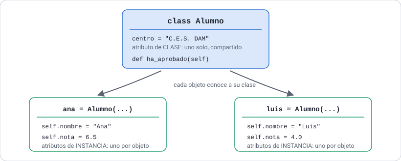
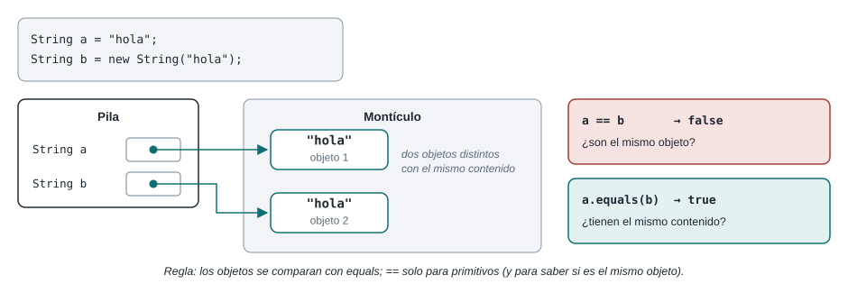
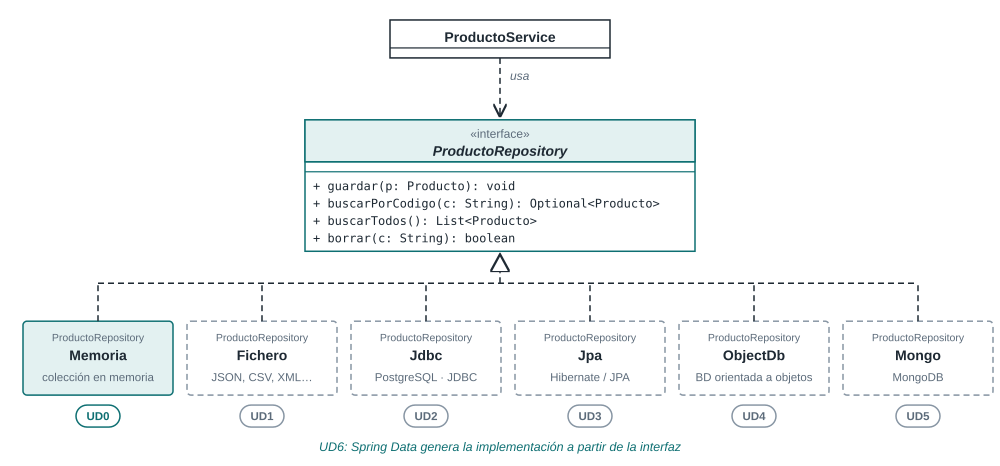
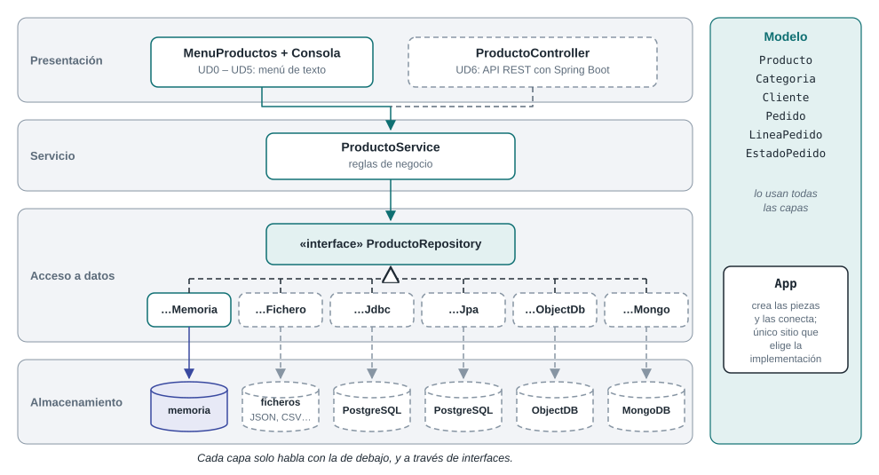
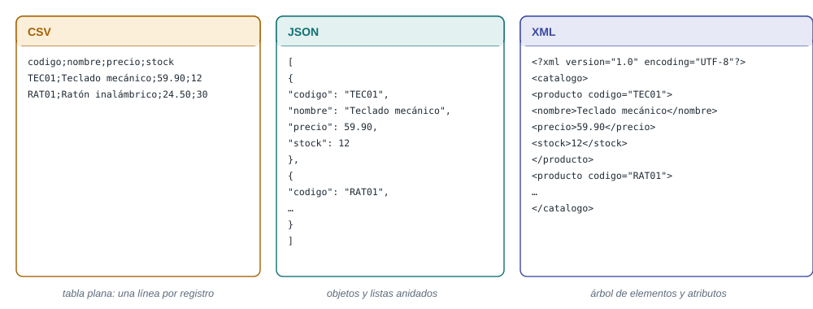
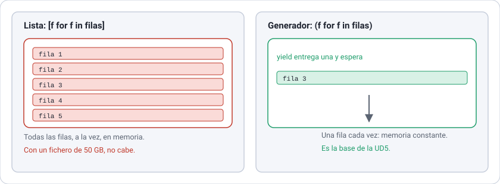
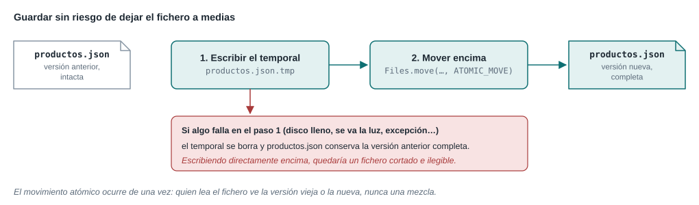
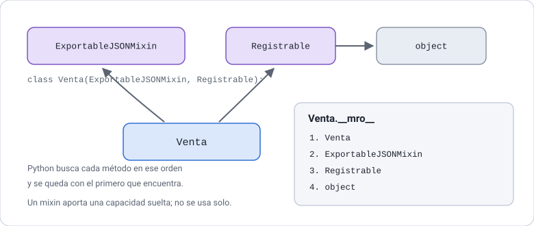

# UD2 · Programación orientada a objetos en Python

**Python aplicado a la Inteligencia Artificial** · 2.º DAM · Curso 2026-2027

[← Volver al índice del módulo](../README.md)

## Índice

- [Presentación de la unidad](#presentación-de-la-unidad)
- [2.1 Objetos ajenos: leer una API](#21-objetos-ajenos-leer-una-api)
- [2.2 Clases propias: el modelo de la tienda](#22-clases-propias-el-modelo-de-la-tienda)
- [2.3 Contratos sin herencia: un repositorio, dos implementaciones](#23-contratos-sin-herencia-un-repositorio-dos-implementaciones)
- [2.4 Generadores y `with`](#24-generadores-y-with)
- [Ampliación](#ampliación)
- [Práctica de la unidad · Hito 1 del proyecto integrador](#práctica-de-la-unidad--hito-1-del-proyecto-integrador)
- [Resumen de la unidad](#resumen-de-la-unidad)
- [Bibliografía de la UD2](#bibliografía-de-la-ud2)
- [Continuar](#continuar)

## Presentación de la unidad

Ya sabes qué es una clase: lo viste en C++ en 1.º y lo estás usando en Java en Acceso a Datos. Esta unidad, de 4 horas, no repite la teoría de la orientación a objetos. Enseña dos cosas distintas:

1. **Leer** los objetos de otra gente, que es lo que harás en el resto del módulo. `DataFrame`, `Pipeline` y `RandomForestRegressor` son clases ajenas, y casi todo tu trabajo a partir de la UD3 consiste en usarlas bien.
2. **Escribir** lo poco que de verdad vas a escribir, y escribirlo como se escribe en Python, que no es como se escribe en Java.

Para la segunda parte usamos un ejemplo que ya conoces: la **tienda** de la UD0 de Acceso a Datos. Allí la lees en Java; aquí la construyes en Python. El diseño está resuelto, así que puedes concentrarte en lo único que cambia: el idioma.


*Figura 2.1. Lo mismo, escrito de dos maneras. Es el mapa de la unidad.*

### Resultado de aprendizaje y criterios de evaluación

**RA1.** Implementa programas básicos en Python aplicados a la manipulación de datos.

| CE | Criterio de evaluación | Apartados |
| --- | --- | --- |
| 1a | Desarrolla programas en Python con variables, estructuras de control y funciones | 2.2 |
| 1b | Utiliza estructuras de datos para organizar la información | 2.2, 2.4 |
| 1e | Diseña, estructura y utiliza módulos y paquetes para organizar y reutilizar el código | 2.3, 2.4 |

La orientación a objetos no aparece en los criterios. Está aquí porque sin ella no se entienden las bibliotecas de los RA2 y RA3, y porque el criterio 1e habla de organizar y reutilizar código, que es exactamente lo que resuelve el apartado 2.3.

### Temporalización

| Sesión | Fecha | Horas | Contenidos |
| --- | --- | --- | --- |
| 1 | Lunes 05/10/2026 (2.ª hora) | 1 | 2.1 Objetos ajenos |
| 2 | Martes 06/10/2026 | 1 | 2.2 Producto, validación y propiedades |
| 3 | Martes 13/10/2026 | 1 | 2.2 Dataclass, enumeraciones e igualdad · 2.3 El contrato |
| 4 | Lunes 19/10/2026 (1.ª hora) | 1 | 2.3 Las dos implementaciones · 2.4 Generadores y `with` |

El lunes 12/10 es festivo. La 2.ª hora del lunes 19/10 queda de colchón: repaso y arranque del hito 1. La UD3 empieza el martes 20/10.

### Qué se queda fuera, y por qué

Python tiene herencia múltiple, mixins, sobrecarga de operadores y decoradores propios. Son interesantes y están al final, en [Ampliación](#ampliación), pero **no se dan en clase ni entran en la práctica**: en las unidades 3 a 7 de este módulo no se usan ni una vez. Lo que sí se usa constantemente es lo de los cuatro apartados de arriba.

### El ejemplo: la tienda

Es el mismo de Acceso a Datos. Allí, el modelo completo tiene clientes, pedidos y líneas de pedido; nosotros trabajamos la parte del catálogo, que es la que da juego para lo que queremos enseñar.


*Figura 2.2. El modelo de la tienda. Es la Figura 0.12 de Acceso a Datos, sin cambios.*

> [!IMPORTANT]
> La tienda es el ejemplo de los apuntes, no tu proyecto. Tu proyecto integrador sigue siendo el conjunto de datos que elegiste en el hito 0, y la práctica de esta unidad trabaja sobre él.

### Requisitos previos

- La UD1 completa: funciones, estructuras de datos, ficheros, módulos y paquetes.
- El entorno del módulo: VS Code, un `.venv` activado y las dependencias instaladas.
- Haber leído el apartado 0.5 de Acceso a Datos (clases y objetos en Java). No es imprescindible, pero los recuadros «Desde Java» se entienden mejor.

### Cómo usar esta carpeta

| Carpeta | Contenido |
| --- | --- |
| [`listados/tienda/`](listados/tienda/) | El paquete de la tienda: `modelo.py`, `formatos.py`, `repositorio.py`, `servicio.py` y `app.py` |
| [`listados/`](listados/) | Los listados sueltos de la unidad como ficheros `.py` |
| [`figuras/`](figuras/) | Las figuras, en SVG |

Los listados se ejecutan desde `ud2-poo/listados/`, con el entorno virtual activado:

```bash
cd ud2-poo/listados
python listado_2_04_producto_en_uso.py
python -m tienda.app                     # el paquete completo, en marcha
```

## 2.1 Objetos ajenos: leer una API

Antes de escribir una clase conviene saber leer las que ya existen, porque en este módulo vas a usar muchas más de las que escribes. La distinción fundamental es sencilla: un **atributo** es un dato que el objeto ya tiene y se escribe sin paréntesis; un **método** es algo que el objeto hace cuando se lo pides y lleva paréntesis ([The Python Tutorial: Classes](https://docs.python.org/3/tutorial/classes.html)).



*Figura 2.3. Una clase define la forma; cada objeto guarda sus propios datos.*

**Listado 2.1.** Atributo o método: cómo distinguirlos en un `DataFrame` · [ver fichero](listados/listado_2_01_objetos_ajenos.py)

```python
import pandas as pd

ventas = pd.DataFrame({
    "ciudad": ["Granada", "Sevilla", "Granada", "Málaga"],
    "unidades": [12, 7, 5, 9],
    "importe": [240.0, 133.0, 95.0, 171.0],
})

# Atributo: un dato que el objeto ya tiene. Sin paréntesis.
print("shape   ", ventas.shape)
print("columns ", list(ventas.columns))

# Método: algo que el objeto hace cuando se lo pides. Con paréntesis.
print(ventas.head(2))

# El error te dice cuál es cuál.
try:
    ventas.shape()
except TypeError as error:
    print("ventas.shape() ->", type(error).__name__, "-", error)
```

```text
shape    (4, 3)
columns  ['ciudad', 'unidades', 'importe']
    ciudad  unidades  importe
0  Granada        12    240.0
1  Sevilla         7    133.0
ventas.shape() -> TypeError - 'tuple' object is not callable
```

`'tuple' object is not callable` es uno de los errores que más vas a ver este curso, y siempre significa lo mismo: has puesto paréntesis a algo que no es una función.

> [!TIP]
> `dir(objeto)` lista todo lo que tiene dentro y `help(objeto.metodo)` muestra su documentación sin salir del intérprete. En VS Code, `Ctrl+Espacio` hace lo mismo mientras escribes.

### El convenio de scikit-learn

Las bibliotecas serias son predecibles. En scikit-learn, **lo que tú decides va en el constructor** y **lo que el objeto aprende aparece después, con un guion bajo final** ([Developing scikit-learn estimators](https://scikit-learn.org/stable/developers/develop.html)). Reconocer ese convenio te ahorra media UD6.

**Listado 2.2.** Parámetros al construir, atributos al aprender · [ver fichero](listados/listado_2_02_estimador.py)

```python
from sklearn.ensemble import RandomForestRegressor

bosque = RandomForestRegressor(n_estimators=50, max_depth=4, random_state=42)
print("n_estimators:", bosque.n_estimators)

print("¿Tiene feature_importances_ antes de fit?", hasattr(bosque, "feature_importances_"))
bosque.fit(X, y)
print("¿Y después?", hasattr(bosque, "feature_importances_"))
print("Importancia de cada variable:", bosque.feature_importances_.round(3))
```

```text
n_estimators: 50
¿Tiene feature_importances_ antes de fit? False
¿Y después? True
Importancia de cada variable: [0.297 0.005 0.022 0.676]
```

> [!WARNING]
> Pedir un atributo terminado en `_` antes de llamar a `fit` lanza `NotFittedError`. Si te pasa, no es un fallo de la biblioteca: es que te has saltado el entrenamiento.

### Para practicar

1. Con el `DataFrame` del Listado 2.1, clasifica estos cinco miembros en atributos o métodos y escribe la línea correcta para cada uno: `size`, `describe`, `T`, `sort_values`, `empty`. Comprueba tu respuesta en el intérprete.

   ```text
   ventas.size      4 valores por 3 columnas -> 12
   ventas.empty     False
   ventas.describe()  devuelve un DataFrame con count, mean, std...
   ```

2. Crea `RandomForestRegressor(n_estimators=5, random_state=0)` y, **sin llamar a `fit`**, escribe `bosque.feature_importances_`. Copia el nombre de la excepción y explica en una línea qué te está diciendo.

3. (A) Busca en la documentación de pandas tres propiedades de un `DataFrame` que no sean las del listado y tres métodos. Explica en una frase por qué `shape` es una propiedad y `head` un método.

## 2.2 Clases propias: el modelo de la tienda

Una clase en Python se declara con `class`, sus métodos reciben siempre el objeto como primer parámetro (`self`, por convenio) y los atributos **nacen al asignarlos**, normalmente dentro de `__init__`. No hay fichero de cabecera ni declaración previa de atributos.


*Figura 2.4. `Producto` en UML. Es la Figura 0.8 de Acceso a Datos: la misma clase que vas a escribir ahora en Python.*

### `Producto`: validar al crear, validar al cambiar

**Listado 2.3.** `tienda/modelo.py` · la clase `Producto` · [ver fichero](listados/tienda/modelo.py)

```python
class Producto:
    """Producto del catálogo.

    Dos productos son iguales si tienen el mismo código.
    """

    def __init__(self, codigo: str, nombre: str, precio: Decimal, stock: int = 0) -> None:
        if not codigo or not codigo.strip():
            raise ValueError("El código es obligatorio")
        if stock < 0:
            raise ValueError(f"Stock no válido: {stock}")
        self._codigo = codigo          # no cambia una vez creado
        self.nombre = nombre
        self.precio = precio           # pasa por el setter de la propiedad
        self._stock = stock

    @classmethod
    def desde_linea(cls, linea: str) -> "Producto":
        """Crea un producto a partir de «codigo;nombre;precio;stock»."""
        codigo, nombre, precio, stock = linea.split(";")
        return cls(codigo, nombre, Decimal(precio), int(stock))

    @property
    def codigo(self) -> str:
        """Identificador del producto. Solo lectura."""
        return self._codigo

    @property
    def precio(self) -> Decimal:
        return self._precio

    @precio.setter
    def precio(self, valor: Decimal) -> None:
        if valor is None or valor < 0:
            raise ValueError(f"Precio no válido: {valor}")
        self._precio = valor

    def reponer(self, unidades: int) -> None:
        """Suma unidades al stock."""
        if unidades <= 0:
            raise ValueError("Las unidades deben ser positivas")
        self._stock += unidades
```

Tres decisiones que conviene mirar de cerca.

**El constructor no deja crear objetos incorrectos.** Es la regla de oro del modelo: si un objeto existe, sus datos son válidos. Las reglas de negocio —que no haya dos códigos iguales, por ejemplo— van en el servicio, no aquí.

**`nombre` es público y `precio` es una propiedad.** En Python los atributos son públicos hasta que haga falta otra cosa. Cuando un dato necesita validarse o calcularse, se convierte en propiedad **sin cambiar el código que ya lo usaba**: `producto.precio` se sigue escribiendo igual. Por eso aquí no se escriben *getters* y *setters* por si acaso.

**El guion bajo no es `private`.** `self._codigo` es accesible desde fuera; el guion bajo es un aviso entre programadores: «esto es interior, no lo toques». Lo que impide cambiar el código es que la propiedad `codigo` no tenga *setter*.

> [!NOTE]
> **Desde C++.** No hay `private` ni `public`: todo es accesible. No hay constructores sobrecargados: se usan parámetros por defecto o métodos de clase. Y no hay destructor que te interese: la memoria se libera sola.

> [!NOTE]
> **Desde Java.** Tu `Producto.java` tiene `getNombre()`, `setNombre()`, `getPrecio()` y `setPrecio()`. En Python todo eso desaparece: `nombre` es un atributo normal y `precio` es una propiedad que valida. Escribir `get_nombre()` en Python se considera un error de estilo, porque obliga a todo el mundo a usar paréntesis para leer un dato. Tu segundo constructor, `Producto(codigo, nombre, precio)`, aquí es el valor por defecto `stock: int = 0`; cuando el constructor alternativo hace algo más que rellenar huecos, como `desde_linea`, se escribe como `@classmethod`.

**Listado 2.4.** La clase en uso · [ver fichero](listados/listado_2_04_producto_en_uso.py)

```python
teclado = Producto("T-100", "Teclado mecánico", Decimal("79.90"), 12)
teclado.precio = Decimal("69.90")        # pasa por el setter, que valida
print("Rebajado:", teclado.precio, "€")

try:
    teclado.precio = Decimal("-5")
except ValueError as error:
    print("Precio negativo ->", error)

try:
    teclado.codigo = "T-999"
except AttributeError as error:
    print("Cambiar el código ->", error)

raton = Producto.desde_linea("R-200;Ratón inalámbrico;24.50;30")
print("Desde una línea de CSV:", raton)
```

```text
Rebajado: 69.90 €
Precio negativo -> Precio no válido: -5
Cambiar el código -> property 'codigo' of 'Producto' object has no setter
Desde una línea de CSV: Producto[R-200, Ratón inalámbrico, 24.50 €, stock 30]
```

> [!WARNING]
> El dinero nunca se guarda en `float`: `0.1 + 0.2` no es `0.3`. Usa `decimal.Decimal` y constrúyelo **desde una cadena**, `Decimal("79.90")`, no desde un número ([decimal — Decimal fixed-point and floating-point arithmetic](https://docs.python.org/3/library/decimal.html)). Es el mismo motivo por el que en Java usas `BigDecimal`.

### `Categoria` y `LineaPedido`: clases de datos sin código repetitivo

Cuando una clase es sobre todo datos, `@dataclass` escribe por ti el constructor, la comparación y la representación ([dataclasses](https://docs.python.org/3/library/dataclasses.html), [PEP 557](https://peps.python.org/pep-0557/)). Con `frozen=True` el objeto no se puede modificar después de crearlo.

**Listado 2.5.** `tienda/modelo.py` · las piezas inmutables y la enumeración · [ver fichero](listados/tienda/modelo.py)

```python
@dataclass(frozen=True)
class Categoria:
    """Categoría de productos. Inmutable."""

    id: int
    nombre: str


@dataclass(frozen=True)
class LineaPedido:
    """Una línea de un pedido: qué producto, cuántas unidades y a qué precio."""

    producto: Producto
    cantidad: int
    precio_unitario: Decimal

    def __post_init__(self) -> None:
        if self.cantidad <= 0:
            raise ValueError(f"Cantidad no válida: {self.cantidad}")

    @property
    def importe(self) -> Decimal:
        return self.precio_unitario * self.cantidad


class EstadoPedido(Enum):
    """Estados por los que pasa un pedido."""

    PENDIENTE = "pendiente"
    PAGADO = "pagado"
    ENVIADO = "enviado"
    ENTREGADO = "entregado"
    CANCELADO = "cancelado"

    def es_final(self) -> bool:
        """Un pedido entregado o cancelado ya no puede cambiar de estado."""
        return self in (EstadoPedido.ENTREGADO, EstadoPedido.CANCELADO)
```

`__post_init__` es el sitio donde una `dataclass` valida: se ejecuta justo después del constructor generado. Y una enumeración de Python es una clase normal, así que puede tener métodos ([enum](https://docs.python.org/3/library/enum.html)).

> [!NOTE]
> **Desde Java.** `Categoria` y `LineaPedido` son `record` en tu proyecto; aquí son `@dataclass(frozen=True)`. El constructor compacto del `record`, donde pones las validaciones, es `__post_init__`. El método `importe()` de Java aquí es una propiedad: se lee `linea.importe`, sin paréntesis, porque no hace trabajo ni cambia nada. Tu `enum EstadoPedido` con su método `esFinal()` se traduce casi letra por letra.

**Listado 2.6.** Inmutabilidad y enumeraciones en marcha · [ver fichero](listados/listado_2_06_pedido.py)

```python
linea = LineaPedido(monitor, cantidad=2, precio_unitario=Decimal("219.00"))
print("Importe de la línea:", linea.importe, "€")

try:
    linea.cantidad = 3
except Exception as error:
    print("Modificar la línea ->", type(error).__name__, "-", error)

print("Copia con otra cantidad:", replace(linea, cantidad=3).importe, "€")

print("Estados:", [estado.name for estado in EstadoPedido])
for estado in (EstadoPedido.PENDIENTE, EstadoPedido.ENTREGADO):
    print(f"  {estado.name:<10} ¿final? {estado.es_final()}")
```

```text
Importe de la línea: 438.00 €
Modificar la línea -> FrozenInstanceError - cannot assign to field 'cantidad'
Copia con otra cantidad: 657.00 €
Estados: ['PENDIENTE', 'PAGADO', 'ENVIADO', 'ENTREGADO', 'CANCELADO']
  PENDIENTE  ¿final? False
  ENTREGADO  ¿final? True
```

### Igualdad: `__eq__`, `__hash__` y `__repr__`

Por omisión, dos objetos solo son iguales si son el mismo objeto. En la tienda queremos otra cosa: dos productos con el mismo código son el mismo producto, vengan de donde vengan.



*Figura 2.5. Identidad frente a igualdad. Es la Figura 0.7 de Acceso a Datos: allí son `==` y `equals`; aquí, `is` y `==`.*

**Listado 2.7.** Lo que cambia al definir `__eq__` y `__hash__` · [ver fichero](listados/listado_2_07_igualdad.py)

```python
uno = Producto("T-100", "Teclado mecánico", Decimal("79.90"), 12)
otro = Producto("T-100", "Teclado mecánico retroiluminado", Decimal("89.90"), 3)

print("uno == otro ", uno == otro)     # True: comparamos por código
print("uno is otro ", uno is otro)     # False: son dos objetos distintos

catalogo = {uno, otro}
print("Productos distintos en el conjunto:", len(catalogo))

existencias = {uno: 12}
print("Existencias consultadas con otro objeto:", existencias[otro])
```

```text
uno == otro  True
uno is otro  False
Productos distintos en el conjunto: 1
Existencias consultadas con otro objeto: 12
```

> [!IMPORTANT]
> `__eq__` y `__hash__` van siempre juntos y sobre los mismos campos. Si defines solo `__eq__`, Python deja el objeto sin `__hash__` y deja de poder usarse en un `set` o como clave de un diccionario.

> [!NOTE]
> **Desde Java.** `equals` es `__eq__`, `hashCode` es `__hash__` y `toString` es `__repr__`. La regla «si redefines `equals`, redefine `hashCode`» es idéntica. La diferencia es que en Java `==` compara referencias y en Python lo hace `is`: en Python el operador `==` llama a tu `__eq__`.

### Para practicar

1. Añade a `Producto` la propiedad de solo lectura `valor_en_almacen`, que devuelva el precio por las unidades en stock.

   ```python
   Producto("T-100", "Teclado mecánico", Decimal("79.90"), 12).valor_en_almacen
   # Decimal('958.80')
   ```

2. Añade a `EstadoPedido` el método `siguiente()`, que devuelva el estado que viene después en el orden `PENDIENTE`, `PAGADO`, `ENVIADO`, `ENTREGADO`, y lance `ValueError` si el estado ya es final.

   ```python
   EstadoPedido.PENDIENTE.siguiente()   # EstadoPedido.PAGADO
   EstadoPedido.ENVIADO.siguiente()     # EstadoPedido.ENTREGADO
   EstadoPedido.ENTREGADO.siguiente()   # ValueError: ENTREGADO es un estado final
   ```

3. Escribe `Cliente` como `@dataclass(frozen=True)` con `id`, `nombre` y `email`, validando en `__post_init__` que el correo contiene una arroba.

   ```python
   Cliente(1, "Ana Ruiz", "ana@ejemplo.es")   # Cliente(id=1, nombre='Ana Ruiz', email='ana@ejemplo.es')
   Cliente(2, "Luis Gil", "luis.ejemplo.es")  # ValueError: correo no válido: luis.ejemplo.es
   ```

4. (A) Quita el método `__hash__` de `Producto`, ejecuta el Listado 2.7 y copia el error. Explica en dos líneas por qué `__eq__` sin `__hash__` rompe los conjuntos y los diccionarios.

## 2.3 Contratos sin herencia: un repositorio, dos implementaciones

Este es el apartado central de la unidad, y la idea que más veces vas a reconocer en el resto del módulo: **separar qué se puede hacer de cómo se hace**.



*Figura 2.6. Un contrato y una implementación por unidad. Es la Figura 0.10 de Acceso a Datos; en Python construiremos las dos primeras.*

### El contrato

En Java esto es una `interface` y las clases la implementan con `implements`. En Python se describe con un `Protocol`: una lista de los métodos que hace falta tener, **sin que nadie tenga que heredar de ella** ([typing.Protocol](https://docs.python.org/3/library/typing.html#typing.Protocol), [PEP 544](https://peps.python.org/pep-0544/)).

**Listado 2.8.** `tienda/repositorio.py` · el contrato · [ver fichero](listados/tienda/repositorio.py)

```python
@runtime_checkable
class ProductoRepository(Protocol):
    """Operaciones de almacenamiento de productos."""

    def guardar(self, producto: Producto) -> None:
        """Da de alta el producto, o lo reemplaza si su código ya existía."""
        ...

    def buscar_por_codigo(self, codigo: str) -> Producto | None:
        """Devuelve el producto, o `None` si no existe."""
        ...

    def buscar_todos(self) -> list[Producto]:
        """Devuelve todos los productos guardados; nunca `None`."""
        ...

    def borrar(self, codigo: str) -> bool:
        """Elimina un producto. Devuelve `True` si existía."""
        ...

    def existe(self, codigo: str) -> bool:
        """Indica si hay un producto con ese código."""
        ...
```

Los tres puntos, `...`, son el cuerpo vacío: el protocolo describe la forma, no el comportamiento.

> [!NOTE]
> **Desde C++.** Lo más parecido a un `Protocol` es una plantilla: `template <typename T>` acepta cualquier tipo que tenga las operaciones que el código usa, sin que herede de nada. La diferencia está en cuándo se comprueba: el compilador de C++ lo verifica al compilar y Python, al ejecutar, salvo que uses el analizador de tipos del editor.

> [!NOTE]
> **Desde Java.** Tu `ProductoRepository` devuelve `Optional<Producto>`; en Python se escribe `Producto | None`, y quien lo recibe comprueba `if producto is None`. Tu interfaz tiene un método `default existe()` con cuerpo: un `Protocol` no reparte código, así que cada implementación escribe su `existe`, que es una línea. Si lo que quieres es precisamente compartir código, entonces el equivalente no es `Protocol` sino `ABC`, que sí es herencia de verdad (está en [Ampliación](#ampliación)).

### La primera implementación: en memoria

**Listado 2.9.** `tienda/repositorio.py` · `ProductoRepositoryMemoria` · [ver fichero](listados/tienda/repositorio.py)

```python
class ProductoRepositoryMemoria:
    """Implementación en memoria: los datos se pierden al cerrar el programa."""

    def __init__(self) -> None:
        self._productos: dict[str, Producto] = {}

    def guardar(self, producto: Producto) -> None:
        self._productos[producto.codigo] = producto

    def buscar_por_codigo(self, codigo: str) -> Producto | None:
        return self._productos.get(codigo)

    def buscar_todos(self) -> list[Producto]:
        return list(self._productos.values())

    def borrar(self, codigo: str) -> bool:
        return self._productos.pop(codigo, None) is not None

    def existe(self, codigo: str) -> bool:
        return codigo in self._productos
```

Fíjate en que **no pone `implements` en ningún sitio**, ni hereda de `ProductoRepository`. Cumple el contrato porque tiene los métodos que el contrato pide. A eso se le llama *duck typing*: si camina como un pato y grazna como un pato, es un pato.

> [!NOTE]
> **Desde Java.** El `LinkedHashMap` de tu implementación aquí es un `dict` normal: desde Python 3.7 los diccionarios conservan el orden de inserción, así que no hace falta una clase especial. `productos.remove(codigo) != null` es `self._productos.pop(codigo, None) is not None`.

### El servicio: composición

El servicio tiene las reglas de negocio y recibe el repositorio **por el constructor**. No lo crea: se lo dan. Así se puede cambiar de almacenamiento sin tocar ni una línea de reglas, y se pueden escribir pruebas pasándole un repositorio en memoria.



*Figura 2.7. Las capas del proyecto. Es la Figura 0.13 de Acceso a Datos; en Python, `app.py` hace el papel de `App.java`.*

**Listado 2.10.** `tienda/servicio.py` · las reglas de negocio · [ver fichero](listados/tienda/servicio.py)

```python
class ProductoService:
    """Qué se puede hacer con los productos, y qué no."""

    def __init__(self, repositorio: ProductoRepository) -> None:
        self._repositorio = repositorio

    def alta(self, producto: Producto) -> None:
        """Da de alta un producto nuevo."""
        if self._repositorio.existe(producto.codigo):
            raise ValueError(f"Ya existe un producto con código {producto.codigo}")
        self._repositorio.guardar(producto)

    def listar(self) -> list[Producto]:
        """Devuelve los productos ordenados por nombre."""
        return sorted(self._repositorio.buscar_todos(), key=lambda p: p.nombre)

    def buscar(self, codigo: str) -> Producto:
        """Devuelve un producto o lanza `ProductoNoEncontradoError`."""
        producto = self._repositorio.buscar_por_codigo(codigo)
        if producto is None:
            raise ProductoNoEncontradoError(codigo)
        return producto

    def valor_inventario(self) -> Decimal:
        """Suma de precio × stock de todos los productos."""
        return sum((p.precio * p.stock for p in self._repositorio.buscar_todos()),
                   start=Decimal("0"))
```

> [!NOTE]
> **Desde Java.** `repositorio.buscarTodos().stream().sorted(Comparator.comparing(Producto::getNombre)).toList()` es `sorted(lista, key=lambda p: p.nombre)`. Y `.map(...).reduce(BigDecimal.ZERO, BigDecimal::add)` es `sum(..., start=Decimal("0"))`. Los *streams* de Java y las comprensiones de Python resuelven el mismo problema.

### El segundo contrato: los formatos

El repositorio en fichero no sabe nada de CSV ni de JSON. Delega el formato en otro objeto, que cumple su propio contrato. Es la misma idea, un nivel más abajo.



*Figura 2.8. Los mismos productos en tres formatos. Es la Figura 1.7 de Acceso a Datos; aquí escribimos los dos primeros.*

**Listado 2.11.** `tienda/formatos.py` · el contrato de los formatos y el de CSV · [ver fichero](listados/tienda/formatos.py)

```python
@dataclass(frozen=True)
class ProductoDto:
    """Un producto tal como se guarda en un fichero: datos planos, sin comportamiento."""

    codigo: str
    nombre: str
    precio: str                       # texto, para no perder decimales al serializar
    stock: int

    @classmethod
    def desde(cls, producto: Producto) -> "ProductoDto":
        return cls(producto.codigo, producto.nombre, str(producto.precio), producto.stock)

    def a_producto(self) -> Producto:
        """Crea un producto del modelo; su constructor valida los datos leídos."""
        return Producto(self.codigo, self.nombre, Decimal(self.precio), self.stock)


@runtime_checkable
class FormatoProductos(Protocol):
    """Un formato de fichero capaz de leer y escribir una lista de productos."""

    def leer(self, ruta: Path) -> list[ProductoDto]: ...

    def escribir(self, ruta: Path, productos: list[ProductoDto]) -> None: ...


class FormatoCsv:
    """Texto separado por punto y coma, con una línea de cabecera. Codificación UTF-8."""

    CAMPOS = ("codigo", "nombre", "precio", "stock")

    def leer(self, ruta: Path) -> list[ProductoDto]:
        with ruta.open(encoding="utf-8", newline="") as fichero:
            lector = csv.DictReader(fichero, delimiter=";")
            productos = []
            for numero, fila in enumerate(lector, start=2):
                try:
                    productos.append(ProductoDto(fila["codigo"], fila["nombre"],
                                                 fila["precio"], int(fila["stock"])))
                except (KeyError, TypeError, ValueError) as error:
                    raise ValueError(f"Línea {numero} de {ruta.name}: {error}") from error
            return productos

    def escribir(self, ruta: Path, productos: list[ProductoDto]) -> None:
        with ruta.open("w", encoding="utf-8", newline="") as fichero:
            escritor = csv.DictWriter(fichero, fieldnames=self.CAMPOS, delimiter=";")
            escritor.writeheader()
            escritor.writerows(asdict(dto) for dto in productos)
```

El `ProductoDto` existe para que el formato del fichero y la clase del modelo puedan cambiar por separado. `asdict` convierte cualquier `dataclass` en un diccionario, que es justo lo que necesitan `csv` y `json`.

### La segunda implementación: en fichero

**Listado 2.12.** `tienda/repositorio.py` · `ProductoRepositoryFichero` · [ver fichero](listados/tienda/repositorio.py)

```python
class ProductoRepositoryFichero:
    """Implementación en fichero.

    Al crearse lee el fichero entero y, tras cada cambio, lo reescribe de forma
    segura: primero un fichero temporal y después un único movimiento.
    """

    def __init__(self, ruta: Path, formato: FormatoProductos) -> None:
        self._ruta = ruta
        self._formato = formato
        self._datos: dict[str, ProductoDto] = {}
        self._cargar()

    def guardar(self, producto: Producto) -> None:
        self._datos[producto.codigo] = ProductoDto.desde(producto)
        self._escribir()

    def buscar_por_codigo(self, codigo: str) -> Producto | None:
        dto = self._datos.get(codigo)
        return dto.a_producto() if dto else None

    def borrar(self, codigo: str) -> bool:
        if self._datos.pop(codigo, None) is None:
            return False
        self._escribir()
        return True
```

Recibe **la ruta y el formato**: dos piezas que no fabrica, sino que le dan hechas. Con eso, el mismo repositorio sirve para CSV y para JSON.

**Listado 2.13.** El mismo código, con los dos repositorios · [ver fichero](listados/listado_2_13_mismo_contrato.py)

```python
def inventario(repositorio: ProductoRepository) -> str:
    """Resume el catálogo. Solo usa el contrato, nunca una clase concreta."""
    servicio = ProductoService(repositorio)
    productos = servicio.listar()
    nombres = ", ".join(p.nombre for p in productos)
    return f"{len(productos)} productos ({nombres}) por {servicio.valor_inventario()} €"


print("En memoria:", inventario(llenar(ProductoRepositoryMemoria())))
print("En fichero:", inventario(llenar(ProductoRepositoryFichero(RUTA, FormatoCsv()))))

print("¿Memoria hereda del contrato?",
      ProductoRepository in ProductoRepositoryMemoria.__mro__)
print("¿Memoria lo cumple?", isinstance(ProductoRepositoryMemoria(), ProductoRepository))
```

```text
En memoria: 2 productos (Ratón inalámbrico, Teclado mecánico) por 1693.80 €
En fichero: 2 productos (Ratón inalámbrico, Teclado mecánico) por 1693.80 €

Contenido de datos/catalogo_demo.csv
codigo;nombre;precio;stock
T-100;Teclado mecánico;79.90;12
R-200;Ratón inalámbrico;24.50;30

¿Memoria hereda del contrato? False
¿Memoria lo cumple? True
```

Ahí está la idea completa: **no hereda y lo cumple**.

> [!TIP]
> `@runtime_checkable` permite usar `isinstance` con un protocolo, pero solo comprueba que los **nombres** de los métodos existan, no sus parámetros ni lo que devuelven. Para comprobar eso de verdad está el analizador de tipos de VS Code, que te avisa mientras escribes.

### El mismo patrón, en scikit-learn

No es un invento de esta asignatura. `Pipeline` encadena pasos sin conocer ninguna clase concreta: le basta con que cada paso tenga `fit` y `transform`, y el último, `fit` y `predict` ([Pipelines and composite estimators](https://scikit-learn.org/stable/modules/compose.html)).


*Figura 2.9. El mismo patrón en los dos sitios. Cambiar la pieza de abajo no toca el código de arriba.*

**Listado 2.14.** Un transformador propio, sin heredar de nada · [ver fichero](listados/listado_2_14_contrato_sklearn.py)

```python
class EscaladoPorMaximo:
    """Un transformador propio: no hereda de scikit-learn, solo cumple el contrato."""

    def fit(self, X, y=None) -> "EscaladoPorMaximo":
        self.maximos_ = np.abs(X).max(axis=0)
        return self                      # devolver self permite encadenar

    def transform(self, X):
        return X / self.maximos_


propio = Pipeline([
    ("escalado", EscaladoPorMaximo()),
    ("regresion", LinearRegression()),
])
propio.fit(X, y)
print("R² con el transformador propio:", round(propio.score(X, y), 3))
```

```text
R² del pipeline: 0.993
R² con el transformador propio: 0.993
```

Dos convenios que se repiten en toda la biblioteca: **`fit` devuelve `self`**, para poder encadenar, y **lo aprendido se guarda con un guion bajo final**, como viste en el Listado 2.2. Volverás a esto en la UD6.

### Para practicar

1. Escribe `FormatoTexto`, un tercer formato que guarde un producto por línea con el aspecto de abajo, y úsalo con `ProductoRepositoryFichero` sin cambiar ni una línea del repositorio.

   ```text
   T-100 | Teclado mecánico     |  79.90 € |  12 uds
   R-200 | Ratón inalámbrico    |  24.50 € |  30 uds
   ```

2. Añade a `ProductoService` el método `sin_stock()`, que devuelva los productos con cero unidades, ordenados por código.

   ```python
   servicio.alta(Producto("T-100", "Teclado mecánico", Decimal("79.90"), 12))
   servicio.alta(Producto("R-200", "Ratón inalámbrico", Decimal("24.50")))
   servicio.alta(Producto("M-300", "Monitor 27 pulgadas", Decimal("219.00")))
   [p.codigo for p in servicio.sin_stock()]   # ['M-300', 'R-200']
   ```

3. Escribe una clase `ProductoRepositoryRoto` a la que le falte el método `borrar`. Pásasela a `ProductoService` y a `isinstance`, y anota qué pasa en cada caso y en qué momento.

   ```python
   isinstance(ProductoRepositoryRoto(), ProductoRepository)   # False
   ProductoService(ProductoRepositoryRoto()).baja("T-100")    # AttributeError, solo al llamarlo
   ```

4. (A) Escribe un transformador propio `RecortaAtipicos(limite)` con `fit` y `transform` que sustituya por el límite los valores que lo superen, y mételo en un `Pipeline` antes de `LinearRegression`. Explica en tres líneas qué tiene en común con `ProductoRepositoryFichero`.

## 2.4 Generadores y `with`

Dos herramientas del lenguaje que vas a usar en todas las unidades siguientes, y que conviene entender bien porque son fáciles de escribir mal.

### Generadores: procesar sin cargar

Una función con `yield` no devuelve una lista: devuelve un **generador**, que entrega los valores de uno en uno según se le piden. El fichero se recorre igual, pero nunca está entero en memoria ([The Python Tutorial: Generators](https://docs.python.org/3/tutorial/classes.html#generators)).



*Figura 2.10. La lista guarda; el generador produce.*

**Listado 2.15.** Un catálogo de 200.000 productos, con lista y con generador · [ver fichero](listados/listado_2_15_catalogo_generador.py)

```python
def cargar_lista(ruta: Path) -> list[Producto]:
    """Lee el fichero entero y devuelve una lista con todos los productos."""
    with ruta.open(encoding="utf-8", newline="") as fichero:
        return [Producto(f["codigo"], f["nombre"], Decimal(f["precio"]), int(f["stock"]))
                for f in csv.DictReader(fichero, delimiter=";")]


def recorrer(ruta: Path) -> Iterator[Producto]:
    """Entrega los productos de uno en uno, según se van leyendo."""
    with ruta.open(encoding="utf-8", newline="") as fichero:
        for f in csv.DictReader(fichero, delimiter=";"):
            yield Producto(f["codigo"], f["nombre"], Decimal(f["precio"]), int(f["stock"]))
```

```text
cargar_lista devuelve: list
recorrer devuelve:     generator (todavía no ha leído nada)

Valor del inventario con la lista:     132390350.00 € ( 64.2 MB de memoria)
Valor del inventario con el generador: 132390350.00 € (  0.1 MB de memoria)
```

El mismo resultado con 640 veces menos memoria. Esa diferencia es la que hace posible la UD5.

> [!WARNING]
> Un generador **se agota**: cuando lo recorres una vez, ya no quedan elementos. Si necesitas pasar dos veces por los datos, o lo vuelves a crear o conviertes el resultado en una lista. Y `len()` no funciona sobre un generador, porque todavía no sabe cuántos elementos va a producir.

### `with`: lo que se abre, se cierra

Un gestor de contexto garantiza que la segunda mitad de una pareja de acciones se ejecute siempre: cerrar el fichero, soltar la conexión, confirmar o deshacer la transacción. También si salta una excepción en medio.

**Listado 2.16.** El `with` cumple aunque falle el bloque · [ver fichero](listados/listado_2_16_with_recursos.py)

```python
try:
    with RUTA.open("a", encoding="utf-8") as f:
        f.write("segunda línea\n")
        raise RuntimeError("algo ha ido mal a mitad de la escritura")
except RuntimeError as error:
    print("Excepción:", error)
print("¿Cerrado por el with?", f.closed)

# El mismo patrón con una conexión a una base de datos (UD4).
with sqlite3.connect(":memory:") as conexion:
    conexion.execute("CREATE TABLE producto (codigo TEXT, nombre TEXT)")
    conexion.execute("INSERT INTO producto VALUES ('T-100', 'Teclado mecánico')")
    print("Filas:", conexion.execute("SELECT * FROM producto").fetchall())
```

```text
Excepción: algo ha ido mal a mitad de la escritura
¿Cerrado por el with? True
Filas: [('T-100', 'Teclado mecánico')]
```

> [!NOTE]
> **Desde C++.** Es el RAII que conoces: en C++ el destructor libera el recurso al salir del ámbito, de forma automática. Python no tiene destructores fiables —no sabes cuándo se ejecuta `__del__`—, así que la liberación se marca a mano, y el sitio donde se marca es el `with`.

> [!NOTE]
> **Desde Java.** Es el `try-with-resources` que usas en `FormatoCsv.leer`. La diferencia es que en Java la clase tiene que implementar `AutoCloseable`; en Python basta con que tenga `__enter__` y `__exit__`, que es otra vez el mismo *duck typing* del apartado anterior.

### Por qué el repositorio en fichero escribe en un temporal

Ahora se entiende el método `_escribir` del Listado 2.12. Si abres el fichero de destino en modo escritura, lo primero que haces es **vaciarlo**: si el programa se corta a mitad, el catálogo entero se ha perdido.



*Figura 2.11. Escritura segura. Es la Figura 1.11 de Acceso a Datos; allí es `Files.move` con `ATOMIC_MOVE`, aquí es `Path.replace`.*

**Listado 2.17.** Escribir encima frente a escribir en un temporal · [ver fichero](listados/listado_2_17_escritura_atomica.py)

```python
def escribir_mal(ruta: Path, contenido: str) -> None:
    """Abre el fichero de destino y lo vacía antes de tener el contenido nuevo."""
    with ruta.open("w", encoding="utf-8") as fichero:
        fichero.write(contenido[:10])
        raise RuntimeError("corte de luz")


def escribir_bien(ruta: Path, contenido: str) -> None:
    """Escribe en un temporal y lo mueve de un solo paso."""
    temporal = ruta.with_name(ruta.name + ".tmp")
    try:
        temporal.write_text(contenido, encoding="utf-8")
        raise RuntimeError("corte de luz")
        temporal.replace(ruta)            # no se llega aquí: el original sigue intacto
    finally:
        temporal.unlink(missing_ok=True)
```

```text
Tras fallar escribiendo encima: [{"codigo"
Tras fallar con temporal:       [{"codigo": "T-100"}]
¿Queda basura en la carpeta? no
```

El fichero de la izquierda se ha quedado a medias y ya no es JSON válido. El de la derecha conserva la versión anterior entera.

### Para practicar

1. Escribe el generador `caros(ruta, minimo)`, que entregue solo los productos que superen un precio, leyendo el fichero una sola vez. Usa el CSV que deja el Listado 2.13 al ejecutarse.

   ```python
   list(caros(Path("datos/catalogo_demo.csv"), Decimal("50")))
   # [Producto[T-100, Teclado mecánico, 79.90 €, stock 12]]
   ```

2. Mide con el Listado 2.15 cuánta memoria hace falta para quedarse solo con los diez productos más caros usando `sorted(recorrer(ruta), key=...)` y usando `heapq.nlargest(10, recorrer(ruta), key=...)`. Explica la diferencia en dos líneas.

3. Ejecuta el Listado 2.17 cambiando `escribir_bien` para que haga `temporal.replace(ruta)` **antes** del `raise`. Anota qué queda en el fichero y por qué ese orden lo cambia todo.

4. (A) Recorre un generador dos veces seguidas con un `for` y anota qué imprime el segundo. Después arréglalo de dos formas distintas y explica cuándo usarías cada una.

## Ampliación

Nada de este apartado entra en la práctica ni en la prueba. Está aquí porque te lo vas a encontrar leyendo código ajeno, y porque alguna de estas cosas la reconocerás de Java.

**Herencia y clases abstractas.** Cuando varias clases comparten de verdad un comportamiento, la herencia sigue siendo la respuesta. `ABC` es el equivalente de una clase abstracta de Java: obliga a implementar los métodos marcados con `@abstractmethod` y, a diferencia de un `Protocol`, sí reparte código ([abc](https://docs.python.org/3/library/abc.html)).

**Listado 2.18.** Las formas de pago de la tienda, en Python · [ver fichero](listados/listado_2_18_herencia.py)

```python
class MetodoPago(ABC):
    """Clase abstracta: no se pueden crear objetos de ella, solo de sus hijas."""

    def __init__(self, titular: str) -> None:
        self.titular = titular

    @abstractmethod
    def comision(self, importe: Decimal) -> Decimal:
        """Cada forma de pago calcula su propia comisión."""


class Tarjeta(MetodoPago):

    def comision(self, importe: Decimal) -> Decimal:
        return (importe * Decimal("0.015")).quantize(Decimal("0.01"), ROUND_HALF_UP)
```

```text
Tarjeta(Ana): 1.20 €
Bizum(Luis): 0.00 €
Crear MetodoPago -> Can't instantiate abstract class MetodoPago without an implementation for abstract method 'comision'
```

Es el Listado 0.22 de Acceso a Datos, con los mismos números.

**Herencia múltiple y mixins.** Python permite heredar de varias clases a la vez. Un *mixin* es una clase pequeña que añade una capacidad suelta, y el **MRO** es el orden en que Python busca un método. Java no tiene mixins: lo más parecido son los métodos `default` de una interfaz.



*Figura 2.12. Herencia múltiple y orden de resolución (MRO).*

**Listado 2.19.** Un mixin y el MRO · [ver fichero](listados/listado_2_19_mixins_mro.py)

**Métodos especiales.** Definir `__len__`, `__getitem__`, `__iter__` o `__add__` integra tus objetos en la sintaxis del lenguaje. Es lo que hace que `len(df)` funcione sobre un `DataFrame`. Úsalo poco: solo cuando el símbolo signifique de verdad lo que parece.

**Listado 2.20.** Un `Pedido` que se comporta como una secuencia · [ver fichero](listados/listado_2_20_operadores.py)

**Decoradores.** Un decorador recibe una función y devuelve otra que la envuelve. Ya has usado tres: `@property`, `@classmethod` y `@dataclass`. Escribir los tuyos es menos frecuente de lo que parece ([functools](https://docs.python.org/3/library/functools.html)).

**Listado 2.21.** Un decorador que mide cuánto tarda una función · [ver fichero](listados/listado_2_21_decorador.py)

**Gestores de contexto propios.** Si una pareja de acciones va siempre junta, `@contextmanager` la envuelve en un `with` con muy poco código ([contextlib](https://docs.python.org/3/library/contextlib.html)).

**Listado 2.22.** Deshacer los cambios si falla el bloque · [ver fichero](listados/listado_2_22_gestor_contexto.py)

## Práctica de la unidad · Hito 1 del proyecto integrador

Vas a convertir el explorador del hito 0 en un **paquete instalable y probado**. Mismo resultado, mejor organización: este paquete es el que seguirás usando a partir de la UD3, así que merece la pena dejarlo bien.

### 1. Punto de partida

Tu explorador de la UD1, con su `informe_inicial.json` ya generado. Ese fichero es tu prueba: al terminar, el programa debe producir **exactamente el mismo JSON**.

### 2. Qué hay que construir

| Elemento | Requisito |
| --- | --- |
| Estructura | `src/<tu_paquete>/` con los módulos separados por responsabilidad: lectura, resumen e informe |
| Instalable | Un `pyproject.toml` y `pip install -e .`, de forma que `import <tu_paquete>` funcione desde cualquier carpeta |
| Configuración | Una `dataclass` `Configuracion` con la ruta de los datos, el separador y la codificación |
| Lectura | Un generador con `yield` que entregue las filas de una en una, sin cargar el fichero entero |
| Ficheros | Toda apertura de fichero dentro de un `with` |
| Interfaz pública | Todas las funciones públicas con anotaciones de tipo y docstring |
| Pruebas | Al menos cuatro con `pytest`, entre ellas una que compruebe que el informe generado es idéntico al de la UD1 |

No hace falta ninguna clase más que la `dataclass` de configuración. Si al terminar tienes una clase con un solo método y ningún estado, conviértela en una función: es la señal de que sobra.

### 3. Entregables

- El paquete en `src/`, con `pyproject.toml`, instalado con `pip install -e .`.
- `datos/informe_inicial.json` regenerado e **idéntico** al de la UD1. Explica en el `README.md` cómo lo has comprobado.
- Las pruebas en `tests/`, pasando con `pytest`.
- Un apartado de tres a cinco líneas en el `README.md`: qué módulos has creado, qué responsabilidad tiene cada uno y por qué.
- Defensa oral breve (5 minutos): justificar la separación en módulos y explicar qué habría que tocar para leer los datos de otro formato.

### 4. Qué se evalúa

| CE | Evidencias en la práctica |
| --- | --- |
| 1a | Funciones con parámetros y anotaciones de tipo, control de flujo y validación de la entrada |
| 1b | `dataclass` y diccionarios para organizar la información del informe |
| 1e | Paquete instalable, módulos separados por responsabilidad y reutilizable sin copiar código en la UD3 |

## Resumen de la unidad

| Apartado | Idea clave |
| --- | --- |
| 2.1 Objetos ajenos | Atributo sin paréntesis, método con paréntesis. En scikit-learn, los parámetros van en el constructor y lo aprendido termina en guion bajo |
| 2.2 Clases propias | El constructor no deja crear objetos inválidos. Atributos públicos hasta que haga falta una propiedad, `dataclass` para los datos y `__eq__` con `__hash__` siempre juntos |
| 2.3 Contratos | Un `Protocol` describe la forma sin exigir herencia. El servicio recibe el repositorio: cambiar de almacenamiento no toca las reglas. Es el patrón de `Pipeline` |
| 2.4 Generadores y `with` | `yield` procesa sin cargar en memoria; `with` garantiza que lo que se abre se cierre, también si falla |

## Bibliografía de la UD2

Todas las fuentes web se consultaron el 18 de octubre de 2026.

### Documentación oficial de Python

- Python Software Foundation. (2026). *The Python Tutorial: Classes*. <https://docs.python.org/3/tutorial/classes.html>
- Python Software Foundation. (2026). *dataclasses — Data Classes*. <https://docs.python.org/3/library/dataclasses.html>
- Python Software Foundation. (2026). *enum — Support for enumerations*. <https://docs.python.org/3/library/enum.html>
- Python Software Foundation. (2026). *typing.Protocol*. <https://docs.python.org/3/library/typing.html#typing.Protocol>
- Python Software Foundation. (2026). *abc — Abstract Base Classes*. <https://docs.python.org/3/library/abc.html>
- Python Software Foundation. (2026). *contextlib — Utilities for with-statement contexts*. <https://docs.python.org/3/library/contextlib.html>
- Python Software Foundation. (2026). *functools*. <https://docs.python.org/3/library/functools.html>
- Python Software Foundation. (2026). *decimal — Decimal fixed-point and floating-point arithmetic*. <https://docs.python.org/3/library/decimal.html>
- Python Software Foundation. (2026). *csv — CSV File Reading and Writing*. <https://docs.python.org/3/library/csv.html>

### Propuestas de mejora de Python (PEP)

- Smith, E. V. (2017). *PEP 557 – Data Classes*. <https://peps.python.org/pep-0557/>
- Levkivskyi, I. et al. (2017). *PEP 544 – Protocols: Structural subtyping (static duck typing)*. <https://peps.python.org/pep-0544/>

### Bibliotecas del curso

- scikit-learn developers. (2026). *Developing scikit-learn estimators*. <https://scikit-learn.org/stable/developers/develop.html>
- scikit-learn developers. (2026). *Pipelines and composite estimators*. <https://scikit-learn.org/stable/modules/compose.html>
- pandas development team. (2026). *DataFrame: API reference*. <https://pandas.pydata.org/docs/reference/frame.html>

### Material del módulo de Acceso a Datos

- *Acceso a Datos · 2.º DAM* (2026), UD0 «Java para quien ya programa en C++» y UD1 «Ficheros». Materiales del propio módulo. <https://neozizou.github.io/ad-dam/>. El modelo de la tienda, las Figuras 0.7, 0.8, 0.10, 0.12, 0.13, 1.7 y 1.11 y los Listados 0.18 a 0.30 proceden de ahí, bajo licencia CC0.

### Lectura complementaria

- Vadillo, J. *Aprende Python desde cero a experto*. Licencia CC BY-NC-SA 4.0. <https://github.com/jvadillo/aprende-python-desde-cero-a-experto>. Capítulo 9 (Clases y objetos) para el apartado 2.2.

---

## Continuar

| ← Unidad anterior | Índice | Unidad siguiente → |
| :--- | :---: | ---: |
| [UD1 · Python para quien ya programa](../ud1-python/UD1-python-para-quien-ya-programa.md) | [Índice del módulo](../README.md) | [UD3 · Análisis de datos](../ud3-datos/UD3-analisis-de-datos.md) |
